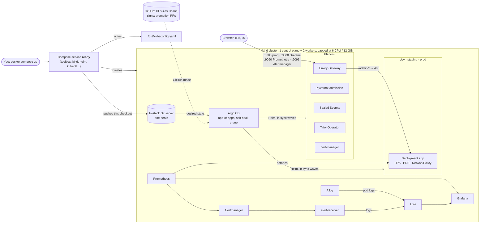

# orders-gateway-platform

A local, reproducible **"cluster in a box"** that runs, ships, observes and operates `orders-gateway`, the assignment's small Node.js service, on Kubernetes the way a platform team would in production.

```sh
docker compose up -d --wait
```

That is all it takes. Compose starts one service, `ready`, which creates a kind cluster and hands it to Argo CD; Argo CD installs everything else from Git, with Helm, in order. `--wait` returns when the platform is installed and prod is serving.

**Status.** Every **[core]** item is done, and so is the **[optional]** GitOps and CI/CD. Of the **[stretch]** items, the Terraform is sketched ([docs/terraform-sketch/](docs/terraform-sketch/README.md)) and distributed tracing is not done. [What we skipped and why](#what-we-skipped-and-why) has the full list.

**The app is untouched.** `app/server.js`, `app/package.json` and `app/server.test.js` are byte-identical to the originals. We rewrote `app/Dockerfile` (base image pinned by digest, numeric non-root user, npm removed) and added `app/k6/` and `app/README.md`, as the rules allow.

## The contract

| Thing | How it's met | Check it |
| --- | --- | --- |
| Readiness | Compose service `ready`; its healthcheck first passes only when the bootstrap has finished, every Argo CD Application is Synced and Healthy, and prod's `/readyz` answers on `:8080`. After that it checks only prod's `/readyz`, so a platform component restarting later doesn't mark the whole stack unhealthy ([0026](docs/decisions/0026-compose-entrypoint.md)) | `docker compose ps` shows `ready` (healthy) |
| Kubeconfig | Written to `./out/kubeconfig.yaml`, pointing at `127.0.0.1` | `kubectl --kubeconfig out/kubeconfig.yaml get nodes` |
| Namespaces | `dev`, `staging` and `prod` each run a Deployment `app` labelled `app.kubernetes.io/name=app`, from one Helm chart with a values file per environment | `kubectl --kubeconfig out/kubeconfig.yaml get deploy -A -l app.kubernetes.io/name=app` |
| App endpoint | prod at `http://localhost:8080` through Envoy Gateway. It's a Gateway API `HTTPRoute`, the successor to the Ingress resource, so `kubectl get ingress` is empty on purpose ([0028](docs/decisions/0028-contract-ports-on-the-gateway.md)). `/admin/*` is answered 403 at the edge; pods inside the cluster can still reach it | `curl localhost:8080/version`; `curl -X POST localhost:8080/admin/fault` → 403 |
| Logins | `admin` / `admin12345` for Grafana and Argo CD (`:3000`, `:8081`). Prometheus, Alertmanager and the Rollouts dashboard have no login | `./platform urls` |
| Dashboards | Grafana `:3000`, Prometheus `:9090`, Alertmanager `:9093`, and Argo CD `:8081` too, all through the same gateway ([0032](docs/decisions/0032-every-ui-on-a-plain-port.md)) | open them |
| Persistence and restarts | `ready` has `restart: unless-stopped`. The cluster lives outside Compose (kind creates its own node containers), so `docker compose stop` / `start` leaves Prometheus, Loki, Grafana and Argo CD running with their data; `start` re-runs the bootstrap, which changes nothing. Prometheus, Loki and the in-stack Git server keep their data on PersistentVolumes, so it also survives their pods restarting. The kubeconfig is kept in a named volume and rewritten on `start`. CI tests a stop/start cycle (healthy again in seconds) | `docker compose stop && docker compose start` |
| 6 CPU / 12 GB | Each kind node is capped at 2 CPU / 4 GiB; measured peak 4.46 CPU and 62% of memory at 100 requests/s ([Resource budget](#resource-budget-measured)) | `./platform budget` |
| Healthy in under 15 min | 9 min 43 s from `docker compose up` to healthy on a GitHub runner ([run](https://github.com/iantest11111989/orders-gateway-platform/actions/runs/45710719231/job/139544268716)) | time it |

## Quick start

### Prerequisites

**Docker only.** Every other tool (kind, kubectl, helm, kubeseal, cosign, k6, the argocd CLI, jq, yq) is pinned and shipped in a toolbox container image that the `./platform` script runs for you.

| | Reference machine | Development machine |
| --- | --- | --- |
| Hardware | 8 vCPU / 16 GB, x86-64 Linux | Apple silicon Mac (arm64), 16 GB |
| Docker | Docker Engine with the Compose plugin | Colima: `colima start --cpu 6 --memory 12`, and `brew install docker-compose` (Colima's Docker has no `docker compose`) |

The whole stack is designed to fit in **6 CPUs and 12 GB RAM**.

### Start, use, stop

```sh
git clone https://github.com/iantest11111989/orders-gateway-platform.git
cd orders-gateway-platform
docker compose up -d --wait
kubectl --kubeconfig out/kubeconfig.yaml get pods -A
curl localhost:8080/version
```

Then open Grafana at <http://localhost:3000> (`admin` / `admin12345`) and its **orders-gateway** dashboard.

`./platform` is the CLI for everything after start-up. It runs every tool from the pinned toolbox image, so you need nothing but Docker:

```sh
./platform verify   # check apps, scrape targets, logs, ports and policies
./platform urls     # every URL and login
./platform budget   # measured CPU and memory against 6 CPU / 12 GiB
./platform ship     # ship app/ to prod; ./platform rollback to undo it
./platform demo chaos    # and the other demos below
./platform shell    # a shell with kubectl, helm, argocd, k6, ... pointed at the cluster
./platform down     # delete the cluster (docker compose down only stops `ready`)
```

`./platform up` does the same as `docker compose up` in the foreground, for development; both are safe to re-run. `out/` is written by the toolbox as root, with the kubeconfig mode 0644 so you can read it.

> **Security note:** the `ready` container and the toolbox mount the Docker socket so kind can create its node containers. That is root-equivalent on the Docker host, normal for kind, but run it on a machine you control.

### More URLs

Every UI is on a plain port above, so these are optional. All hostnames use `*.localtest.me`, which resolves to `127.0.0.1`, and need ports 80 and 443 free on the machine running the browser. **On macOS with Colima they don't reach the Mac's browser:** macOS only lets root open ports below 1024 on `127.0.0.1`, and Colima runs as you. Use the plain ports there.

- `https://orders.dev.localtest.me`, `https://orders.staging.localtest.me`, `https://orders.localtest.me`
- `https://argocd.localtest.me`, `https://grafana.localtest.me`, `https://prometheus.localtest.me`, `https://alertmanager.localtest.me`, `https://rollouts.localtest.me`

`./platform urls` prints them with the logins and how to trust the demo CA. The HTTPS names and the contract's ports reach the same services.

## Architecture



How it fits together:

- **Compose is only the outer shell.** Its one service, `ready`, runs the toolbox image (every tool pinned and checksum-verified), creates the kind cluster, installs Argo CD and hands it the root Application. It then stays up as the healthcheck ([0026](docs/decisions/0026-compose-entrypoint.md)).
- **Git is the only way in.** By default Argo CD follows a Git server inside the cluster, to which `ready` (and `./platform up`, `ship`, `rollback`) pushes this checkout. That's the assignment's "Git repo your own stack hosts", with self-heal and prune on ([0029](docs/decisions/0029-in-stack-git-server.md)). GitHub mode (`REPO_URL=https://github.com/...`) follows GitHub instead, where CI's promotion PRs and the patch promoter apply.
- **Argo CD installs everything with Helm,** itself included, in sync waves: CRDs, then controllers, then observability, policies and the gateway, then the apps ([0005](docs/decisions/0005-gitops-layout.md)).
- **One edge.** Envoy Gateway serves the contract's ports (`:8080`, `:3000`, `:9090`, `:9093`) and HTTPS on `*.localtest.me`, and refuses `/admin/*` from outside ([0028](docs/decisions/0028-contract-ports-on-the-gateway.md)).
- **Alerts are observable.** Alertmanager delivers to a small `alert-receiver` that logs every alert as JSON, so delivery shows up in Loki next to everything else; the always-firing Watchdog proves the path ([0025](docs/decisions/0025-security-alerts-and-routing.md)).

### Key decisions and trade-offs

Each choice has a decision record in [`docs/decisions/`](docs/decisions/README.md) (31 of them). The short version:

| Choice | Why | Instead of |
| --- | --- | --- |
| **kind**, 1 control plane + 2 workers, run from a toolbox container | Only Docker needed; it's what upstream Kubernetes tests with; two workers in two labelled zones make PodDisruptionBudgets, drains and topology spread real ([0004](docs/decisions/0004-toolbox-and-cluster.md)) | k3d: as good, but k3s differs from upstream (Traefik, its own storage, SQLite); minikube: heavier, built for one node |
| **Helm chart, one values file per environment** | The app needs conditionals (HPA, PDB, Rollout, public route only in prod), which Kustomize patches express badly; Argo CD renders Helm natively ([0009](docs/decisions/0009-chart-and-environments.md)) | Kustomize overlays: fine for small diffs, awkward for "on in prod only" |
| **Argo CD, app-of-apps, managing itself** | Everything comes from Git, including Argo CD; sync waves give a deterministic bootstrap; its UI makes the demos easy to follow ([0005](docs/decisions/0005-gitops-layout.md)) | Flux: equally good, no UI |
| **In-stack Git server** (soft-serve) | Works offline and on a fresh VM with no GitHub token; `ship` and `rollback` are Git commits Argo CD applies ([0029](docs/decisions/0029-in-stack-git-server.md)) | Gitea: a UI and Actions for about 300 MB more; the upgrade path, not needed here |
| **Gateway API + Envoy Gateway** | The standard successor to Ingress; per-path filters (the `/admin` 403) and traffic weights (the canary) without annotations ([0008](docs/decisions/0008-gateway-and-tls.md), [0028](docs/decisions/0028-contract-ports-on-the-gateway.md)) | ingress-nginx: retired upstream; an Ingress object would need a second proxy |
| **Plain Deployment in prod, canary in a demo copy** | The contract wants a Deployment `app`; a Rollout would scale it to zero. The canary with SLO analysis is shown in `demo` ([0011](docs/decisions/0011-canary-rollouts.md), [0020](docs/decisions/0020-demos-in-a-copy-of-prod.md)) | Canary in prod: better releases, but breaks the contract |
| **kube-prometheus-stack, Loki single binary, Alloy** | The common open-source stack, trimmed to fit 12 GB ([0007](docs/decisions/0007-observability-stack.md)) | Elastic or a SaaS: too heavy, or not local |
| **Multi-window burn-rate SLO alerts** | Page fast on real problems, quiet on blips, stop soon after a fix ([0006](docs/decisions/0006-slo-rules.md), [0027](docs/decisions/0027-slis-for-the-node-app.md)) | Threshold alerts on error rate: page on blips |
| **Sealed Secrets** | Encrypted secrets live in Git and work offline. The demo key is committed so any clone can decrypt: **demo only** ([0018](docs/decisions/0018-sealed-secrets.md)) | External Secrets: needs a real secret manager |
| **Kyverno, policies as YAML, Audit first** | Policies next to the manifests, tested with `kyverno test`; enforced one at a time once clean ([0012](docs/decisions/0012-kyverno-policies.md), [0022](docs/decisions/0022-enforce-in-orders.md)) | OPA Gatekeeper: Rego is another language to learn |
| **cosign keyless, Trivy, Renovate** | Signed images with SBOMs and no keys to manage; scans in CI and in the cluster; every pin kept current ([0013](docs/decisions/0013-image-signing.md), [0016](docs/decisions/0016-trivy-image-scan.md), [0021](docs/decisions/0021-trivy-operator.md), [0010](docs/decisions/0010-renovate.md)) | |

<details>
<summary>What's inside, component by component</summary>

| Area | Choice |
| --- | --- |
| Local cluster | kind: 1 control plane + 2 workers |
| Packaging | Helm chart (`charts/orders-gateway/`) |
| GitOps | Argo CD, app-of-apps, Argo CD manages itself; in-stack Git server |
| Progressive delivery | Argo Rollouts with `workloadRef` (demo copy of prod) |
| Traffic | Gateway API with Envoy Gateway |
| TLS | cert-manager with a local demo CA |
| Metrics | Prometheus, Alertmanager, Grafana (kube-prometheus-stack) |
| Logs | Loki (single binary) + Alloy |
| Policy | Kyverno |
| Secrets | Sealed Secrets (demo key, **demo only**) |
| Scanning and signing | Trivy (CI and Trivy Operator), cosign keyless |
| CI and updates | GitHub Actions, Renovate |

</details>

## Ship a new version, roll it back

From the repo root, with the platform up (decision [0030](docs/decisions/0030-ship-and-rollback.md)):

```sh
# Optional, in a second terminal: traffic on prod while you do it
while true; do curl -s -o /dev/null -w '%{http_code} ' 'http://localhost:8080/work?ms=20'; sleep 0.2; done

./platform ship            # build app/, load it into kind, roll prod out to it
./platform rollback        # back to the image prod ran before
```

`ship` builds `app/` as `localhost/orders-gateway:local-<timestamp>` (or `./platform ship <tag>`), loads it into every kind node, sets it in `environments/prod/values.yaml`, and pushes your checkout to the in-stack Git server. Argo CD then rolls prod over one pod at a time, never below full capacity. `rollback` puts back the image prod ran before the current one first appeared (so a second `rollback` goes further back rather than undoing the first) and ships it the same way. Both wait for the rollout and print the pods by version, `http://localhost:8080/version`, and the 5-minute availability SLO. Watch it in Grafana's **orders-gateway** dashboard (**Pods by version**, and the version-change annotation). `--env dev|staging` targets another environment.

These are Git changes on purpose: `kubectl set image` or `kubectl rollout undo` would be reverted by Argo CD within seconds. The edit to `environments/prod/values.yaml` stays in your checkout to commit or revert.

**Tested with traffic flowing.** CI's **E2E · Fresh install** job ships a new version and rolls it back while three clients hit `:8080` the whole time (`/work?ms=5`, `POST /echo`, and a slow `/work?ms=200`, so requests are in flight while old pods drain), and fails on any non-200: 2,641 requests, 0 errors. It then rolls back once more to prove a second rollback goes further back instead of toggling ([run](https://github.com/iantest11111989/orders-gateway-platform/actions/runs/45710719231/job/139544268716)).

**From GitHub instead.** In GitHub mode, CI ships: every merge to `main` builds, scans, signs and pushes an image and commits it to dev; staging and prod move by pull request ([0014](docs/decisions/0014-promotion.md), [0015](docs/decisions/0015-promotion-prs.md)). Roll back there with a revert PR.

## When it's broken: how to debug

Work from the symptom inwards. Each step names where to look.

1. **Is it broken, where, and since when?** Grafana → **orders-gateway** dashboard (<http://localhost:3000>), environment picker at the top. The first row answers it in seconds: the SLO and how much error budget is left, the burn rate over time, and any firing SLO alert. Below it: requests by route and status, the 5xx share, latency percentiles, pods by version (with an annotation at every version change, so "did a release cause this?" is one look). **platform-overview** shows every environment and the cluster at once.
2. **What's alerting?** Alertmanager at <http://localhost:9093>. Every alert has a `runbook_url` pointing at [`runbooks/`](runbooks/README.md): what it means, how to confirm it, and what to do. Delivered alerts are in Loki too: `{namespace="monitoring", app="alert-receiver"} | json`.
3. **What do the logs say?** Grafana → Explore → Loki. The app's JSON logs parse with no setup:
   ```logql
   {namespace="prod", app="app"} | json | status >= 500
   {namespace="prod", app="app"} | json | route="/echo" | duration_ms > 250
   {namespace=~"dev|staging|prod", app="app"} | json | trace_id="<id from a traceparent header>"
   ```
4. **Is Kubernetes happy?** `./platform shell`, then `kubectl -n prod get pods,events`, `kubectl -n prod describe pod <pod>`, and `argocd app list` (or <http://localhost:8081>). `./platform verify` checks the whole platform and names what's unhealthy.
5. **Was it a release?** If **Pods by version** changed when the errors began, `./platform rollback` first and investigate after.

Fixes go through Git. A `kubectl edit` in an app namespace is undone by Argo CD's self-heal within seconds, by design.

The [`docs/learn/`](docs/learn/README.md) track teaches this hands-on, starting with [a tour of the assignment, element by element](docs/learn/00-the-work-test.md): Prometheus, Grafana, Loki, SLOs, and Kubernetes operations, each about 15 minutes on the running stack.

### Troubleshooting the platform itself

Start with `./platform doctor` (Docker, CPU, memory, disk, ports) and `./platform verify`.

| Symptom | Likely cause | What to do |
| --- | --- | --- |
| `doctor`: "Port 80/443 is already in use" | Another web server on the host | Stop it, or run on a machine without one |
| macOS: a contract port shows another app, or `ERR_SSL_PROTOCOL_ERROR` on `*.localtest.me` | A program on the Mac itself holds the port (the toolbox's checks run inside Docker's VM and can't see it) | `./platform doctor` checks the Mac's own ports and names the clash. Stop that program, then `colima restart` so the ports are forwarded again |
| `up` waits on an app, pods in `ImagePullBackOff` | A registry rate-limited or flaked (ECR Public, Docker Hub) | Wait and re-run `./platform up`; it's safe to re-run. Kubernetes keeps retrying the pull |
| `up` fails: "nodes advertise more than their cap" | The cluster was created before node reservations existed | `./platform down && ./platform up` |
| `budget` reports `OOMKilled` | A container hit its memory limit (init containers too) | `./platform kubectl -n <ns> describe pod <pod>`; limits are in `gitops/values/` |
| Browser warns about the certificate | The demo CA isn't trusted | `./platform urls` shows how to trust it, or accept the warning |
| A pod in `dev`, `staging`, `prod` or `demo` is refused by `disallow-latest-tag` or `verify-image-signatures` | Working as intended: `:latest` and unsigned app images aren't allowed there | Use a tagged, signed image ([0022](docs/decisions/0022-enforce-in-orders.md)) |
| An app in Argo CD is `OutOfSync` after a manual change | Self-heal puts it back from Git within seconds | Change Git, not the cluster |
| The promoter logs `dry run (no token)` after a rebuild | `./platform down` deleted its GitHub token, which lives only in the cluster | On macOS, `./platform up` restores it from the Keychain if you saved it once with `./platform promoter-token save`; or run `./platform promoter-token load` ([decision 0024](docs/decisions/0024-patch-promoter.md)). One `dry run` pass right after `up` is normal: it can fire before the token is restored |
| A demo was interrupted | Its copy is left in `demo` | `./platform demo clean` |
| Under Colima, a path in `/tmp` isn't found | Colima mounts only your home folder | Keep the checkout (and any worktree) under `~` |
| Slow or evicted pods | Docker has less than 6 CPU / 12 GB | Colima: `colima start --cpu 6 --memory 12`; check with `./platform budget` |

## Operating under stress

The app is a single Node event loop with a 3-second warm-up, a `/readyz` that turns 503 when it drains, and a SIGTERM handler that stops accepting, finishes in-flight requests and hard-exits after 25 s ([`app/server.js`](app/server.js)). The chart is built around that behaviour ([`charts/orders-gateway/`](charts/orders-gateway/values.yaml)):

| Situation | What protects it | Why this way |
| --- | --- | --- |
| A pod starts | `startupProbe` on `/healthz` (every 1 s, up to 30 s), then `readinessProbe` on `/readyz` (every 2 s) | Traffic arrives only after the app's warm-up; a slow start isn't mistaken for a dead pod |
| A pod is stopped (release, drain, scale-down) | `preStop` sleep 5 s, then SIGTERM; `terminationGracePeriodSeconds: 35` | The 5 s lets Envoy and the endpoints drop the pod *before* it stops accepting. 35 s = 5 s preStop + the app's 25 s hard exit + 5 s margin, so Kubernetes never kills a pod that is still draining |
| A rolling release | `maxSurge: 1`, `maxUnavailable: 0` | Never below full capacity during a release |
| A node drain or eviction | PodDisruptionBudget (`maxUnavailable: 1`, prod); topology spread across nodes and zones | A drain takes one pod at a time, and a node going away doesn't take out every replica |
| Traffic rises sharply | HPA, 3–6 pods at 70% of a 100m CPU request; **no CPU limit**, memory limit 128 Mi | `/work` burns CPU on the event loop. A CPU limit would only throttle and add latency, while the request is what the HPA scales on ([0012](docs/decisions/0012-kyverno-policies.md)) |
| The event loop is busy | `livenessProbe` is lenient (every 10 s, 6 failures) | A busy pod answering `/healthz` late isn't restarted in the middle of a spike, which would make it worse |
| A pod is compromised | Non-root (uid 1000), read-only root filesystem, all capabilities dropped, seccomp `RuntimeDefault`, no service-account token, Pod Security `restricted`; NetworkPolicy: ingress only from the gateway and Prometheus, egress only to DNS ([0017](docs/decisions/0017-network-policies.md)) | Least privilege; the app has no downstream to reach |
| A platform component dies | Argo CD self-heal puts back anything deleted; Kyverno's webhooks are `failurePolicy: Ignore`, so a Kyverno outage doesn't stop pods being created; the app's data path (Envoy → pod) doesn't depend on Prometheus, Loki or Argo CD | The app stays up when the tools around it don't. Trade-off: while Kyverno is down, policies aren't checked ([0022](docs/decisions/0022-enforce-in-orders.md)) |

**Measured:**

- **Load:** k6 at 100 requests/s on `:8080` for 3 minutes: 18,000 requests, **0 failed**, `POST /echo` p99 42 ms (SLO 250 ms). The HPA went from 3 to 6 pods; the cluster peaked at 4.46 of 6 CPU.
- **Ship and roll back under traffic:** 2,641 requests, 0 errors (above).
- **Demos you can run** (each fails unless 99.5% of k6's requests meet the SLO): `./platform demo chaos` deletes a pod, then drains a worker; `rolling-update`; `autoscale` (180 requests/s, 3 → 6 pods and back). See [Demos](#demos).

What we'd test next: killing Envoy Gateway's proxy (one replica here, so a short outage at the edge; production runs two or more), CoreDNS loss, and a full node loss rather than a drain.

## Observability

| | What | Where |
| --- | --- | --- |
| **Metrics: the app** | `http_requests_total`, `http_request_duration_seconds`, `app_info`, `app_ready`, `app_inflight_requests`, scraped by a ServiceMonitor; unknown paths are dropped at scrape time so a scanner can't explode cardinality ([0027](docs/decisions/0027-slis-for-the-node-app.md)) | Prometheus `:9090` |
| **Metrics: cluster and nodes** | kube-state-metrics, node-exporter, kubelet/cAdvisor, and every platform component (Argo CD, Kyverno, Envoy, cert-manager, Loki...) | Prometheus |
| **Logs** | Alloy ships every pod's stdout to Loki. Four labels only (`namespace`, `app`, `env`, `pod`); the app's JSON fields come out with `\| json`, no parsing config | Grafana → Explore → Loki |
| **Dashboards as code** | 7 dashboards as JSON in [`dashboards/`](dashboards/README.md), loaded by the Grafana sidecar; CI checks they're in sync and every query parses ([0023](docs/decisions/0023-dashboards-as-code.md)). **orders-gateway** for on-call, **platform-overview** for the cluster, plus Argo CD, Rollouts, Kyverno, security and budget | Grafana `:3000` |
| **SLOs** | Availability: 99.5% of `/work` and `/echo` requests are not 5xx (4xx is the caller's fault). Latency: 99.5% of `/echo` and `/version` answer within 250 ms; `/work` takes as long as the caller asks, so it's left out ([0027](docs/decisions/0027-slis-for-the-node-app.md)) | [`alerts/orders-gateway-slo.yaml`](alerts/orders-gateway-slo.yaml) |
| **Alerts** | Multi-window burn rates: fast burn (1 h and 5 min windows) pages, slow burn (6 h and 30 min) opens a ticket. Plus delivery and security alerts (Argo CD, certificates, Kyverno, Sealed Secrets, Trivy, memory budget). Each has a runbook and a `promtool` unit test; a quiet, healthy system fires only the Watchdog ([0006](docs/decisions/0006-slo-rules.md), [0025](docs/decisions/0025-security-alerts-and-routing.md)) | Alertmanager `:9093`, [`runbooks/`](runbooks/README.md) |
| **Alert delivery** | Alertmanager → `alert-receiver`, which logs each alert as JSON, routed by severity (`/page`, `/ticket`); `./platform verify` checks the Watchdog arrives | Loki: `{namespace="monitoring", app="alert-receiver"}` |
| **Tracing** [stretch] | **Not done.** The app logs `trace_id` from a W3C `traceparent` header, so one request can be followed across logs, but there's no tracing backend | |

## Environments, secrets, CI/CD and GitOps

**Environments.** One chart, three values files: [`environments/{dev,staging,prod}/values.yaml`](environments/) override [`charts/orders-gateway/values.yaml`](charts/orders-gateway/values.yaml). dev runs 1 pod; staging 2, spread; prod 3–6 with the HPA, PDB, topology spread and the `:8080` route. A promotion changes one line, the image tag. Argo CD's Applications are generated from one template, so nothing is copy-pasted ([0009](docs/decisions/0009-chart-and-environments.md)).

**Re-running is safe.** `docker compose up` and `./platform up` are idempotent: the bootstrap checks before it creates, and Argo CD converges to Git either way. CI runs `up` twice in a row to prove it.

**Secrets.** No plaintext secrets in the repo: they're SealedSecrets, encrypted for the cluster's Sealed Secrets controller ([0018](docs/decisions/0018-sealed-secrets.md)). For a local setup that has to work offline on a fresh VM, it's the sensible choice: no external secret manager, and the encrypted form lives in Git next to what uses it. Its private key is a **demo key committed to Git** so every clone can decrypt; production would keep the key out of Git or use External Secrets. CI's `secrets` workflow fails on any plain `Secret` or private key, apart from that labelled demo key. Two credentials aren't secret by design: `admin12345`, the contract's published login, and Argo CD's bcrypt hash of it (Argo CD starts before the controller that could unseal it).

**GitOps** [optional]. The default mode is exactly what the assignment describes: Argo CD reconciles the cluster from a Git server the stack hosts itself, with self-heal and prune, and every change, `ship` and `rollback` included, is a Git commit ([0029](docs/decisions/0029-in-stack-git-server.md)). GitHub mode adds promotion by pull request and the **patch promoter**, a CronJob that merges a staging or prod promotion PR once it has soaked (an hour on the previous environment, SLO held, no alerts, healthy pods); feature releases still need the owner's approval ([0024](docs/decisions/0024-patch-promoter.md)).

**The pipeline, end to end.** GitHub Actions does the CI half; Argo CD and the patch promoter, inside the cluster, do the CD half. Every arrow into an environment is a Git commit, which Argo CD syncs.


The top row is GitHub mode (`REPO_URL` set, decision [0024](docs/decisions/0024-patch-promoter.md)). The default mode has no CI in the loop: `./platform ship` and `rollback` build locally and commit to the in-stack Git server, and Argo CD syncs from there (decisions [0029](docs/decisions/0029-in-stack-git-server.md), [0030](docs/decisions/0030-ship-and-rollback.md)). Watch Argo CD sync in its UI at <http://localhost:8081>.

**CI/CD** [optional]. [`.github/workflows/`](.github/workflows/) runs on real GitHub:

| Workflow | When | Stages |
| --- | --- | --- |
| **CI · app** (`ci-app.yml`) | every pull request touching the app | 1 · Test, 1 · Lint → 2 · Build (amd64 + arm64), scan (Trivy) and rehearse signing; nothing pushed. 3 · Smoke test the image: run it as Kubernetes would (non-root, read-only) and check warm-up, endpoints, metrics and a clean SIGTERM drain. 4 · Performance gate: 60 s of k6 at 20 requests/s, held to the SLOs (99.5% good, `/echo` and `/version` p99 under 250 ms) |
| **CD · app** (`cd-app.yml`) | every merge to `main` touching the app | 1 · Test, 1 · Lint → 2 · Build and push to GHCR → 3 · Sign (cosign keyless, SBOM), 3 · Scan → 4 · Deploy dev (commit to `environments/dev`; Argo CD syncs) → 5 · Promote (staging and prod PRs) |
| **CI · platform** | pull requests and `main` | Lint (shellcheck, actionlint) → Build toolbox → **E2E · Fresh install**: `docker compose up -d --wait` on a fresh runner, kubeconfig from the host, restart, re-run bootstrap, verify, ship and roll back under traffic, resource budget. On `main` it also publishes the toolbox |
| **CI · alerts / policies / promoter** | pull requests and `main` | `promtool` rule tests, runbook links and dashboard checks; `kyverno test`; the promoter's unit tests |
| **CI · secrets / renovate config** | pull requests and `main` | No plain secrets; Renovate's config is valid |
| **Scheduled · nightly E2E / image rescan** | daily | A full `up` + `verify` + canary demo on fresh x86-64 and arm64 runners; a re-scan of the images that are running |

Pull requests run checks only (read-only token, no secrets); pushes to `main` build, sign and promote. Every job declares least-privilege `permissions:`, actions are pinned by commit SHA, and Docker layers and the cluster's images are cached. Prod's approval gate is a pull request the owner approves, rather than a GitHub Environment.

We run the workflows on real GitHub rather than locally with `act`: they're the same files, GitHub gives evidence anyone can open (the [E2E · Fresh install job](https://github.com/iantest11111989/orders-gateway-platform/actions/runs/45710719231/job/139544268716) above), and `act` would need changes to them: it has no GitHub OIDC token, so cosign keyless signing can't run, and the E2E job needs the host's Docker socket plus the full 6 CPU / 12 GB, which `act`'s default runner images aren't set up for.

## Resource budget (measured)

`./platform up` caps each kind node container at 2 CPU / 4 GiB (6 / 12 in total) and reserves the rest of the host so the scheduler can't overcommit. `./platform budget` measures real use from `docker stats` and fails on any out-of-memory kill; `--watch N` samples every 5 s and reports the peak.

Measured on 2026-11-25 with the Node app, on a Mac mini under Colima (6 CPU / 12 GiB, arm64):

| What ran | CPU (peak) | Memory (peak) | OOM kills |
| --- | --- | --- | --- |
| Idle, 2 minutes | 2.24 of 6 | 8,530 MiB (69%) | none |
| k6 at 100 requests/s on `:8080` for 3 minutes (HPA 3 → 6) | **4.46 of 6** | 7,674 MiB (62%) | none |

Idle memory was higher than under load because the idle sample came first, while background work was running; we haven't pinned down which. The largest users at idle: `kube-system` (API server, etcd) 2.3 GiB, `monitoring` 1.3 GiB, `argocd` 0.6 GiB; each app environment under 40 MiB.

**Time to healthy:** 9 min 43 s from `docker compose up -d --wait` to healthy on a GitHub-hosted runner ([run](https://github.com/iantest11111989/orders-gateway-platform/actions/runs/45710719231/job/139544268716)), against the 15-minute limit. Most of it is pulling about 60 images.

## Local vs a real cloud (EKS/GKE)

What would change, and why it's different here:

| Here (local) | On EKS/GKE | Why it's this way locally |
| --- | --- | --- |
| kind in Docker, 3 nodes, two labelled "zones" | Managed control plane, node groups in 3 real zones, Karpenter or the cluster autoscaler adding nodes when the HPA runs out | One machine, 6 CPU / 12 GB |
| dev, staging and prod as namespaces in one cluster | prod in its own cluster (at least), each managed by Argo CD from the same repo | The budget |
| Envoy on NodePorts mapped to `127.0.0.1`, one proxy replica | A cloud load balancer in front of 2+ proxy replicas spread across zones | No load balancer locally; memory |
| Demo CA, `*.localtest.me` → 127.0.0.1 | Let's Encrypt via DNS-01, or the company PKI; ExternalDNS writing real records | No public DNS |
| Sealed Secrets with a demo key in Git | External Secrets from AWS Secrets Manager / GCP Secret Manager with workload identity; or Sealed Secrets with the key kept out of Git and rotated | Must work offline, from a clone |
| `admin` / `admin12345` on Grafana and Argo CD; Prometheus and Alertmanager open | SSO (OIDC) with groups mapped to roles; Prometheus and Alertmanager behind an auth proxy | The contract |
| In-stack Git server; `./platform ship` loads a `localhost/` image into kind | GitHub only; prod admits only CI-built images signed by `main` (Kyverno already enforces this for GHCR images) | No registry or token needed locally |
| `local-path` volumes, Prometheus keeping 24 h | Cloud disks; 30+ days of metrics (Thanos, Mimir or a managed Prometheus) so the true 30-day error budget can be computed | Disk and memory |
| One replica each of Argo CD, Kyverno, Prometheus, Loki; Kyverno webhooks fail open | HA pairs or more; Kyverno with 3 replicas and `failurePolicy: Fail` | Memory |
| Alerts to a local `alert-receiver` that logs them | PagerDuty or Opsgenie for pages, a chat channel for tickets, a dead-man's switch on the Watchdog | Must be observable without accounts |
| Patch promoter with a fine-grained GitHub token | A GitHub App installation token | Simpler to set up for a demo |

**Terraform** [stretch]: [`docs/terraform-sketch/`](docs/terraform-sketch/README.md) sketches the EKS version: VPC across 3 zones, EKS with a private API endpoint and SSO access entries, two node groups, IAM roles for cert-manager, ExternalDNS, the load balancer controller and External Secrets, an ECR pull-through cache, and Argo CD with the same root Application. Terraform builds the cluster and hands over to Argo CD; everything inside stays in `gitops/`, as it is here. It's a sketch: never applied or validated.

## What we skipped and why

| Item | Label | Status |
| --- | --- | --- |
| Kubernetes workloads | [core] | Done |
| Environments, release and rollback | [core] | Done; ship and rollback tested under traffic in CI |
| GitOps | [optional] | Done: in-stack Git server, self-heal, prune, promotion by Git change |
| CI/CD | [optional] | Done on real GitHub, with signing, SBOMs and least-privilege tokens. **Not run locally** with `act` or Gitea Actions (see [why](#environments-secrets-cicd-and-gitops)) |
| Observability | [core] | Done |
| Distributed tracing, log-to-trace correlation | [stretch] | **Not done.** The app logs `trace_id` from `traceparent`, so logs correlate by request; there's no tracing backend (Tempo) or exemplars. It would cost memory we spent on the rest, and the app makes no downstream calls, so a trace would be one span |
| Operating under stress | [core] | Done; see the measurements |
| Documentation | [core] | Done (this README, 31 decision records, runbooks, `docs/learn/`) |
| Terraform for the cloud | [stretch] | Sketched, not applied |

### Honest limitations

- **Envoy Gateway's proxy is a single replica.** Killing it interrupts traffic at the edge for a few seconds until it restarts. A second replica costs a little memory and is first on the list below; production would run them across zones.
- **prod runs a plain Deployment, not the canary.** The contract asks for a Deployment `app`, and an Argo Rollout would scale it to zero. The canary with automatic SLO analysis exists and works, but only in the `demo` copy.
- **Kyverno fails open.** If it's down, pods are admitted unchecked, chosen so a policy engine outage can't stop a rollback.
- **Prometheus keeps 24 hours**, so the error-budget panels cover a day, not 30 days.
- **The Sealed Secrets key is public**, by design for a local demo. Anything sealed with it is effectively public.
- **First start pulls about 60 images.** A slow or rate-limited registry can push start-up toward the 15-minute limit; re-running is safe.
- **The background test traffic** (the "trickle" that keeps dev and staging soaking) shows ~40 ms on its own `POST /echo` requests, a client-side quirk we haven't tracked down. Real clients and k6 see under 1 ms.

### What we'd do next

1. Two Envoy proxy replicas with a PDB, and a demo that kills one.
2. Tracing: Tempo plus OpenTelemetry at the gateway, and exemplars from latency to traces.
3. Run the CI workflows locally with Gitea Actions, using the in-stack Git server.
4. A real canary in prod, and the contract's Deployment kept as a separate stable track.
5. Apply the Terraform sketch to a sandbox account and run `terraform plan` in CI.

## Demos

`./platform demo <name>` narrates each step in the terminal and says where to watch it. The demos run in `demo`, a copy of the live `prod` (canary, chaos and autoscale) or `dev` (rolling update) Application, so the real environments only ever change through Git ([decision 0020](docs/decisions/0020-demos-in-a-copy-of-prod.md)). k6 sends ~10 requests/s through the gateway while they run (`autoscale` sends more).

| Demo | What happens | Time |
| --- | --- | --- |
| `rolling-update` | v1 → v2 in a 3-replica copy of dev: pods replace one at a time (`maxSurge: 1`, `maxUnavailable: 0`), and the demo fails if fewer than 99.5% of k6's requests meet the SLO | ~2 min |
| `chaos` | in a copy of prod: delete a pod, then drain a worker for the demo's pods (cordon + evictions, like `kubectl drain`). The PodDisruptionBudget refuses a second eviction until a replacement is ready; fails if fewer than 99.5% of k6's requests meet the SLO | ~3 min |
| `gitops-revert` | a bad config commit (`FAULT_ERROR_RATE` 0.3) on a temporary `demo/gitops-revert-*` branch that a copy of dev follows: Argo CD syncs it and ~30% of orders fail; `git revert` heals it. Needs `GITHUB_TOKEN` with push access to the repo the cluster syncs from (your fork, `REPO_URL`); the branch is deleted afterwards | ~5 min |
| `canary` | v1 → v2: Rollouts moves traffic 10% → 25% → 50% → 100% and the SLO analysis passes at each step | ~8 min |
| `canary-fail` | v2 → v2-bad: the first analysis fails the SLO, Rollouts aborts and sends all traffic back to v2 | ~3 min |
| `autoscale` | in a copy of prod whose pods request 10m CPU (prod: 50m, so a laptop-sized load is enough). The HPA is prod's own (3–6 pods, 70% CPU target); only the request it measures against changes: k6 sends a fixed rate (`AUTOSCALE_RATE`, default 180 requests/s), CPU goes past the HPA's 70% target and it scales the Rollout from 3 to 6 pods; when k6 stops it scales back to 3 after the HPA's 5-minute scale-down window. Fails if it doesn't scale up, or isn't back at 3 within 10 minutes | ~8 min |
| `policy` | Kyverno refuses two pods created for real in `demo`: an orders-gateway image without main's signature (the unsigned image staging and prod ran until 2026-11-25) and a `:latest` image. Each prints the policy that refused it and why. A signed image is admitted (dry run). Nothing is left running ([decision 0022](docs/decisions/0022-enforce-in-orders.md)) | <1 min |
| `clean` | deletes the demo copy (after an interrupted demo, or `--keep`) | |

Add `--keep` to leave `demo` running afterwards. Watch in the Rollouts dashboard (`https://rollouts.localtest.me/rollouts/demo`), Argo CD, or Grafana. Run `./platform budget --watch 600` in a second terminal to see the peak.

## Repository layout

```
app/                    the app (server.js unchanged), our Dockerfile, its tests, k6 scripts
charts/orders-gateway/  Helm chart
environments/           dev, staging and prod values
gitops/                 Argo CD Applications per component
policies/               Kyverno policies and tests
dashboards/             Grafana dashboards (JSON)
alerts/                 PrometheusRules
runbooks/               one per alert
platform                the CLI script
scripts/                what ./platform runs inside the toolbox
cluster/                kind cluster config
toolbox/                toolbox image
docs/decisions/         architecture decision records
docs/learn/             hands-on exercises
docs/terraform-sketch/  the EKS version, sketched (not applied)
.github/workflows/      CI
```

## License

[MIT](LICENSE)

