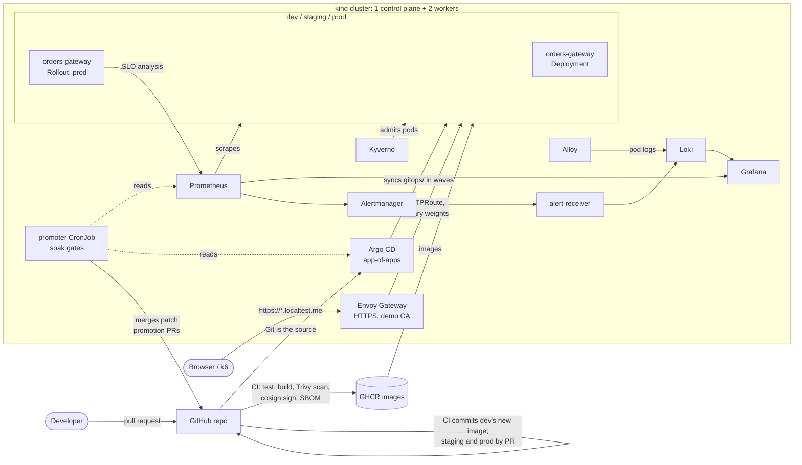

# orders-gateway-platform

A local, reproducible **"cluster in a box"** that shows how a platform team would **run, ship, observe and operate** a small stateless HTTP service, `orders-gateway`, on Kubernetes.

The service is a small Go stand-in. The platform around it is the real point: GitOps with Argo CD, canary releases with Argo Rollouts, HTTPS through Envoy Gateway, metrics and logs with Prometheus, Grafana and Loki, and a security baseline that keeps itself patched.

> **Status:** everything in the brief's definition of done is built: the stack, all six demos, the `docs/learn/` track, dashboards and alerts for every component, and automatic patch promotion. The promoter runs as a **dry run** until the owner adds a GitHub token ([decision 0024](docs/decisions/0024-patch-promoter.md)).

## Prerequisites

**Docker only.** Every other tool (kind, kubectl, helm, kubeseal, cosign, k6, the argocd CLI, jq, yq) is pinned and shipped in a toolbox container image that the `./platform` script runs for you.

| | Reference machine | Development machine |
| --- | --- | --- |
| Hardware | 8 vCPU / 16 GB, x86-64 Linux | Apple silicon Mac (arm64), 16 GB |
| Docker | Docker Engine | Colima: `colima start --cpu 6 --memory 12` |

The whole stack is designed to fit in **6 CPUs and 12 GB RAM**.

## Quick start

```sh
git clone https://github.com/iantest11111989/orders-gateway-platform.git
cd orders-gateway-platform
docker compose up -d --wait   # the whole platform; returns when it's ready (decision 0026)
kubectl --kubeconfig out/kubeconfig.yaml get nodes
```

`out/` is written by the toolbox as root (the kubeconfig is mode 0644, so you can read it). `docker compose down` stops `ready` but leaves the cluster; `./platform down` deletes it.

`./platform` does the same and everything after it:

```sh
./platform doctor   # check Docker, CPU, memory, disk and ports
./platform up       # create the cluster (safe to re-run)
./platform verify   # check apps, scrape targets, logs, HTTPS and policies
./platform urls     # every URL and login
./platform budget   # measured CPU and memory against the 6 CPU / 12 GiB budget
./platform demo canary   # and the other demos below
./platform shell    # a shell with kubectl, helm, argocd, k6, ... pointed at the cluster
./platform down     # delete it all (safe to re-run)
```

`up` creates the kind cluster (1 control plane + 2 workers), installs Argo CD and hands it the root Application, then waits until every Application is Synced and Healthy. From then on Argo CD manages everything, including itself, from Git, in sync waves (CRDs, then controllers, then observability, policies and the gateway, then the apps). From a clean machine that takes about 6–7 minutes, most of it pulling images (358–427 s in the nightly end-to-end run on fresh GitHub runners). `./platform verify` then checks the running stack: every Application Synced and Healthy, every Prometheus target up, logs in Loki from every namespace, HTTPS on every hostname, and Kyverno rejecting a bad manifest in `dev`. `./platform budget` measures what the cluster uses against the 6 CPU / 12 GiB budget (`--watch 120` reports the peak while something runs).

Argo CD deploys **this checkout**: the bootstrap pushes a snapshot of the working tree to a Git server inside the cluster, and every `up` (or Compose start) pushes your changes again ([decision 0029](docs/decisions/0029-in-stack-git-server.md)). To follow a repo on GitHub instead (GitHub mode, where CI's promotion PRs and the patch promoter apply): `REPO_URL=https://github.com/<you>/orders-gateway-platform.git REVISION=main ./platform up`.

`./platform` runs everything inside a **toolbox** container with every tool pinned and checksum-verified (`toolbox/versions.env`). The first run pulls or builds it. Set `TOOLBOX_IMAGE` to use a different image.

> **Security note:** the toolbox mounts the Docker socket so kind can create its node containers. That gives it root-equivalent access to your Docker host, which is normal for kind but worth knowing. Run it on a machine you control. With Colima, keep the checkout inside your home folder.

## What's inside

| Area | Choice |
| --- | --- |
| Local cluster | kind: 1 control plane + 2 workers |
| Packaging | Helm chart |
| GitOps | Argo CD, app-of-apps, Argo CD manages itself |
| Progressive delivery | Argo Rollouts with `workloadRef` |
| Traffic | Gateway API with Envoy Gateway |
| TLS | cert-manager with a local demo CA |
| Metrics | Prometheus, Alertmanager, Grafana (kube-prometheus-stack) |
| Logs | Loki (single binary) + Alloy |
| Policy | Kyverno |
| Secrets | Sealed Secrets (demo key, **demo only**) |
| Scanning and signing | Trivy (CI and Trivy Operator), cosign keyless |
| CI and updates | GitHub Actions, Renovate |
| Environments | dev, staging, prod namespaces |

## URLs

All hostnames use `*.localtest.me`, which resolves to `127.0.0.1`.

- `https://orders.dev.localtest.me`, `https://orders.staging.localtest.me`, `https://orders.localtest.me`
- `https://argocd.localtest.me`, `https://grafana.localtest.me`, `https://prometheus.localtest.me`, `https://alertmanager.localtest.me`, `https://rollouts.localtest.me`

`./platform urls` prints them with the logins (Argo CD's admin password, and Grafana's, which comes from a SealedSecret) and how to trust the demo CA.

## Demos

`./platform demo <name>` narrates each step in the terminal and says where to watch it. The demos run in `demo`, a copy of the live `prod` (canary, chaos and autoscale) or `dev` (rolling update) Application, so the real environments only ever change through Git ([decision 0020](docs/decisions/0020-demos-in-a-copy-of-prod.md)). k6 sends ~10 requests/s through the gateway while they run (`autoscale` sends more).

| Demo | What happens | Time |
| --- | --- | --- |
| `rolling-update` | v1 → v2 in a 3-replica copy of dev: pods replace one at a time (`maxSurge: 1`, `maxUnavailable: 0`), and the demo fails if fewer than 99.5% of k6's requests meet the SLO | ~2 min |
| `chaos` | in a copy of prod: delete a pod, then drain a worker for the demo's pods (cordon + evictions, like `kubectl drain`). The PodDisruptionBudget refuses a second eviction until a replacement is ready; fails if fewer than 99.5% of k6's requests meet the SLO | ~3 min |
| `gitops-revert` | a bad config commit (`FAULT_ERROR_RATE` 0.3) on a temporary `demo/gitops-revert-*` branch that a copy of dev follows: Argo CD syncs it and ~30% of orders fail; `git revert` heals it. Needs `GITHUB_TOKEN` with push access to the repo the cluster syncs from (your fork, `REPO_URL`); the branch is deleted afterwards | ~5 min |
| `canary` | v1 → v2: Rollouts moves traffic 10% → 25% → 50% → 100% and the SLO analysis passes at each step | ~8 min |
| `canary-fail` | v2 → v2-bad: the first analysis fails the SLO, Rollouts aborts and sends all traffic back to v2 | ~3 min |
| `autoscale` | in a copy of prod whose pods request 10m CPU (prod: 50m, so a laptop-sized load is enough). The HPA is prod's own (3–6 pods, 70% CPU target); only the request it measures against changes: k6 sends a fixed rate (`AUTOSCALE_RATE`, default 180 requests/s), CPU goes past the HPA's 70% target and it scales the Rollout from 3 to 6 pods; when k6 stops it scales back to 3 after the HPA's 5-minute scale-down window. Fails if it doesn't scale up, or isn't back at 3 within 10 minutes | ~8 min |
| `policy` | Kyverno refuses two pods created for real in `demo`: an orders-gateway image without main's signature (the unsigned image staging and prod ran until 2026-11-25) and a `:latest` image. Each prints the policy that refused it and why. A signed image is admitted (dry run). Nothing is left running ([decision 0022](docs/decisions/0022-enforce-in-orders.md)) | <1 min |
| `clean` | deletes the demo copy (after an interrupted demo, or `--keep`) | |

Add `--keep` to leave `demo` running afterwards. Watch in the Rollouts dashboard (`https://rollouts.localtest.me/rollouts/demo`), Argo CD, or Grafana. Run `./platform budget --watch 600` in a second terminal to see the peak.

## Repository layout

```
app/                    Go source, Dockerfile, tests, k6 scripts
charts/orders-gateway/  Helm chart
environments/           dev, staging and prod values
gitops/                 Argo CD Applications per component
policies/               Kyverno policies and tests
dashboards/             Grafana dashboards (JSON)
alerts/                 PrometheusRules
runbooks/               one per alert
platform                the CLI script
scripts/                what ./platform runs inside the toolbox
cluster/                kind cluster config
toolbox/                toolbox image
docs/decisions/         architecture decision records
docs/learn/             hands-on exercises
.github/workflows/      CI
```

## Architecture



- **Git is the only way in.** CI promotes every signed image to dev by committing to `environments/dev/values.yaml`; staging and prod move by pull request ([0014](docs/decisions/0014-promotion.md), [0015](docs/decisions/0015-promotion-prs.md)). Argo CD syncs everything, itself included, in sync waves ([0005](docs/decisions/0005-gitops-layout.md)).
- **Traffic** enters through one Envoy Gateway with a cert-manager certificate from a demo CA ([0008](docs/decisions/0008-gateway-and-tls.md)). In prod, Argo Rollouts moves the HTTPRoute's weights step by step and checks the SLO in Prometheus at each step ([0011](docs/decisions/0011-canary-rollouts.md)).
- **Patches promote themselves.** A CronJob in the cluster checks each staging and prod promotion PR against soak gates (an hour on the environment before, the SLO held, no alerts, healthy pods) and merges it when they pass; features still need the owner. A `promotion/PAUSED` file on main stops it ([0024](docs/decisions/0024-patch-promoter.md)).
- **Alerts** go from Alertmanager to a small receiver that logs them, so they're in Loki next to everything else; the always-firing Watchdog proves the path ([0025](docs/decisions/0025-security-alerts-and-routing.md)).
- **Admission:** Kyverno refuses `:latest` and unsigned app images in the app namespaces (`dev`, `staging`, `prod`, `demo`) and audits the rest ([0012](docs/decisions/0012-kyverno-policies.md), [0022](docs/decisions/0022-enforce-in-orders.md)).

## Resource budget (measured)

The brief's budget is **6 CPU / 12 GiB** for everything. `./platform up` caps each kind node container at 2 CPU / 4 GiB (6 / 12 in total) and reserves the rest of the host so the scheduler can't overcommit. `./platform budget` measures real use from `docker stats` and fails on any out-of-memory kill. `--watch N` samples every 5 s and reports the peak.

| Where | What ran | CPU (peak) | Memory (peak) | OOM kills |
| --- | --- | --- | --- | --- |
| Mac mini, Colima 6 CPU / 12 GiB (arm64) | idle | 0.63 | 7,105 MiB (57%) | none |
| Mac mini, Colima | `demo canary` (k6, 10 req/s) | **3.75** | **7,731 MiB (62%)** | none |
| Mac mini, Colima | `demo autoscale` (k6, 180 req/s; HPA 3 → 6) | **4.40** | 7,602 MiB (61%) | none |
| Mac mini, Colima | `demo rolling-update` | 3.00 | 7,440 MiB (60%) | none |
| GitHub runner, x86-64 Ubuntu, Docker only (nightly) | `demo canary` | 3.59 | **8,049 MiB (65%)** | none |
| GitHub runner, arm64 Ubuntu, Docker only (nightly) | `demo canary` | 2.13 | 7,251 MiB (59%) | none |

Measured on 2026-11-25. Mac rows at commit `6c51240`; nightly rows from [run 45577072639](https://github.com/iantest11111989/orders-gateway-platform/actions/runs/45577072639). The heaviest moment is the autoscale demo at 180 req/s; memory never went above two thirds. k6 itself runs in the toolbox container on the Docker host, outside the kind nodes, so its own CPU isn't counted, only the cluster's work serving it. Those runs were before the patch promoter existed; with it and its order trickle running, idle is 0.77 CPU and 7,062 MiB (57%), the promoter namespace itself 6m CPU and 13 MiB.

**Time to a healthy stack** (`./platform up`, every pod image pulled fresh): 383 s on the x86-64 runner and 390 s on the arm64 runner (same nightly run); **316 s** on the Mac mini under Colima (6 CPU / 12 GiB, after `./platform down`), followed by `./platform verify` passing every check.

## Why these choices

Each choice has a decision record in [`docs/decisions/`](docs/decisions/README.md). The short version:

| Choice | Why | Instead of |
| --- | --- | --- |
| **kind**, 1 control plane + 2 workers, in a toolbox container | Only Docker needed; two workers in two zones make PodDisruptionBudgets and topology spread real ([0004](docs/decisions/0004-toolbox-and-cluster.md)) | k3d or minikube: similar, but kind is what upstream Kubernetes tests with |
| **Argo CD, app-of-apps, managing itself** | Everything, including Argo CD, comes from Git; sync waves give a deterministic bootstrap ([0005](docs/decisions/0005-gitops-layout.md)) | Flux: equally good; Argo CD's UI makes the demos easier to follow |
| **Argo Rollouts with `workloadRef`** | The chart keeps one Deployment; prod adds a canary with SLO analysis without forking the chart ([0011](docs/decisions/0011-canary-rollouts.md)) | Flagger: also supports Gateway API; Rollouts fits Argo CD (health checks, UI) and its own dashboard |
| **Gateway API + Envoy Gateway** | The standard successor to Ingress; Rollouts can shift weights on an HTTPRoute directly ([0008](docs/decisions/0008-gateway-and-tls.md)) | ingress-nginx: canary weights only through annotations, and the Ingress API is frozen in favour of Gateway API |
| **kube-prometheus-stack, Loki single binary, Alloy** | The common open-source stack, trimmed to fit 12 GB ([0007](docs/decisions/0007-observability-stack.md)) | Elastic or a hosted SaaS: too heavy, or not local |
| **Multi-window burn-rate alerts** | Page fast on real problems, stop quickly after a fix ([0006](docs/decisions/0006-slo-rules.md)) | Threshold alerts on error rate: page on blips |
| **Kyverno, CEL policies, Audit first** | Policies as YAML next to the manifests, tested with `kyverno test`; enforce one at a time once clean ([0012](docs/decisions/0012-kyverno-policies.md)) | OPA Gatekeeper: Rego is another language to learn |
| **Sealed Secrets** | Encrypted secrets can live in Git; works offline ([0018](docs/decisions/0018-sealed-secrets.md)) | External Secrets: needs a real secret manager |
| **cosign keyless, Trivy, Renovate** | Signed images with SBOMs and no keys to manage; scanning in CI and in the cluster; every pin kept current ([0013](docs/decisions/0013-image-signing.md), [0016](docs/decisions/0016-trivy-image-scan.md), [0021](docs/decisions/0021-trivy-operator.md), [0010](docs/decisions/0010-renovate.md)) | |
| **Demos in a copy of prod** | The real environments only ever change through Git ([0020](docs/decisions/0020-demos-in-a-copy-of-prod.md)) | Demos that patch prod directly |

## Production differences

- **Metrics retention.** Prometheus here keeps 24 hours of data, enough for the burn-rate alerts (at most 6 h), so the error-budget panel covers only that window. Production would keep 30+ days, for example in long-term storage, so the true 30-day error budget can be computed.
- **TLS and DNS.** Certificates here come from a demo CA created inside each cluster, and `*.localtest.me` resolves to 127.0.0.1. Production would use a public CA (Let's Encrypt via ACME DNS-01) or the company PKI, with real DNS records.
- **Ingress.** Here Envoy listens on NodePorts mapped to 127.0.0.1:80/443, with one proxy replica. Production would use a cloud load balancer, two or more proxy replicas spread across zones, and SSO in front of Prometheus and Alertmanager, which have no login of their own.
- **Secrets.** The Sealed Secrets private key is a **DEMO ONLY** key committed to Git, so any clone can decrypt the sealed secrets ([decision 0018](docs/decisions/0018-sealed-secrets.md)). Production would generate the key in the cluster (or keep it in a cloud KMS / External Secrets with a secret manager), back it up outside Git, and rotate it.
- **Alert routing.** Every alert goes to a local `alert-receiver` that writes it to the logs (Loki), routed by severity (`/page`, `/ticket`), with the always-firing `Watchdog` checked by `./platform verify` ([decision 0025](docs/decisions/0025-security-alerts-and-routing.md)). Production would send pages to an on-call tool such as PagerDuty or Opsgenie, tickets to a chat channel, and watch `Watchdog` with a dead-man's switch.
- **Logins.** Argo CD and Grafana each have one local `admin` account (Argo CD's Dex is off to save memory). Production would use SSO (OIDC) with groups mapped to roles, and no shared admin password.
- **Promotion credentials.** The patch promoter merges with a fine-grained GitHub token the owner creates by hand as a plain Secret, never in Git, since anything sealed with the demo key is public. On the Mac mini it's also kept in the Keychain (`./platform promoter-token save`), so `./platform up` puts it back after a rebuild. Production would use a GitHub App installation token, or a secret manager through External Secrets.
- **Soak traffic.** Staging and dev soak on a synthetic order trickle (`customer_id` `cust-trickle`), because they get no real traffic. Production would soak on real traffic, possibly longer off-peak.
- **Clusters.** dev, staging and prod are namespaces in one kind cluster here, to fit the budget. Production would run separate clusters (at least prod apart from the rest), each managed by Argo CD from the same Git repo, with prod promotions still by pull request.
- **Availability.** One replica each for Argo CD, Kyverno, Prometheus, Loki and the Envoy proxy. Production would run highly available pairs or more (Kyverno with three replicas and `failurePolicy: Fail`, [decision 0022](docs/decisions/0022-enforce-in-orders.md)), with persistent storage for Grafana and Loki.

## Troubleshooting

Start with `./platform doctor` (Docker, CPU, memory, disk, ports) and `./platform verify` (names what's unhealthy).

| Symptom | Likely cause | What to do |
| --- | --- | --- |
| `doctor`: "Port 80/443 is already in use" | Another web server on the host | Stop it, or run on a machine without one |
| `up` waits on an app, pods in `ImagePullBackOff` | A registry rate-limited or flaked (ECR Public, Docker Hub) | Wait and re-run `./platform up`; it's safe to re-run. Kubernetes keeps retrying the pull |
| `up` fails: "nodes advertise more than their cap" | The cluster was created before node reservations existed | `./platform down && ./platform up` |
| `budget` reports `OOMKilled` | A container hit its memory limit (init containers too) | `./platform kubectl -n <ns> describe pod <pod>`; limits are in `gitops/values/` |
| Browser warns about the certificate | The demo CA isn't trusted | `./platform urls` shows how to trust it, or accept the warning |
| A pod in `dev`, `staging`, `prod` or `demo` is refused by `disallow-latest-tag` or `verify-image-signatures` | Working as intended: `:latest` and unsigned app images aren't allowed there | Use a tagged, signed image ([0022](docs/decisions/0022-enforce-in-orders.md)) |
| An app in Argo CD is `OutOfSync` after a manual change | Self-heal puts it back from Git within seconds | Change Git, not the cluster |
| The promoter logs `dry run (no token)` after a rebuild | `./platform down` deleted its GitHub token, which lives only in the cluster | On macOS, `./platform up` restores it from the Keychain if you saved it once with `./platform promoter-token save`; or run `./platform promoter-token load` ([decision 0024](docs/decisions/0024-patch-promoter.md)). One `dry run` pass right after `up` is normal: it can fire before the token is restored |
| A demo was interrupted | Its copy is left in `demo` | `./platform demo clean` |
| Under Colima, a path in `/tmp` isn't found | Colima mounts only your home folder | Keep the checkout (and any worktree) under `~` |
| Slow or evicted pods | Docker has less than 6 CPU / 12 GB | Colima: `colima start --cpu 6 --memory 12`; check with `./platform budget` |

## License

[MIT](LICENSE)
