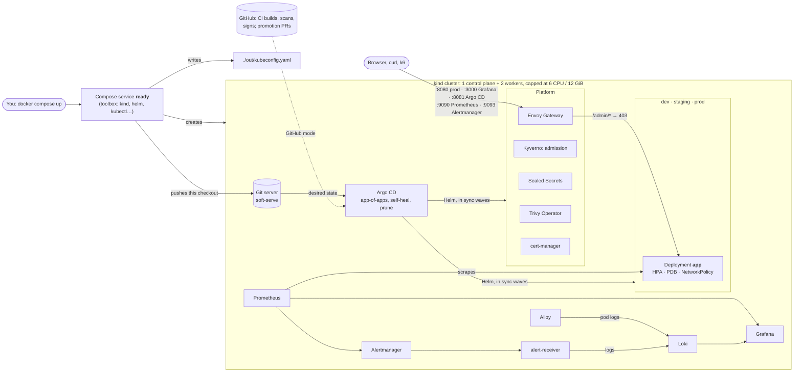

# orders-gateway-platform

A local **"cluster in a box"**: one command starts a Kubernetes cluster that runs, ships, monitors and operates `orders-gateway`, a small Node.js service, the way a platform team would in production.

```sh
docker compose up -d --wait
```

That's all it takes. Compose's `ready` service creates a kind cluster and hands it to Argo CD, and Argo CD installs everything else from Git, with Helm, in order. `--wait` returns when the platform is installed and prod is serving, about 9 minutes from cold. While it runs, four progress services turn **Healthy** one by one:

```
 ✔ Container orders-gateway-platform-step-1-cluster-1    Healthy   (kind nodes Ready)
 ✔ Container orders-gateway-platform-step-2-argocd-1     Healthy   (Git server and Argo CD running)
 ⠿ Container orders-gateway-platform-step-3-platform-1   Waiting   (every platform component Synced and Healthy)
 ⠿ Container orders-gateway-platform-step-4-apps-1       Waiting   (dev, staging and prod Synced and Healthy)
 ⠿ Container orders-gateway-platform-ready-1             Waiting   (all of it, and prod serving on :8080)
```

To follow every detail as it happens: `docker compose logs -f ready`.

## What you get

| | Where | Check it |
| --- | --- | --- |
| The app in prod | `http://localhost:8080` (`/admin/*` is refused with 403) | `curl localhost:8080/version` |
| The app in dev and staging | `https://orders.dev.localtest.me`, `https://orders.staging.localtest.me` | `curl -k https://orders.dev.localtest.me/version` |
| Grafana | `http://localhost:3000`, `admin` / `admin12345` | the **orders-gateway** dashboard |
| Argo CD | `http://localhost:8081`, `admin` / `admin12345` | every app Synced and Healthy |
| Prometheus, Alertmanager | `http://localhost:9090`, `http://localhost:9093` | only **Watchdog** firing when healthy |
| kubectl | `./out/kubeconfig.yaml` | `kubectl --kubeconfig out/kubeconfig.yaml get pods -A` |
| A health signal | Compose service `ready` turns healthy when everything is installed and prod serves | `docker compose ps` |
| Survives restarts | `docker compose stop` / `start` keeps the cluster and its data | `docker compose stop && docker compose start` |
| Fits 6 CPU / 12 GB | each kind node is capped at 2 CPU / 4 GiB | `./platform budget` |

`./platform verify` checks all of it in one go.

## Quick start

**You need Docker, nothing else.** Every other tool (kind, kubectl, helm, kubeseal, cosign, k6, the argocd CLI, jq, yq) is pinned in a toolbox image that `./platform` runs for you.

| | Linux | Mac (Apple silicon) |
| --- | --- | --- |
| Machine | 8 vCPU / 16 GB, x86-64 | 16 GB |
| Docker | Docker Engine with the Compose plugin | Colima: `colima start --cpu 6 --memory 12`, plus `brew install docker-compose` |

```sh
git clone https://github.com/iantest11111989/orders-gateway-platform.git
cd orders-gateway-platform
docker compose up -d --wait
curl localhost:8080/version
```

Then open Grafana at <http://localhost:3000> and its **orders-gateway** dashboard.

`./platform` does everything after start-up:

```sh
./platform verify        # check apps, scrape targets, logs, ports and policies
./platform urls          # every URL and login
./platform budget        # CPU and memory against 6 CPU / 12 GiB
./platform ship          # ship app/ to prod; ./platform rollback undoes it
./platform demo chaos    # and the other demos below
./platform shell         # a shell with kubectl, helm, argocd, k6 pointed at the cluster
./platform down          # delete everything: the Compose services and the cluster
```

`./platform up` does the same as `docker compose up`, in the foreground. Both are safe to re-run.

> **Security note:** the `ready` container and the toolbox mount the Docker socket so kind can create its node containers. That's root-equivalent on the Docker host (normal for kind), so run it on a machine you control.

**HTTPS names.** Every UI also has an HTTPS name under `*.localtest.me`, which resolves to `127.0.0.1`: `argocd`, `grafana`, `prometheus`, `alertmanager`, `rollouts`, and `orders`, `orders.dev`, `orders.staging` for the app. They use a certificate from the cluster's own demo CA (`./platform urls` shows how to trust it) and need ports 80 and 443 free. On macOS with Colima they don't reach the Mac's browser (only root can open ports below 1024 there), so use the plain ports.

## How it works



- **Compose is only the outer shell.** Its `ready` service runs the toolbox, creates the kind cluster, installs Argo CD and hands it the root Application, then stays up as the health signal. The four `step-*` services do no work: their healthchecks show progress.
- **Git is the only way in.** Argo CD follows a Git server inside the cluster, which `ready` (and `./platform up`, `ship`, `rollback`) pushes this checkout to, with self-heal and prune on. Set `REPO_URL=https://github.com/...` to follow GitHub instead, where CI and promotion pull requests take over.
- **Argo CD installs everything with Helm,** itself included, in sync waves: CRDs, then controllers, then monitoring, policies and the gateway, then the apps.
- **One edge.** Envoy Gateway serves every port and HTTPS name, and refuses `/admin/*` from outside.
- **Alerts you can see.** Alertmanager delivers to a small `alert-receiver` that logs each alert as JSON into Loki. The always-firing Watchdog proves the path works.

### Main choices

| Choice | Why | Instead of |
| --- | --- | --- |
| **kind**, 1 control plane + 2 workers, run from a toolbox container | Only Docker needed; upstream Kubernetes; two workers in two labelled zones make disruption budgets, drains and spreading real | k3d (k3s differs from upstream), minikube (built for one node) |
| **One Helm chart, a values file per environment** | The app needs conditionals (HPA, PDB, canary, public route only in prod), which Helm expresses simply | Kustomize overlays |
| **Argo CD, app-of-apps, managing itself** | Everything comes from Git, sync waves give an ordered start-up, and its UI makes changes easy to follow | Flux (no UI) |
| **A Git server inside the cluster** (soft-serve) | Works offline with no GitHub token; `ship` and `rollback` are Git commits | Gitea (heavier) |
| **Gateway API with Envoy Gateway** | The successor to Ingress; per-path filters and traffic weights without annotations | ingress-nginx (retired) |
| **A plain Deployment in prod; the canary runs in a demo copy** | prod is a Deployment named `app`; the canary with automatic SLO checks is shown with `./platform demo canary` | Argo Rollouts in prod |
| **kube-prometheus-stack, Loki, Alloy** | The common open-source stack, trimmed to fit 12 GB | Elastic, or a SaaS |
| **Burn-rate SLO alerts** | Page fast on real problems, stay quiet on blips | Plain error-rate thresholds |
| **Sealed Secrets** | Encrypted secrets live in Git and work offline. The key is committed so any clone can decrypt: **demo only** | External Secrets (needs a secret manager) |
| **Kyverno** | Policies as YAML next to the manifests, tested with `kyverno test` | OPA Gatekeeper (Rego) |
| **cosign keyless, Trivy, Renovate** | Signed images with SBOMs and no keys to manage; scans in CI and in the cluster; every pin kept current | |

## Ship a new version, roll it back

```sh
# Optional, in a second terminal: traffic on prod while you do it
while true; do curl -s -o /dev/null -w '%{http_code} ' 'http://localhost:8080/work?ms=20'; sleep 0.2; done

./platform ship            # build app/, load it into kind, roll prod out to it
./platform rollback        # back to the image prod ran before
```

`ship` builds `app/` as `localhost/orders-gateway:local-<timestamp>` (or `./platform ship <tag>`), loads it into the kind nodes, sets it in `environments/prod/values.yaml` and pushes the checkout to the cluster's Git server. Argo CD then replaces prod's pods one at a time, never dropping below full capacity. `rollback` puts back the image prod ran before (a second `rollback` goes further back) and leaves the values file as Git has it. Both wait for the rollout, then print the pods by version and the 5-minute error rate. `--env dev|staging` targets another environment.

These are Git changes on purpose: `kubectl set image` or `kubectl rollout undo` would be reverted by Argo CD within seconds.

**Tested with traffic flowing.** CI ships and rolls back while three clients hit `:8080` the whole time, and fails on any non-200: 2,641 requests, 0 errors ([run](https://github.com/iantest11111989/orders-gateway-platform/actions/runs/45710719231/job/139544268716)).

**From GitHub instead.** In GitHub mode every merge to `main` builds, scans, signs and pushes an image and commits it to dev; staging and prod move by pull request. Roll back there with a revert PR.

## When it's broken

Work from the symptom inwards:

1. **Is it broken, where, since when?** Grafana → **orders-gateway**, environment picker at the top. The first row shows the SLO, the error budget left and any firing SLO alert. Below: requests by route and status, latency, and pods by version (with a marker at every version change).
2. **What's alerting?** Alertmanager at <http://localhost:9093>. Every alert links to a runbook in [`runbooks/`](runbooks/README.md): what it means, how to confirm it, what to do.
3. **What do the logs say?** Grafana → Explore → Loki. The app's JSON logs parse with no setup:
   ```logql
   {namespace="prod", app="app"} | json | status >= 500
   {namespace="prod", app="app"} | json | route="/echo" | duration_ms > 250
   ```
4. **Is Kubernetes happy?** `./platform shell`, then `kubectl -n prod get pods,events` and `argocd app list` (or <http://localhost:8081>). `./platform verify` names anything unhealthy.
5. **Was it a release?** If **Pods by version** changed when the errors began, `./platform rollback` first, investigate after.

Fixes go through Git: a `kubectl edit` in an app namespace is undone by Argo CD within seconds.

[`docs/learn/`](docs/learn/README.md) teaches this hands-on, starting with [a tour of the repo](docs/learn/00-repo-tour.md): Prometheus, Grafana, Loki, SLOs and Kubernetes operations, about 15 minutes each on the running stack.

### Troubleshooting the platform itself

Start with `./platform doctor` (Docker, CPU, memory, disk, ports) and `./platform verify`.

| Symptom | Likely cause | What to do |
| --- | --- | --- |
| `doctor`: "Port 80/443 is already in use" | Another web server on the host | Stop it |
| macOS: a port shows another app, or `ERR_SSL_PROTOCOL_ERROR` on `*.localtest.me` | A program on the Mac holds the port | `./platform doctor` names it; stop it, then `colima restart` |
| Pods in `ImagePullBackOff` during start-up | A registry rate-limited or flaked | Wait and re-run `./platform up`; Kubernetes keeps retrying |
| `up` fails: "nodes advertise more than their cap" | An old cluster | `./platform down && ./platform up` |
| `budget` reports `OOMKilled` | A container hit its memory limit | `./platform kubectl -n <ns> describe pod <pod>`; limits are in `gitops/values/` |
| The browser warns about the certificate | The demo CA isn't trusted | `./platform urls` shows how to trust it |
| A pod in `dev`, `staging`, `prod` or `demo` is refused by `disallow-latest-tag` or `verify-image-signatures` | Working as intended | Use a tagged, signed image |
| An app is `OutOfSync` after a manual change | Self-heal puts it back from Git | Change Git, not the cluster |
| The promoter logs `dry run (no token)` after a rebuild | `./platform down` deleted its GitHub token | `./platform promoter-token load` (on macOS, `./platform up` restores it if you saved it with `./platform promoter-token save`) |
| `docker compose up -d --wait` waits forever, `ready` unhealthy | The cluster was deleted while an old `ready` kept running | `docker compose down && docker compose up -d --wait` |
| A demo was interrupted | Its copy is left in `demo` | `./platform demo clean` |
| Under Colima, a path in `/tmp` isn't found | Colima only shares your home folder | Keep the checkout under `~` |
| Slow or evicted pods | Docker has less than 6 CPU / 12 GB | `colima start --cpu 6 --memory 12` |

## Under load and failure

The app is a single Node event loop with a 3-second warm-up, a `/readyz` that turns 503 while it drains, and a SIGTERM handler that finishes in-flight requests and exits within 25 s. The chart is built around that:

| Situation | What protects it | Why |
| --- | --- | --- |
| A pod starts | `startupProbe` on `/healthz`, then `readinessProbe` on `/readyz` | Traffic arrives only after the warm-up |
| A pod stops (release, drain, scale-down) | `preStop` sleep 5 s, then SIGTERM; `terminationGracePeriodSeconds: 35` | The gateway drops the pod *before* it stops accepting; 35 s = 5 s + the app's 25 s + margin |
| A release | `maxSurge: 1`, `maxUnavailable: 0` | Never below full capacity |
| A node drain | PodDisruptionBudget (`maxUnavailable: 1`); spread across nodes and zones | One pod at a time; a lost node doesn't take every replica |
| A traffic spike | HPA, 3–6 pods at 70% of a 100m CPU request; **no CPU limit**, 128 Mi memory limit | `/work` burns CPU; a CPU limit would only throttle |
| A busy event loop | a lenient `livenessProbe` (every 10 s, 6 failures) | A busy pod isn't restarted mid-spike |
| A compromised pod | non-root, read-only filesystem, no capabilities, no service-account token, Pod Security `restricted`; NetworkPolicy allows in only the gateway and Prometheus, out only DNS | Least privilege |
| A platform component dies | Argo CD puts back anything deleted; Kyverno fails open; the request path (Envoy → pod) doesn't depend on Prometheus, Loki or Argo CD | The app stays up when the tools around it don't |

**Measured:** k6 at 100 requests/s on `:8080` for 3 minutes: 18,000 requests, **0 failed**, `POST /echo` p99 42 ms. The HPA went from 3 to 6 pods and the cluster peaked at 4.46 of 6 CPU. The demos below each fail unless 99.5% of their requests meet the SLO.

## Observability

| | What | Where |
| --- | --- | --- |
| **App metrics** | `http_requests_total`, `http_request_duration_seconds`, `app_info`, `app_ready`, `app_inflight_requests`; unknown paths are dropped at scrape time so a scanner can't explode the series count | Prometheus `:9090` |
| **Cluster metrics** | kube-state-metrics, node-exporter, kubelet/cAdvisor, and every platform component | Prometheus |
| **Logs** | Alloy ships every pod's output to Loki with four labels (`namespace`, `app`, `env`, `pod`); the app's JSON fields come out with `\| json` | Grafana → Explore → Loki |
| **Dashboards** | 7 dashboards as JSON in [`dashboards/`](dashboards/README.md), loaded automatically; CI checks every query parses. **orders-gateway** for on-call, **platform-overview** for the cluster, plus Argo CD, Rollouts, Kyverno, security and budget | Grafana `:3000` |
| **SLOs** | Availability: 99.5% of `/work` and `/echo` requests aren't 5xx. Latency: 99.5% of `/echo` and `/version` answer within 250 ms (`/work` takes as long as the caller asks, so it's left out) | [`alerts/orders-gateway-slo.yaml`](alerts/orders-gateway-slo.yaml) |
| **Alerts** | Burn-rate alerts: a fast burn pages, a slow burn opens a ticket. Plus delivery and security alerts (Argo CD, certificates, Kyverno, Sealed Secrets, Trivy, memory). Each has a runbook and a unit test; a healthy system fires only Watchdog | Alertmanager `:9093`, [`runbooks/`](runbooks/README.md) |
| **Alert delivery** | Alertmanager → `alert-receiver`, which logs each alert as JSON, routed by severity | Loki: `{namespace="monitoring", app="alert-receiver"}` |
| **Tracing** | **Not done.** The app logs a `trace_id` from a `traceparent` header, so one request can be followed across logs, but there's no tracing backend | |

## Environments, secrets and CI/CD

**Environments.** One chart, three values files: [`environments/{dev,staging,prod}/values.yaml`](environments/) override [`charts/orders-gateway/values.yaml`](charts/orders-gateway/values.yaml). dev runs 1 pod, staging 2, prod 3–6 with the HPA, disruption budget, spreading and the `:8080` route. A promotion changes one line: the image tag.

**Secrets.** No plain secrets in the repo: they're SealedSecrets, encrypted for the cluster's Sealed Secrets controller. Its key is a **demo key committed to Git** so every clone can decrypt; a real setup keeps the key out of Git or uses External Secrets. CI fails on any plain `Secret` or private key apart from that demo key. `admin12345` is a published demo login, not a secret.

**GitOps.** By default Argo CD reconciles the cluster from the Git server inside it, with self-heal and prune, and every change (`ship` and `rollback` included) is a commit. In GitHub mode, staging and prod move by pull request, and the **patch promoter**, a CronJob, merges a promotion PR once the previous environment has run it for an hour with the SLO held and no alerts. Feature releases still wait for the owner's approval. The promoter also reports what Argo CD has synced as GitHub **Deployments**, so the repo's **Environments** panel shows which version each environment runs.

**The pipeline.** GitHub Actions does CI; Argo CD and the promoter, inside the cluster, do CD. Every arrow into an environment is a Git commit.

```mermaid
flowchart LR
  pr["Pull request<br/>1 · test, lint<br/>2 · build both arches<br/>rehearse signing"] -->|review, merge| main["main"]
  main --> build["2 · build and push to GHCR<br/>3 · sign (cosign) · scan (Trivy)"]
  build --> devc["4 · commit image to<br/>environments/dev"]
  devc --> devs(["Argo CD syncs dev"])
  build --> prs["5 · promotion PRs<br/>for staging and prod"]
  devs --> soak1{"soak 1 h on dev:<br/>SLO held, no alerts"}
  prs --> soak1
  soak1 -->|"promoter merges<br/>(patch release)"| stc["environments/staging"]
  stc --> sts(["Argo CD syncs staging"])
  sts --> soak2{"soak 1 h on staging"}
  soak2 -->|"promoter merges a patch;<br/>a feature waits for the owner"| prc["environments/prod"]
  prc --> prs2(["Argo CD syncs prod"])
  localship["Locally: ./platform ship / rollback"] -->|"commit to the cluster's Git server"| prs2
```



| Workflow | When | What it does |
| --- | --- | --- |
| **CI · app** (`ci-app.yml`) | pull requests touching the app | 1 · test, lint → 2 · build (amd64 + arm64), scan, rehearse signing → 3 · smoke-test the image as Kubernetes runs it (non-root, read-only: warm-up, endpoints, metrics, a clean SIGTERM drain) → 4 · a 60 s k6 performance gate held to the SLOs |
| **CD · app** (`cd-app.yml`) | merges to `main` touching the app | 1 · test, lint → 2 · build and push to GHCR → 3 · sign (cosign keyless, SBOM), scan → 4 · deploy dev → 5 · open staging and prod promotion PRs |
| **CI · platform** | pull requests and `main` | shellcheck and actionlint · manifest validation (the chart for every environment, every manifest, checked against Kubernetes and CRD schemas and our policies) · toolbox build · **E2E · Fresh install**: `docker compose up -d --wait` on a fresh runner, restart, re-run, verify, ship and roll back under traffic, budget |
| **CI · alerts / policies / promoter** | pull requests and `main` | alert unit tests, runbook links and dashboard checks; `kyverno test`; the promoter's unit tests |
| **CI · security** | pull requests, `main`, weekly | CodeQL; gitleaks over the whole history |
| **CI · secrets / renovate config** | pull requests and `main` | no plain secrets; Renovate's config is valid |
| **Scheduled** | daily | full start-up, verify and the canary demos on fresh x86-64 and arm64 runners; a re-scan of the running images |

Pull requests run checks only (read-only token, no secrets); pushes to `main` build, sign and promote. Every job declares least-privilege permissions and actions are pinned by commit SHA.

## Resource budget (measured)

`./platform up` caps each kind node at 2 CPU / 4 GiB (6 / 12 in total) and reserves the rest of the host so the scheduler can't overcommit. `./platform budget` measures real use and fails on any out-of-memory kill; `--watch N` samples for N seconds and reports the peak.

Measured on 2026-11-25 on a Mac mini under Colima (6 CPU / 12 GiB, arm64):

| What ran | CPU (peak) | Memory (peak) | OOM kills |
| --- | --- | --- | --- |
| Idle, 2 minutes | 2.24 of 6 | 8,530 MiB (69%) | none |
| k6 at 100 requests/s on `:8080` for 3 minutes (HPA 3 → 6) | **4.46 of 6** | 7,674 MiB (62%) | none |

The largest users at idle: `kube-system` (API server, etcd) 2.3 GiB, `monitoring` 1.3 GiB, `argocd` 0.6 GiB; each app environment uses under 40 MiB.

**Time to healthy:** 9 min 43 s from `docker compose up -d --wait` on a GitHub-hosted runner ([run](https://github.com/iantest11111989/orders-gateway-platform/actions/runs/45710719231/job/139544268716)). Most of it is pulling about 60 images.

## Demos

`./platform demo <name>` narrates each step and says where to watch. Demos run in namespace `demo`, a copy of prod (or of dev for `rolling-update` and `gitops-revert`), so the real environments only change through Git. k6 sends traffic through the gateway the whole time.

| Demo | What happens | Time |
| --- | --- | --- |
| `rolling-update` | v1 → v2 in a 3-pod copy of dev: pods replace one at a time; fails if fewer than 99.5% of requests meet the SLO | ~2 min |
| `chaos` | delete a pod, then drain a worker; the disruption budget lets only one pod go at a time; fails if fewer than 99.5% of requests meet the SLO | ~3 min |
| `gitops-revert` | a bad config commit (30% of requests fail) on a temporary branch that a copy of dev follows; Argo CD syncs it, then `git revert` heals it. Pushes to the cluster's Git server (in GitHub mode, needs `GITHUB_TOKEN`) | ~5 min |
| `canary` | v1 → v2: Argo Rollouts moves traffic 10% → 25% → 50% → 100% and checks the SLO after each step | ~8 min |
| `canary-fail` | v2 → v2-bad (10% errors): the first check fails, Rollouts aborts and sends all traffic back to v2 | ~3 min |
| `autoscale` | k6 sends a fixed 20 requests/s (`AUTOSCALE_RATE`), mostly CPU-heavy `/work`; the HPA scales 3 → 6 pods, then back to 3 about 5 minutes after the load stops | ~8 min |
| `policy` | Kyverno refuses an unsigned image and a `:latest` image, printing which policy refused each and why; a signed image is admitted | <1 min |
| `clean` | delete the demo copy (after an interrupted demo, or `--keep`) | |

Add `--keep` to leave the copy running. Watch in the Rollouts dashboard (`https://rollouts.localtest.me/rollouts/demo`), Argo CD or Grafana (environment `demo`).

## Local vs a real cloud

The full plan for running this on AWS (accounts, EKS, IAM, ECR, Argo CD across clusters, Datadog, tests, canaries in prod, DR, cost, on-call) is in [docs/production-on-aws.md](docs/production-on-aws.md). [`docs/terraform-sketch/`](docs/terraform-sketch/README.md) sketches the EKS part in Terraform (never applied). The short version:

| Here (local) | In the cloud | Why it's this way locally |
| --- | --- | --- |
| kind in Docker, 3 nodes, two labelled "zones" | A managed control plane, nodes in 3 real zones, Karpenter adding nodes | One machine |
| dev, staging and prod as namespaces in one cluster | prod in its own cluster at least | The budget |
| Envoy on host ports, one proxy | A cloud load balancer in front of 2+ proxies across zones | No load balancer locally |
| Demo CA, `*.localtest.me` | Real certificates and DNS | No public DNS |
| Sealed Secrets with a demo key in Git | External Secrets from a secret manager | Must work offline from a clone |
| `admin` / `admin12345` | SSO with roles | A demo login |
| A Git server in the cluster; `ship` loads a local image | GitHub only; prod admits only signed CI images | No registry or token needed |
| Prometheus keeps 24 h | 30+ days, so the real 30-day error budget can be computed | Disk and memory |
| One replica of Argo CD, Kyverno, Prometheus, Loki; Kyverno fails open | HA everywhere; Kyverno fails closed | Memory |
| Alerts to a local receiver | PagerDuty for pages, chat for tickets | No accounts needed |

## Limitations

- **Envoy's proxy is a single replica.** Killing it interrupts traffic at the edge for a few seconds.
- **prod runs a plain Deployment, not the canary.** The canary with automatic SLO checks works, in the `demo` copy.
- **Kyverno fails open.** If it's down, pods are admitted unchecked, so a policy outage can't block a rollback.
- **Prometheus keeps 24 hours,** so the error-budget panels cover a day, not 30 days.
- **The Sealed Secrets key is public,** by design. Anything sealed with it is effectively public.
- **First start pulls about 60 images.** A slow registry can stretch start-up; re-running is safe.
- **No tracing backend.** Requests correlate across logs by `trace_id` only.
- **The app's latency fault only slows `/work`,** which the latency SLO leaves out, so injected latency doesn't trip the latency alert. Saturating the event loop with `/work` does (see [docs/learn/04-slos.md](docs/learn/04-slos.md)).

**Next steps:** two Envoy replicas with a disruption budget; tracing with Tempo and OpenTelemetry; a real canary in prod; applying the Terraform to a sandbox account.

## Repository layout

```
app/                    the service (server.js), Dockerfile, tests, k6 scripts
charts/orders-gateway/  Helm chart
environments/           dev, staging and prod values
gitops/                 Argo CD Applications, per-component values and manifests
policies/               Kyverno policies and tests
dashboards/             Grafana dashboards (JSON)
alerts/                 Prometheus alert rules and tests
runbooks/               one per alert
platform                the CLI
scripts/                what ./platform runs inside the toolbox
cluster/                kind cluster config
toolbox/                toolbox image
docs/learn/             hands-on exercises
docs/production-on-aws.md  the plan for running it on AWS
docs/terraform-sketch/  the EKS part in Terraform (not applied)
.github/workflows/      CI/CD
```

## License

[MIT](LICENSE)
