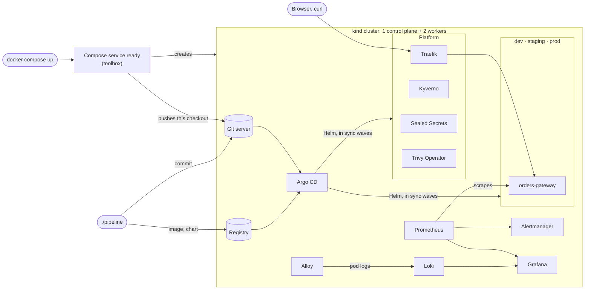

# platform-demo

A Kubernetes platform you can run on your own machine, for hands-on practice. One command starts a local kind cluster with Argo CD, a Git server and an image registry inside the cluster, Prometheus, Grafana, Loki, Alertmanager, Kyverno, Sealed Secrets, Trivy and Traefik. It runs a small Node.js service, `orders-gateway`, in dev, staging and prod.

CI/CD runs locally too: `./pipeline` tests, builds and scans an app, then promotes it from dev to staging to prod through Git and Argo CD.

It started as an answer to a take-home DevOps test. [docs/brief.md](docs/brief.md) goes through that test point by point.

## What you need

Docker, and nothing else. Every other tool (kind, kubectl, helm, kubeseal, cosign, k6, the argocd CLI, jq, yq) is pinned in a [toolbox image](stack/toolbox/README.md) that `./platform` runs for you.

| | Linux | Mac (Apple silicon) |
| --- | --- | --- |
| Machine | 8 vCPU / 16 GB, x86-64 | 16 GB |
| Docker | Docker Engine with the Compose plugin | Colima (`colima start --cpu 6 --memory 12`) and `brew install docker-compose` |

The platform uses 6 CPU and 12 GB. On a Mac, keep the checkout under your home folder: Colima only shares that.

## Start it

```sh
git clone https://github.com/iantest11111989/platform-demo.git
cd platform-demo
docker compose up -d --wait
curl localhost:8080/version
```

The first start takes about 10 minutes, mostly pulling images. Compose's `ready` service creates the cluster and hands it to Argo CD, which installs everything else from Git. Four `step-*` services turn Healthy as it goes (cluster, Argo CD, platform, apps), and `--wait` returns once prod is serving. To follow along: `docker compose logs -f ready`.

`docker compose stop` and `start` keep the cluster and its data. Running `up` again is safe.

The `ready` container and the toolbox mount the Docker socket so kind can create its nodes. That gives them full control of Docker, and so of the machine, so run this on a machine you control.

## URLs and logins

Everything is plain HTTP on `127.0.0.1`, through Traefik.

| What | URL | Login |
| --- | --- | --- |
| orders-gateway in prod | <http://localhost:8080> | |
| dev, staging | <http://localhost:8082>, <http://localhost:8083> | |
| Demo copy (while a demo runs) | <http://localhost:8084> | |
| Argo CD | <http://localhost:8081> | `admin` / `admin12345` |
| Grafana | <http://localhost:3000> | `admin` / `admin12345` |
| Prometheus, Alertmanager | <http://localhost:9090>, <http://localhost:9093> | none |
| kubectl | `./out/kubeconfig.yaml` | |

`/admin/*` on the app is refused from outside with a 403. `admin12345` is a published demo login, not a secret. `./platform urls` prints all of this.

## Everyday commands

```sh
./platform doctor        # check Docker, CPU, memory, disk and ports
./platform verify        # check apps, scrape targets, logs, ports and policies
./platform urls          # every URL and login
./platform budget        # CPU and memory use against 6 CPU / 12 GiB
./platform shell         # a shell with kubectl, helm, argocd and k6 set up for the cluster
./platform demo <name>   # run a demo (see below)
./platform up            # same as docker compose up, in the foreground
./platform down          # delete everything: the Compose services and the cluster
```

## Ship a version

`./pipeline` is the CI/CD. It works for any app that has `apps/<app>/app/`, `apps/<app>/chart/` and `apps/<app>/cd/`.

```sh
./pipeline ci orders-gateway --version 1.2.0          # test, build, scan, publish image and chart 1.2.0
./pipeline cd orders-gateway dev --version 1.2.0      # deploy to dev
./pipeline cd orders-gateway staging --version 1.2.0  # then staging
./pipeline cd orders-gateway prod --version 1.2.0     # then prod
./pipeline rollback orders-gateway prod               # back to prod's previous version
```

How it behaves:

- `ci` publishes to the registry inside the cluster. A published version is never overwritten. Without `--version` you get a dev-only build.
- `cd` sets the version in `apps/<app>/cd/<env>.yaml`, commits it and pushes the checkout to the in-cluster Git server. Argo CD then deploys it.
- Promotion goes in order. Staging only takes a version dev has run, and prod only one staging has run. The previous environment must be healthy: Synced and Healthy in Argo CD, with no alerts firing for the app. `--force` skips these checks for emergencies.
- dev syncs by itself. Staging and prod wait for you: open Argo CD, check the diff and click **Sync**, or add `--sync` to sync from the command line and wait for the rollout.
- `rollback` is always allowed. You always name the environment; there is no default.

Change Git, not the cluster. Where auto-sync is on, Argo CD undoes a `kubectl set image` or `kubectl edit` within seconds. Elsewhere the app shows OutOfSync until Git matches.

## How it works



- Compose is only the outer shell. Its `ready` service creates the kind cluster, installs Argo CD and gives it the root Application from [`stack/delivery/bootstrap/`](stack/delivery/bootstrap/README.md).
- Argo CD installs everything with Helm, itself included, in order: CRDs, controllers, monitoring, policies, then the apps. Self-heal and prune are on.
- Traefik is the only way in. It serves each port as a standard Kubernetes Ingress.
- Kyverno checks pods as they are admitted. See [`stack/security/kyverno/policies/`](stack/security/kyverno/policies/README.md).
- Secrets are SealedSecrets. The decryption key is committed so any clone works. That is for the demo only.

The app's chart is built for zero-downtime releases and drains: probes, a graceful shutdown, a disruption budget, spreading across nodes and an HPA in staging and prod. [The chart's README](apps/orders-gateway/chart/README.md#how-the-app-behaves-and-what-the-chart-does-about-it) goes through what `server.js` does and which setting answers each behaviour.

## Observability

- **Dashboards.** Six Grafana dashboards in [`stack/observability/dashboards/`](stack/observability/dashboards/README.md). Start with **platform-overview** for the cluster or **orders-gateway** for the app.
- **SLOs.** 99.5% of `/work` and `/echo` requests succeed, and 99.5% of `/echo` and `/version` answer within 250 ms. Burn-rate alerts are in [`stack/observability/alerts/`](stack/observability/alerts/README.md).
- **Alerts.** Each alert links to a runbook in [`stack/observability/runbooks/`](stack/observability/runbooks/README.md). Alertmanager sends them to a small receiver that logs them into Loki. When all is well, only Watchdog fires.
- **Logs.** Alloy ships every pod's output to Loki. The app logs JSON, so `| json` gives you its fields.
- **Tracing.** Not set up. The app logs a `trace_id` from the `traceparent` header, so you can follow one request through the logs.

## When something breaks

1. Open Grafana, dashboard **orders-gateway**, and pick the environment. Check the SLO, the error rate and **Pods by version**.
2. Check Alertmanager (<http://localhost:9093>). Each alert links to its runbook.
3. Read the logs in Grafana → Explore → Loki:
   ```logql
   {namespace="prod", app="orders-gateway"} | json | status >= 500
   ```
4. Check Kubernetes: `./platform shell`, then `kubectl -n prod get pods,events` and `argocd app list`.
5. If the errors started with a new version, roll back first (`./pipeline rollback orders-gateway prod`) and investigate after.

### Troubleshooting the platform

Start with `./platform doctor` and `./platform verify`.

| Symptom | What to do |
| --- | --- |
| `doctor` says a port is in use | Stop whatever holds it. On a Mac, then run `colima restart`. |
| Pods in `ImagePullBackOff` during start-up | A registry was slow. Wait, or re-run `./platform up`. |
| `up` fails: "nodes advertise more than their cap" | An old cluster. Run `./platform down && ./platform up`. |
| `budget` reports `OOMKilled` | Describe the pod. Limits are in that component's `values.yaml` under `stack/` (Prometheus and Grafana: `stack/observability/prometheus/values.yaml`). |
| A pod is refused by `disallow-latest-tag` or `verify-image-signatures` | Working as intended. Use a tagged, signed image. |
| staging or prod is `OutOfSync` after `./pipeline cd` | It is waiting for its Sync. Click **Sync** in Argo CD, or rerun with `--sync`. |
| `docker compose up -d --wait` never finishes | Run `docker compose down && docker compose up -d --wait`. |
| A demo was interrupted | Run `./platform demo clean`. |
| Slow or evicted pods | Give Docker 6 CPU / 12 GB. |

## Demos

The repo began as a take-home DevOps test ("the brief"), and each demo runs one of the checks it asked for. A demo prints every command it runs (`kubectl`, `curl`, `git`, `k6`, `./pipeline`) with its output, and ends with a pass or a fail. Run one with `./platform demo <name>`; each is a folder in [`demo/`](demo/README.md).

| Checks | Demo | What it shows | Time |
| --- | --- | --- | --- |
| The fixed contract | `contract` | every row of the contract table, checked live: `ready`, kubeconfig, the Deployments, each endpoint on :8080, `/admin/*` refused, logins, restart policies, volumes | <1 min |
| Ship and roll back | `hello-world` | a second app through `./pipeline`: CI, dev → staging → prod, a refused out-of-order promotion, a rollback. Left running (`./platform demo hello-world clean` tears it down) | ~6 min |
| Rolling releases under traffic | `rolling-update` | v1 → v2 one pod at a time under load, with no errors | ~2 min |
| Pods killed | `chaos` | a pod deleted and a worker drained; the disruption budget keeps it serving | ~3 min |
| Platform components killed | `platform-chaos` | Traefik, CoreDNS, Argo CD, Prometheus and Kyverno pods deleted under load, one at a time | ~3 min |
| Traffic that rises sharply | `autoscale` | load pushes the HPA from 3 to 6 pods and back | ~8 min |
| SLOs and alerting | `alert` | the app's fault switched on: the burn-rate alert fires, reaches the receiver with its runbook, and resolves | ~15 min |
| Promotion by Git change | `gitops-revert` | a bad commit synced by Argo CD, then healed by `git revert` | ~5 min |
| Sensible security | `policy` | Kyverno refuses an unsigned image and a `:latest` image | <1 min |

`./platform demo clean` deletes whatever a demo left. Add `--keep` to leave a demo's copy running.

## Tests and CI

All CI/CD runs on your machine. GitHub Actions only runs checks. Nothing there builds a release or deploys.

| Workflow | When | What it checks |
| --- | --- | --- |
| CI · app | pull requests that touch the app | tests and lint, image build and scan, a smoke test of the image, a 60 s k6 performance gate |
| CI · infra | pull requests and `main` | shellcheck, actionlint, manifest and chart validation, the toolbox image |
| CI · infra · alerts, policies | pull requests and `main` | alert unit tests, runbook links, dashboard queries; `kyverno test` |
| CI · security | pull requests, `main`, weekly | CodeQL, gitleaks |
| CI · secrets, renovate config | pull requests and `main` | no plain secrets; Renovate's config is valid |
| E2E | `main`, by hand, or a pull request with the `run-e2e` label | a fresh cluster in five stages: start, verify, `./pipeline ci`, `./pipeline cd` dev → prod with a rollback under traffic, the `hello-world` demo |
| Scheduled · nightly E2E | daily | start-up, verify and two demos on x86-64 and arm64 |

To run checks locally: `scripts/test-alerts.sh` for alerts, `scripts/dashboards.sh check` for dashboards, and the `kyverno test` command in [`stack/security/kyverno/policies/`](stack/security/kyverno/policies/README.md).

## Local versus production

This is a local practice setup, so some things differ from a real platform:

- One cluster holds dev, staging and prod as namespaces. In production each gets its own cluster.
- Plain HTTP on local ports. No TLS, no hostnames.
- Releases are rolling updates, not canaries.
- One replica of Argo CD, Kyverno, Prometheus and Loki. Kyverno fails open, so a Kyverno outage can't block a rollback.
- Prometheus keeps 24 hours, so error-budget panels cover a day, not 30 days.
- The Sealed Secrets key is public. Anything sealed with it is public too.
- Alerts go to a local receiver, not a pager.

[docs/production.md](docs/production.md) covers what would change and why. [docs/brief.md](docs/brief.md) lists the key decisions (why kind, why Helm), what was skipped and why, and what next. See [docs/deviations-from-test.md](docs/deviations-from-test.md) for where the repo departs from the original brief.

## Further reading

- [docs/brief.md](docs/brief.md): the original brief point by point, with where each point is answered, the key decisions, what was skipped and why, and what next.
- [docs/learn/](docs/learn/README.md): hands-on exercises on the running stack, starting with [a tour of the repo](docs/learn/00-repo-tour.md).
- [docs/production.md](docs/production.md): what would change in a real cloud deployment, and how shipping and rollback would work there.
- [docs/terraform-sketch/](docs/terraform-sketch/README.md): the EKS part in Terraform, never applied.

## Repository layout

```
apps/orders-gateway/        the app: everything ./pipeline ships
  app/                      the code, Dockerfile, tests and k6 scripts
  chart/                    its Helm chart
  cd/                       the version each environment runs
stack/                      the platform, grouped by job
  observability/            Prometheus, Grafana and Alertmanager (prometheus/), loki/, alloy/,
                            dashboards/, alerts/, runbooks/, trickle/ (background traffic)
  security/                 kyverno/ (and its policies/), sealed-secrets/, trivy-operator/,
                            network-policies/
  delivery/                 argocd/, bootstrap/ (Argo CD's root Application and one
                            Application per component), git-server/, registry/
  networking/               traefik/, edge/ (what's reachable from outside)
  cluster/                  the kind cluster config
  toolbox/                  the image every command runs in
demo/                       one folder per demo
docs/                       learning guides and production notes
scripts/                    what ./platform and ./pipeline run
platform                    the cluster CLI
pipeline                    local CI/CD
```

## License

[MIT](LICENSE)
