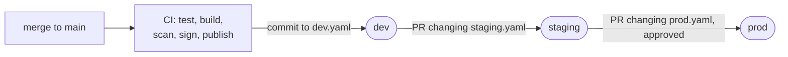

# CI/CD in production

Here, CI/CD runs on your machine. `./pipeline ci` tests, builds, scans and publishes an app to the registry inside the stack. `./pipeline cd` promotes it from dev to staging to prod by changing the app's env file, and Argo CD syncs the change. GitHub Actions only runs checks.

This page shows how a production team would run the same pipeline in CI. The AWS side (ECR, IAM, an Argo CD per cluster) is in [`production-on-aws.md`](production-on-aws.md), under "Images and charts" and "Releases and promotion".

## Why it's local here

- **So you can practise it.** Someone who clones the repo has no CI or registry of their own. If the pipeline ran only on GitHub, they could watch it but not run it. Locally they run every step: publish a version, promote it, fail a gate, roll back.
- **Each cluster follows its own checkout.** A pipeline on GitHub would need every clone's cluster to follow GitHub's main, so everyone would run whatever was merged last.
- **One path to test.** The E2E workflow tests the same `./pipeline` you run.

In production, CI does this instead, because builds must be reviewed, repeatable and signed by a known identity.

## Which CI

GitHub Actions. The code and reviews are already on GitHub, it gets short-lived AWS credentials through OIDC with no stored keys, and cosign can sign with its identity, also without keys. GitHub environments with required reviewers give prod an approval step.

## The stages

[`ci-app.yml`](../.github/workflows/ci-app.yml) already runs most of them on pull requests. Production adds publishing, signing and deploying on main.

| Stage | Here (`./pipeline ci`) | Production, on main |
| --- | --- | --- |
| Lint and test | `npm run lint`, `npm test` | The same, plus the image smoke test and a 60 s k6 gate, as `ci-app.yml` runs on pull requests today |
| Build | `docker build` | amd64 and arm64, pushed by digest |
| Scan | Trivy; fails on a fixable HIGH or CRITICAL | The same. The registry also rescans for CVEs found later |
| Sign | Not signed (the local registry is trusted) | cosign keyless, plus an SBOM |
| Publish | Image and chart version X to the in-stack registry | Image and chart to ECR, with immutable tags |
| Deploy | `./pipeline cd` changes the env file and pushes it to the in-stack Git server | A commit to `dev.yaml`, then promotion PRs for staging and prod |

Pull requests get no secrets and a read-only token. Only main publishes and signs.

## Build once, promote the digest

One version number covers the app's image and its chart. Each env file pins it:

```yaml
# cd/orders-gateway/prod.yaml
version: 1.2.0     # image orders-gateway:1.2.0 and chart orders-gateway 1.2.0
image:
  tag: 1.2.0
  digest: sha256:...
```

The image is built once. `./pipeline cd` writes its digest into the env file, so staging and prod run exactly the image dev ran. Nothing is rebuilt for an environment, and a published version is never overwritten.

In production a release is a Git tag such as `orders-gateway-v1.2.0`. CI on that tag builds and pushes the image, packages the chart (`helm push` to the registry), and signs both.

One number keeps things simple: "deploy 1.2.0 to staging" says everything. The cost is that a chart-only change, such as a probe setting, also needs a new version.

## Promotion by pull request



- **Dev** follows main. CI commits the new version to `cd/<app>/dev.yaml` right after publishing.
- **Staging and prod** move by pull request. The PR changes only that environment's file, so its diff is the release. Merging it is the deploy.
- **Gates** run as checks on the PR. They are the ones `./pipeline cd` applies locally: the previous environment must have run this version, and `scripts/promotion-gate.sh` requires its Argo CD app to be Synced and Healthy with no alert firing for the app. Prod also needs a reviewer's approval. Locally, you are the approver.
- **CI never touches a cluster.** Argo CD in each cluster pulls from Git.
- **Each app** has its own `cd/<app>/` files and its own promotion PRs, so apps release on their own schedules.

A job that merges patch promotions on its own once they've soaked is described in [`production-on-aws.md`](production-on-aws.md), under "Automating patch promotions".

## Rollback

Rollback is a Git change too. In production it's a revert PR of the promotion commit, which puts the previous version back in the env file. The image and chart go back together, and Argo CD syncs it like any other change.

Locally the same thing is `./pipeline rollback <app> <env>`.

Don't use `kubectl rollout undo` or `kubectl set image`: Argo CD would put back what Git says.
