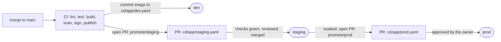

# CI/CD in production

This repo is a practice tool: whoever clones it runs the whole CI/CD loop on their own machine, for two apps (`orders-gateway` and `hello-world`). `./pipeline ci <app> --version X` tests, builds and scans the app, then publishes image and chart as version X to a registry inside the stack. `./pipeline cd <app> <env> --version X` promotes a published version by changing `cd/<app>/<env>.yaml`, in order (dev, then staging, then prod) and through health gates. Argo CD syncs that change from the Git server inside the cluster. `./pipeline rollback` goes back the same way. GitHub only runs checks on pull requests. This page describes how a production team would run the same pipeline in CI, and why this repo runs it locally.

The AWS side (accounts, ECR, IAM, one Argo CD per cluster) is in [`production-on-aws.md`](production-on-aws.md), §3.4 and §3.5. This page covers the pipeline itself.

## 1. Choosing a CI provider

| Provider | For | Against | Verdict |
| --- | --- | --- | --- |
| **GitHub Actions** | The code is already on GitHub. OIDC to AWS and keyless cosign signing work without stored secrets. Environments with required reviewers serve as promotion gates. Big marketplace; actions can be pinned by SHA. | Hosted runners are small (4 CPUs) and per-minute billed. Marketplace actions are a supply-chain risk unless pinned. Complex fan-out gets verbose. | **Recommended.** It's where the repo, reviews and identities already are. Use self-hosted or larger runners for the E2E. |
| GitLab CI | Strong pipelines, built-in registry and environments | Means moving the repo or mirroring it | Only if the organisation is on GitLab |
| Buildkite | Your own runners, fast, good for monorepos with many apps | Another vendor and runner fleet to run | Worth it at many apps, or for heavy builds |
| CircleCI | Fast, good caching | Another vendor; OIDC and signing need more setup | No advantage over Actions here |
| Jenkins | Runs anywhere, fully controllable | Plugin upkeep, security patching, no keyless OIDC by default | No |
| AWS CodeBuild / CodePipeline | Native IAM, runs in the VPC | Weak pull request UX; reviews still happen in GitHub | Only as a runner for steps that must run inside AWS |
| Tekton / Argo Workflows | Kubernetes-native, close to Argo CD | You run the CI system on the clusters it deploys to | No: keep CI outside the clusters |

## 2. The pipeline stages

The stages are the ones `./pipeline ci` and [`ci-app.yml`](../.github/workflows/ci-app.yml) run today. Production moves them into CI, publishes to a real registry and signs for real.

| Stage | Locally (`./pipeline ci`) | On a pull request (`ci-app.yml`, today) | On main (production) |
| --- | --- | --- | --- |
| **Lint** | `npm run lint` | `npm run lint`, hadolint (Dockerfile), plus shellcheck and actionlint in `infra.yml` | same as the pull request |
| **Test** | `npm test` in the Dockerfile's Node image | the same, then a smoke test of the built image (non-root, read-only, endpoints, SIGTERM drain) and a 60 s k6 gate held to the SLOs | same as the pull request |
| **Build** | `docker build` | both architectures (amd64 and arm64), pushed nowhere | both architectures, pushed by digest |
| **Scan** | Trivy, the version CI pins; fails on a HIGH or CRITICAL with a fix | same | same, on the pushed digest. The registry rescans continuously (ECR + Inspector) for CVEs published later |
| **Sign** | not signed: the stack's registry is admitted only locally | a rehearsal against a throwaway local registry | cosign keyless (OIDC identity = this workflow on `refs/heads/main`), an SBOM attached, then `cosign verify` |
| **Publish** | with `--version X`: image `<app>:X` and chart `<app>` X to the stack's registry; a published version can't be overwritten. Without `--version`: a dev-only build | nothing | the image to the registry, and the chart as an OCI package when its version went up (§3) |
| **Deploy** | `./pipeline cd <app> <env> --version X` changes the env file (through the gates, §4) and pushes it to the in-stack Git server | nothing | dev: a commit to `cd/<app>/dev.yaml`. staging and prod: a promotion PR (§4) |

Rules that stay the same everywhere:
- **Pull requests get no secrets and a read-only token.** Only main publishes or signs. Every job declares least-privilege permissions.
- **Pin everything** by digest or commit SHA (actions, Trivy, the Node image), and let Renovate update the pins.
- **Build once, promote the digest.** staging and prod run the same image that dev ran, by digest. Nothing is rebuilt for an environment.
- **The deploy step is a Git change, not a `kubectl` command.** CI never holds cluster credentials. Argo CD in each cluster pulls.

## 3. How the image and the chart ship together

One version number per app covers both. Each environment's file pins it:

```yaml
# cd/orders-gateway/prod.yaml
version: 1.2.0     # image orders-gateway:1.2.0 and chart orders-gateway 1.2.0
```

- **Locally:** `./pipeline ci orders-gateway --version 1.2.0` publishes image `orders-gateway:1.2.0` and chart `orders-gateway` 1.2.0 to the stack's registry, together. The Argo CD Application for that environment takes the chart from the registry at that version, and the values from Git (`cd/<app>/values.yaml` + `<env>.yaml`). dev can also run a dev-only build (no version): the chart from `helm/<app>/` as it is and an unpublished image, so a change is tried in dev before it's released.
- **In production:** a release is a Git tag per app, `orders-gateway-v1.2.0`. CI on that tag builds and pushes the image by digest, packages the chart (`helm package`, `helm push` to `oci://<registry>/charts/<app>`), and signs both with cosign. The registry has immutable tags, and CI refuses a version that exists. Every merge to main also publishes a `sha-<commit>` build that only dev runs.
- **Why one number:** "deploy orders-gateway 1.2.0 to staging" says everything, and the image and chart can't arrive out of order. The cost is that a chart-only change (a probe, a PDB setting) is also a new app version. Teams that need them apart pin `image` and `chartVersion` separately, at the price of a compatibility matrix.
- **Rollback** is the previous version in the env file: image and chart go back together.

## 4. Promotion: a pull request per environment file



- **dev** follows main: CI commits the new image to `cd/<app>/dev.yaml` right after publishing. That's the only direct push to main, made by a GitHub App with a narrow branch-protection bypass.
- **staging and prod** move by pull request. CI opens or updates `promote/staging` with the new version. The PR changes only that environment's file, so its diff is the release. Merging it is the deploy.
- **Gates** run as checks on the promotion PR: dev healthy and within its SLO for a soak period, no firing alerts, an E2E run against the change, then human approval for prod (a GitHub environment with required reviewers). `production-on-aws.md` §3.5 adds a patch promoter that auto-merges patch-only changes once they've soaked.
- **The same gates locally:** `./pipeline cd` refuses a version the previous environment hasn't run (from the env files' Git history), and `scripts/promotion-gate.sh` refuses while the previous environment's Argo CD Application isn't Synced and Healthy or an alert fires there for the app. `--force` skips both, for emergencies. Human approval has no local equivalent: you are the approver.
- **Rollback** is a revert PR of the promotion commit, back to the previous version. Argo CD syncs it like any other change. The same thing locally is `./pipeline rollback <app> <env>`.
- **Many apps:** each app has its own `cd/<app>/` files and its own promotion PRs, so apps release on their own schedules. A pipeline triggered by `apps/<app>/**` (a matrix over changed apps) keeps one workflow for all of them.

## 5. Why this repo runs CI/CD locally

- **It's a practice tool.** Someone who clones the repo has no CI of their own on GitHub and no write access to anyone's registry. If the pipeline only ran on GitHub, they could watch it but not practice it. Locally they run every step: change the app, publish a version, promote it, fail a gate, roll back.
- **Nobody's cluster follows someone else's main.** Each cluster follows the checkout it was started from, through its own Git server. A GitHub-driven pipeline would need the cluster to follow GitHub, so everyone would run whatever was merged last.
- **One mode, not two.** The repo used to have a "GitHub mode" where CI pushed to GHCR, committed to dev and opened promotion PRs. Every change had to work both ways. Now there is one path, and the E2E tests it.
- **What stays on GitHub is what keeps the repo working:** lint, manifest validation, policy and alert tests, each app's pull request checks, security scans, and the E2E (a fresh cluster on a runner: platform build, platform verify, then both apps through `./pipeline ci` and `cd` under traffic). None of them publish or deploy, apart from the toolbox image the scripts run in.

So the local pipeline has the shape of production (stages, versioned and immutable releases, Git-driven deploys, ordered promotion through gates, rollback by Git change), and this page and `ci-app.yml` show what moves to CI in a real setup.
