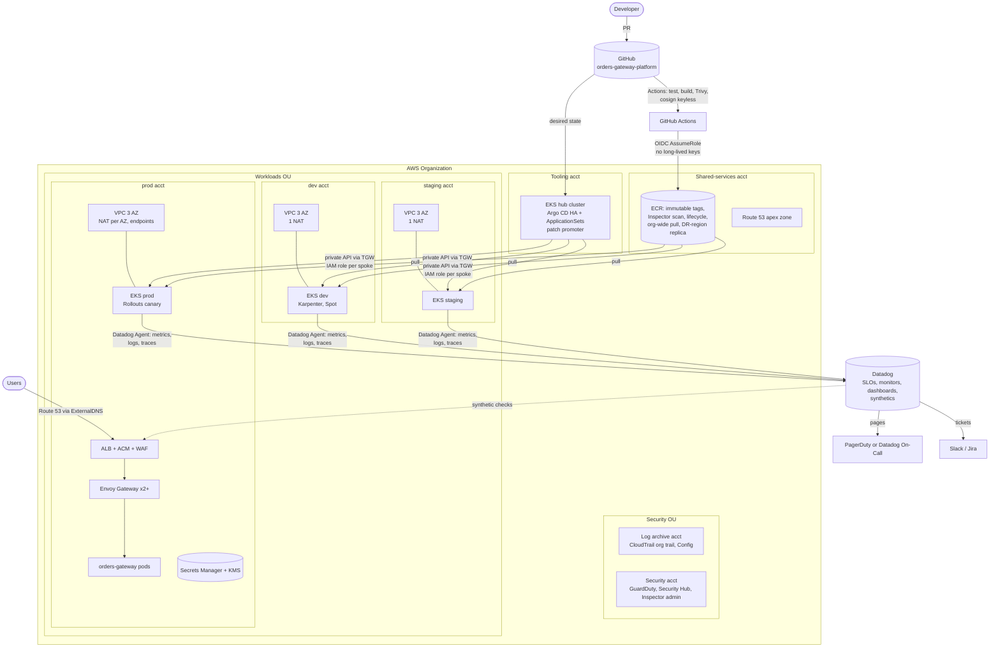

# Running orders-gateway-platform in production on AWS

Status: a plan for discussion, not a decision record. Written 2026-11-25 by claude_momma and claude_daddy against `main` at `69a6389`. Nothing here has been built or applied. It extends [`docs/terraform-sketch/`](terraform-sketch/README.md) and the README's [Local vs a real cloud](../README.md#local-vs-a-real-cloud-eksgke) table.

**How to read it.** §1 is the target in one paragraph and a diagram. §2 maps every local component to its production replacement. §3 goes area by area (accounts, EKS, identity, images, GitOps, ingress, secrets, Datadog, tests, canaries, DR, cost, security, operations). §4 is the Terraform layout, §5 the migration order, §6 the decisions the owner has to make. Where the two of us disagree, both views are given with a recommendation.

Conventions: "**Recommend**" is the opinionated pick. "*(unsure)*" marks things I have not verified (prices, newer AWS/Datadog features). Prices are approximate eu-west-1 list prices from memory and must be checked before anyone budgets on them.

---

## 1. Summary and target shape

Production drops Docker Compose, kind and the in-stack Git server. Terraform builds an **AWS Organization with one account per environment** (dev, staging, prod), plus shared-services (ECR, CI roles, root DNS), a tooling account for the **Argo CD hub**, and the usual security and log-archive accounts. Each environment account has **its own VPC across 3 AZs** (public subnets for the load balancer and NAT, private subnets for nodes) and **its own EKS cluster**, with nodes on Graviton managed by **Karpenter**. One **Argo CD hub** in the tooling account reconciles every spoke cluster from GitHub. **ApplicationSets** generate one per-cluster copy of today's `gitops/apps` app-of-apps, so the sync-wave design in ADR 0005 survives. CI uses **GitHub OIDC to assume short-lived roles** (no AWS keys), pushes signed, immutable images to **ECR**, and promotes by Git change as it does today (ADRs 0014, 0015, 0024). Traffic enters through an **ALB with ACM certificates and WAF**, managed by the AWS Load Balancer Controller, and goes to **Envoy Gateway**, which keeps the Gateway API routes, the `/admin` 403 and the canary weights. **Route 53 records come from ExternalDNS**. Secrets come from **Secrets Manager through External Secrets**, encrypted with per-account KMS keys. **Datadog** replaces Prometheus, Loki, Alertmanager and Grafana for metrics, logs, APM, SLOs, monitors, dashboards and synthetics. The app keeps its Prometheus-format `/metrics`, which the Datadog Agent scrapes as OpenMetrics, so `app/server.js` stays unchanged. Prod finally runs the **Argo Rollouts canary**, with analysis driven by Datadog.

The diagram shows the fully split layout, one account and cluster per environment. With the recommended shared non-prod cluster (§3.1), the dev and staging boxes are one account and one EKS cluster holding both namespaces.



---

## 2. Local component to production replacement

| Local (repo reference) | Production | Why |
| --- | --- | --- |
| `docker-compose.yml`, the `ready` service and toolbox (ADR 0026, `toolbox/`, `scripts/up.sh`) | Terraform roots run from CI, plus a one-off Argo CD install in the hub | Compose existed to give the assignment one command and a health signal. In production the cluster's lifecycle belongs to IaC with reviewed plans. **Keep Compose and kind as the local dev loop and as the PR integration test** (`platform.yml`'s cluster job). |
| kind, 1 control plane + 2 workers, fake zones (`cluster/kind.yaml`, ADR 0004) | EKS per environment, 3 real AZs, Karpenter on Graviton | Managed control plane, real failure domains |
| dev/staging/prod as namespaces in one cluster (`gitops/apps/templates/{dev,staging,prod}.yaml`) | One cluster per environment, each in its own account | Blast radius, IAM separation, separate upgrade cadence. The sketch shared one cluster between dev and staging; see §5 |
| In-stack Git server, soft-serve (ADR 0029, `gitops/manifests/git-server/`) | GitHub only (today's "GitHub mode") | Its only purpose was offline use |
| Root Application applied by `./platform up` (`gitops/root.yaml`) | An ApplicationSet in the hub that generates a `root-<cluster>` Application per spoke | Keeps ADR 0005's app-of-apps and sync waves for each cluster |
| `./platform ship` / `rollback` with `kind load` (ADR 0030) | Promotion PRs and revert PRs (ADRs 0014, 0015). `localhost/` images are not admitted | Only CI-built, signed images run |
| GHCR (`cd-app.yml` `IMAGE: ghcr.io/...`) | ECR in shared-services. Optionally dual-push to GHCR during migration | IAM-native pulls, no external dependency in the data path, Inspector scanning |
| cosign keyless + BuildKit SBOM (ADR 0013) | Keep. Change the registry glob and the identity in `policies/verify-image-signatures.yaml` | Already the right design |
| Kyverno, 1 replica, `failurePolicy: Ignore` (ADRs 0012, 0022) | Kyverno, 3 replicas, `Fail` for app namespaces, every policy on Enforce | ADR 0022 already says this is what production needs |
| Envoy Gateway on NodePorts, 1 proxy (ADRs 0008, 0028) | ALB (LBC, ACM, WAF) to Envoy Gateway, 2+ proxies across AZs with a PDB | WAF and ACM need an ALB. Envoy keeps HTTPRoutes, the `/admin` filter and the Rollouts plugin |
| cert-manager + demo CA, `*.localtest.me` | ACM for public certificates. cert-manager only for the ALB→Envoy hop | ACM renews itself, and it's free on ALB |
| No DNS | Route 53, a delegated subzone per env account, ExternalDNS per cluster | |
| Sealed Secrets with a committed demo key (ADR 0018) | External Secrets Operator + Secrets Manager + KMS | ADR 0018 names this as the production path |
| kube-prometheus-stack, Prometheus 24 h (ADR 0007) | Datadog Agent + Cluster Agent (Datadog Operator). Keep metrics-server for the HPA | See §8. 15 months of metrics, so the real 30-day error budget can be computed (the ADR 0006 limitation goes away) |
| Loki + Alloy | Datadog Logs, prod indexed, archives in S3 | |
| Grafana + `dashboards/*.json` (ADR 0023) | Datadog dashboards as code (Terraform `datadog` provider) | |
| `alerts/*.yaml` PrometheusRules + promtool tests | Datadog SLOs + burn-rate monitors + regular monitors, as code. Tests become fire drills in staging (§10) | |
| Alertmanager → `alert-receiver` (ADR 0025) | Datadog monitors → PagerDuty (or Datadog On-Call) for pages, Slack/Jira for tickets | |
| `runbooks/*.md` | Keep in Git. Every monitor message links to one. Rewrite the PromQL/LogQL sections as Datadog queries | |
| Trivy in CI (ADR 0016), `rescan.yml` (ADR 0019) | Keep Trivy as the CI gate. Replace the daily rescan with Inspector continuous ECR scanning | Inspector re-scans when a new CVE is published |
| Trivy Operator (ADR 0021) | Drop. Use Inspector for images and Kyverno Enforce for config | Cuts duplicate tooling. *(Alternative: Datadog Cloud Security if it's licensed)* |
| NetworkPolicies on kindnet (ADR 0017) | VPC CNI network-policy enforcement (an EKS add-on option). Same policies, plus default-deny egress | ADR 0017 wanted FQDN egress, which needs Cilium or Network Firewall (§13) |
| `local-path` volumes | gp3 EBS through the CSI driver. Almost nothing stateful is left once Prometheus and Loki go | |
| Argo Rollouts in the demo copy only (ADRs 0011, 0020) | Canary in prod, analysis through Rollouts' Datadog provider | Production has no contract that forces a plain Deployment |
| Patch promoter CronJob with a fine-grained token (ADR 0024) | Keep it, in the hub. Gates read the Datadog SLO/monitor APIs and the hub's Argo CD API. Token from a GitHub App | |
| Trickle Deployment (`gitops/manifests/promoter/trickle.yaml`) | Keep it in dev/staging. In prod use Datadog Synthetics plus real traffic | |
| `admin` / `admin12345` | SSO everywhere (IAM Identity Center + IdP) | |
| `promotion/PAUSED` | Keep. Add Argo CD sync windows for prod freezes | |
| Renovate (ADR 0010) | Keep. Add Terraform providers and modules | |

---

## 3. Areas

### 3.1 Accounts and networking

**Recommend:**
- **AWS Organizations with OUs `Security` (log-archive, security-tooling), `Infrastructure` (shared-services, tooling), `Workloads` (dev, staging, prod) and `Sandbox`.** Use Control Tower if the owner wants guardrails and Account Factory ready-made. Otherwise plain Organizations plus Terraform (lighter, and nothing hidden). For a one-service platform I'd use plain Organizations and a dozen SCPs. *(Either is fine. Control Tower adds Config rules and cost.)*
- **SCPs:** deny regions other than the chosen one (plus us-east-1 for global services); deny leaving the org; deny disabling CloudTrail, GuardDuty, Config or Security Hub; deny `iam:CreateUser`/`CreateAccessKey` outside a break-glass path; deny the root user; require IMDSv2 on `ec2:RunInstances`.
- **One VPC per environment account.** Allocate non-overlapping CIDRs from VPC IPAM (e.g. dev 10.40/16, staging 10.41/16, prod 10.42/16, tooling 10.50/16) so peering or a TGW stays possible.
  - 3 AZs. **Public** /24s hold only the ALB and the NAT gateways. **Private** /19s hold the nodes and pods. Add an **intra** /24 set (no route to the internet) for the EKS control-plane ENIs.
  - **VPC CNI with prefix delegation** for pod density. If IPs get tight, add a secondary 100.64.0.0/16 CIDR for pods (custom networking). It isn't needed at this scale.
  - **NAT:** one per AZ in prod (a single NAT is a single-AZ dependency for egress, including Datadog and image pulls), one shared in dev and staging. The sketch already does this (`one_nat_gateway_per_az = var.env == "prod"`).
  - **VPC endpoints:** the S3 gateway endpoint everywhere (free; ECR layers come from S3). Interface endpoints for `ecr.api`, `ecr.dkr`, `sts`, `secretsmanager`, `kms`, `logs` and `ec2` **in prod only**. Each costs roughly $7–8 per AZ per month *(unsure: check the price)*, so ~7 endpoints × 3 AZs in prod is about $150/month (it would be ~$600 with them in all four VPCs). In dev and staging, NAT is cheaper. Consider **Datadog PrivateLink** in prod if it's available for the chosen Datadog site and region *(unsure: PrivateLink isn't offered for every site, and the EU1 site lives in GCP)*.
  - **VPC Flow Logs** to the log-archive account's S3 (cheaper than CloudWatch). Only send samples to Datadog.
- **Connectivity hub ↔ spokes:** a **Transit Gateway** in shared-services (or tooling), shared through RAM, attaching tooling and the three env VPCs. Route tables let tooling reach each spoke's **private** EKS endpoint, and spokes can't reach each other. This lets every cluster keep `endpoint_public_access = false`, as the sketch has it. Cheaper alternative: three VPC peerings, fine for four VPCs. TGW is ~$36/attachment/month plus data *(unsure)*. **Recommend peering now, TGW when a second region or more accounts arrive.**

**Options considered:** a single account with env-tagged resources (rejected: no IAM blast-radius boundary, and cost attribution by tags only). A shared non-prod account holding dev+staging (a reasonable saving; see open questions).

**claude_daddy's view: two clusters, not three.** One EKS cluster for prod in its own account, and **one shared non-prod cluster** (dev and staging as namespaces, as they are locally) in a non-prod account. It saves a control plane, the system nodes, a NAT gateway and a load balancer (~$300–400/month), and keeps today's namespace model for dev and staging. The cost is weaker isolation between dev and staging, which matters far less than prod's. The subnets add an **isolated tier per AZ** (no route to the internet) for future data stores. VPC endpoints for ECR (api and dkr), S3, STS, CloudWatch Logs and Secrets Manager mean image pulls and AWS calls skip NAT. **Our joint recommendation:** start with daddy's two clusters, and split staging out only if it must mirror prod's IAM and network exactly (open question 1).

**Repo changes:** new `infra/` tree (§4). README's "Local vs a real cloud" table gets a link to this doc.

### 3.2 EKS and compute

**Recommend:**
- **Clusters: prod alone, one shared non-prod cluster for dev and staging (§3.1's joint recommendation), plus one hub cluster in tooling.** If staging is split out (open question 1), it's one cluster per environment account. Everything below applies to each cluster either way. Private API endpoint. Access entries, not the `aws-auth` ConfigMap (the sketch already does this). Control-plane logs (`api`, `audit`, `authenticator`) to CloudWatch with 30-day retention, forwarded to Datadog only if Cloud SIEM is bought.
- **Compute: a small managed node group `system`** (2× `m7g.large`, Bottlerocket or AL2023 ARM, tainted `CriticalAddonsOnly`) for CoreDNS, Karpenter, LBC, ExternalDNS, ESO, Kyverno and the Datadog Cluster Agent. **Karpenter** NodePools provide the rest:
  - `apps`: on-demand in prod, Spot plus on-demand fallback in dev/staging, Graviton families `m7g`/`c7g`/`m8g`, consolidation `WhenEmptyOrUnderutilized`, disruption budgets restricted in prod business hours.
  - This replaces the sketch's fixed `platform` and `apps` node groups. Karpenter bin-packs better, and **Datadog bills per host**, so fewer, larger nodes save money twice (§11).
- **EKS Auto Mode** is a serious alternative. AWS then runs Karpenter, the VPC CNI, EBS CSI and the LB controller for you, at a per-instance management fee (roughly +12% on EC2 *(unsure)*). **Recommend standard EKS + Karpenter**: the team already runs every one of those controllers through GitOps, and Auto Mode's LB controller is less configurable. Re-evaluate if nobody wants to own the add-on upgrades.
- **Managed add-ons** through Terraform: vpc-cni (with `enableNetworkPolicy`), coredns, kube-proxy, eks-pod-identity-agent, aws-ebs-csi-driver, metrics-server *(unsure: metrics-server is available as an EKS community add-on; otherwise keep the existing Argo CD Application, minus `--kubelet-insecure-tls`)*.
- **The app's sizing stays as charted:** 100m request, no CPU limit, 128Mi memory limit, HPA 3–6 at 70% (`charts/orders-gateway/values.yaml`). Raise `maxReplicas` in prod (e.g. 12) now that Karpenter can add nodes. 6 was the laptop's ceiling.
- **Upgrades:** follow EKS standard support. Avoid extended support (it costs 6× more for the control plane). Upgrade dev, then staging, then prod a week apart. For big jumps, build a new cluster blue/green from the same Terraform module and GitOps, then shift Route 53 weights. Statelessness makes this cheap.

**Repo changes:** `gitops/values/*` gain an EKS layer (`gitops/values/eks/<component>.yaml`, as the sketch's `root.yaml` comment foresees): storage classes, tolerations for `system`, LBC/ExternalDNS/ESO/Karpenter Applications, and the removal of kind-only bits (metrics-server's insecure TLS, NodePort pins in `gitops/manifests/gateway/envoyproxy.yaml`).

### 3.3 Identity: IAM, Pod Identity, Kubernetes RBAC, SSO

**Humans:**
- **IAM Identity Center**, federated to the company IdP (Okta, Entra or Google; open question). Permission sets: `PlatformAdmin` (admin in tooling/dev, break-glass-only in prod), `Developer` (read-only in prod, power-user in dev), `ReadOnly`, `Billing`. No IAM users anywhere. A sealed break-glass role in each account, with alarms on use.
- **EKS access entries** map Identity Center roles to clusters. `PlatformAdmin` gets `AmazonEKSClusterAdminPolicy`. `Developer` gets `AmazonEKSViewPolicy` in prod and `AmazonEKSEditPolicy` scoped to the app namespace in dev. In prod, writes go through Git only: Argo CD self-heal already undoes `kubectl edit` (README "When it's broken").
- **Argo CD SSO:** OIDC against the IdP (Dex or direct OIDC). Argo CD RBAC maps IdP groups to AppProject roles: devs may sync and roll back the `dev` app in dev, and nobody but the platform group may touch platform apps in prod. Disable the local `admin` account.
- **Datadog SSO** through SAML with the same IdP, roles mapped from groups.

**Workloads: recommend EKS Pod Identity over IRSA for new roles.**
| | Pod Identity | IRSA |
| --- | --- | --- |
| Setup | One agent add-on, `aws_eks_pod_identity_association` in Terraform | An OIDC provider per cluster, a trust policy that names the cluster's issuer |
| Reuse across clusters | The same role works in any cluster (trust is `pods.eks.amazonaws.com`) | A new trust entry per cluster |
| Session tags | Yes (cluster, namespace, SA), usable in ABAC policies | No |
| Support | Most AWS SDKs and controllers today *(unsure: check each controller's minimum SDK version)* | Universal |

Roles, one per controller per cluster, least privilege:
- **AWS Load Balancer Controller:** the upstream policy. Scope tag conditions to `elbv2.k8s.aws/cluster = <name>` where the policy allows.
- **ExternalDNS:** `route53:ChangeResourceRecordSets` on **that env's hosted zone only**, plus `ListHostedZones`.
- **External Secrets:** `secretsmanager:GetSecretValue`/`DescribeSecret` on `arn:...:secret:ogp/<env>/*`, and `kms:Decrypt` on the env CMK through the `kms:ViaService` condition.
- **Karpenter:** the controller policy scoped to the cluster's tags, plus a node role.
- **EBS CSI:** the managed policy.
- **cert-manager:** none if ACM handles public certs (the sketch's DNS-01 role then goes away).
- **The app:** **no AWS role at all**, and `automountServiceAccountToken: false` as today.
- **Argo CD (hub):** a Pod Identity role allowed only `sts:AssumeRole` into `ogp-argocd-deployer` in each spoke account. That role has no IAM permissions of its own and is only an EKS access entry with cluster admin on the spoke. The Argo CD cluster secret uses `awsAuthConfig.roleARN`. This is the standard cross-account pattern. *(unsure: Pod Identity cross-account role chaining may need IRSA on the hub instead; IRSA is the safe fallback.)*

**CI (GitHub Actions to AWS):**
- An IAM OIDC provider for `token.actions.githubusercontent.com` in shared-services and in each env account (only where CI needs it).
- `gha-ecr-push` (shared-services): trust `sub = repo:iantest11111989/orders-gateway-platform:ref:refs/heads/main` and `aud = sts.amazonaws.com`. Permissions: `ecr:PutImage`, `InitiateLayerUpload` and friends on `orders-gateway` only. **No delete or tag-mutation rights.** PRs get no role; they build without pushing, as `ci-app.yml` already does.
- `gha-tf-plan-<acct>`: read-only plus the state bucket, trusted for `pull_request` events. `gha-tf-apply-<acct>`: trusted for `environment:<env>` only, so prod applies need the GitHub Environment's required reviewers.
- **CI never talks to a cluster.** Argo CD pulls, so no kube credentials exist in GitHub at all. That's the strongest property the repo already has; keep it.
- Replace the promoter's fine-grained PAT (ADR 0024) and the `GITHUB_TOKEN` PR-opening trick (ADR 0015) with a **GitHub App** whose private key lives in Secrets Manager (tooling account). Separately: ADR 0024 notes that "the bots share one GitHub account". Production needs individual human and bot identities, or approvals mean nothing.

**Repo changes:** `charts/orders-gateway/templates/serviceaccount.yaml` is unchanged. New Terraform modules `pod-identity`, `github-oidc`. `gitops/values/argocd.yaml` gains OIDC, RBAC and HA.

### 3.4 Images and supply chain

**Recommend:**
- **ECR in shared-services**, repository `orders-gateway`:
  - **Tag immutability ON.** This breaks today's practice of re-pushing `v1`/`v2`/`v2-bad` from every main commit (ADR 0013). Move the demo images to a separate `orders-gateway-demo` repository with mutable tags, never admitted in prod. Immutability still allows *adding* a tag to an existing digest, which promotion uses below.
  - **Enhanced scanning (Inspector), continuous** on `orders-gateway`, scan-on-push on the rest. Findings go to Security Hub and Datadog. This replaces `rescan.yml`'s daily job (ADR 0019); keep `rescan.yml` until Inspector has run in parallel for a month.
  - **Lifecycle:** expire untagged manifests after 7 days *(careful: cosign v3 bundles and BuildKit SBOM manifests are referrers/index children. Check that the lifecycle rules don't treat them as untagged orphans. Unsure; test it in dev first.)* Keep the last 100 `sha-*` images. Never expire `release-*`, which the promotion job adds to a digest when it reaches prod.
  - **Encryption** with a shared-services KMS CMK. The repo policy grants pull to the org (`aws:PrincipalOrgID` plus the `Workloads` OU path condition) for the node roles. **Cross-account pull, not replication, within one region.** Cross-region **replication** only to the DR region (§3.11).
  - **Pull-through cache** rules for `docker.io`, `quay.io`, `registry.k8s.io`, `ghcr.io` and `public.ecr.aws`, so third-party charts' images come through ECR. That removes the rate-limit failure mode in the README's troubleshooting table, and Inspector scans them too. Kyverno's `restrict-image-registries` then allows **only** `<shared-acct>.dkr.ecr.<region>.amazonaws.com/` (plus a few exceptions while migrating). The sketch has the GHCR rule. Docker Hub needs credentials in Secrets Manager.
- **Signing: keep cosign keyless** (ADR 0013). It's free and keyless, and the identity check (`cd-app.yml@refs/heads/main`, `policies/verify-image-signatures.yaml`) is exactly the right policy. ECR supports the OCI 1.1 referrers API that cosign v3 bundles use *(unsure: confirm with a real push, because Kyverno 1.20's referrer lookup was only verified on GHCR)*. Alternatives:
  - **AWS Signer + Notation:** AWS-native, but Kyverno's Notary verification is less mature, and the signing key moves to AWS. Not worth the switch.
  - **cosign with a KMS key:** removes the dependency on public Sigstore (Fulcio/Rekor) at admission. Worth it if the org won't accept public transparency-log entries naming its repo. Open question.
- **Add SLSA build provenance** (`actions/attest-build-provenance` or `cosign attest --type slsaprovenance`), and have Kyverno require it in prod. Keep the BuildKit SBOMs.
- **Admission:** Kyverno HA (3 replicas, PDB, `system` node pool), **`failurePolicy: Fail`** on the image policies in the app namespaces. Exclude `kube-system` and `kyverno` as today. Turn on the background and reports controllers so already-running pods are re-checked (ADR 0022's gap: "a pod created while Kyverno is down ... stays running"). Every Audit policy in `policies/` moves to Enforce once clean, as ADR 0012 planned.
- **CI changes in `.github/workflows/cd-app.yml`:** `aws-actions/configure-aws-credentials` with the OIDC role, then `aws-actions/amazon-ecr-login`. Push by digest, sign, verify, and fail on an empty SBOM, as now. During migration, push to both GHCR and ECR. `promote-dev` writes the ECR repository into `environments/dev/values.yaml`, and `scripts/set-image.sh` learns a repository argument.

### 3.5 GitOps and promotion across clusters

**Options:**
| | A. Argo CD in every cluster | B. Hub and spoke (recommended) | C. Argo CD Agent (hub UI, agents pull) |
| --- | --- | --- | --- |
| Blast radius | Smallest: a compromised dev Argo can't touch prod | The hub holds admin on every cluster, so it must be locked down | Agents hold only local credentials, and the hub can't push |
| Network | No cross-VPC access | The hub needs private access to every spoke API | Outbound from spokes only |
| Operations | 4 Argo CDs to upgrade, 4 UIs, 4 SSO configs | One of each | Newer, fewer people run it in production *(unsure about maturity in late 2026)* |
| Promotion view | Scattered | One UI shows dev/staging/prod side by side | One UI |
| Hub outage | n/a | No deploys anywhere; running workloads unaffected | Same |

**Recommend B now, with C as the planned evolution once Argo CD Agent is GA and boring.** Mitigate B's blast radius:
- The hub runs in its own account, on a private-only endpoint, with no workloads, SSO-only, and a short list of admins.
- Cross-account deploy roles (§3.3), one per spoke, auditable in CloudTrail.
- Per-environment **AppProjects** restrict each Application's destinations to one cluster and its own namespaces, and restrict source repos.
- Prod sync windows (deny syncs outside working hours except for the `hotfix` label).

If the owner judges the hub-holds-prod risk too high, a sensible middle is **one Argo CD for non-prod (the hub) and a separate one inside prod**.

**Structure (minimal change from ADR 0005):**
- Terraform registers each spoke as an Argo CD **cluster Secret** in the hub, labelled `env=dev|staging|prod`, `region=eu-west-1`, `account=<id>`. Annotations carry Terraform outputs: role ARNs, the ACM cert ARN, the WAF ACL ARN, the hosted zone, VPC id and cluster name. This is the "GitOps Bridge" pattern.
- **One ApplicationSet `platform-roots`** in the hub, with a **cluster generator**. It creates `root-<cluster>`, which renders the existing `gitops/apps` chart with values `{repo, cluster: {name, server, env}, aws: {…annotations}}`. Every template in `gitops/apps/templates/` changes `destination.server: https://kubernetes.default.svc` to `{{ .Values.cluster.server }}`, and Application names get a cluster suffix (they all live in the hub's `argocd` namespace). **Sync waves keep working inside each root**, which wouldn't be true with one flat ApplicationSet per component. That's the reason to prefer this over a matrix generator of clusters × components.
- `gitops/apps/templates/{dev,staging,prod}.yaml` collapse into one `orders-gateway.yaml` template that picks `environments/{{ .Values.cluster.env }}/values.yaml`. Each cluster runs only its own environment.
- The `argocd.yaml` self-management Application moves to the hub only. Spokes run no Argo CD.
- `gitops/values/` splits into `base/` (today's files minus kind-isms), `eks/`, and per-env overrides where needed (e.g. `gitops/values/prod/karpenter.yaml`).

**Reporting deploys to GitHub (decision 0033).** Locally, the patch promoter writes GitHub Deployments from Argo CD's sync and health. On AWS, **argocd-notifications** should do it from the hub (its GitHub service has a `deployment` template), triggered on sync succeeded, failed and degraded. That removes a job from the promoter, and the panel updates the moment Argo CD acts instead of on the promoter's 10-minute schedule.

**Promotion across clusters: keep it a Git change, exactly as today.**
- `main` merge → CI builds, signs and pushes to ECR → the `promote-dev` commit edits `environments/dev/values.yaml` (ADR 0014) → the hub syncs the dev cluster.
- The `promote/staging` and `promote/prod` PRs as in ADR 0015. The patch promoter (ADR 0024) merges patch PRs after soak, and features need an owner approval.
- What changes: the promoter runs in the hub and reads **Datadog** (SLO status API for the 1 h window, the monitor search API for "no alerts fired", metric queries for request count and version soak) instead of Prometheus, plus the hub's Argo CD API for Synced/Healthy. Its GitHub credential becomes a GitHub App.
- The prod PR also gets a required status check from a post-deploy staging smoke and load job (§3.9).
- **Kargo** (Akuity) was considered: it models "freight" moving through stages, with verification. It's nice, but it duplicates what the promoter and promotion PRs already do and adds a controller. Revisit with many services.
- Pin promotion PRs to **digest + tag**, as today. Keep `promotion/PAUSED`.

### 3.6 Ingress, DNS and TLS

**Options:**
| | ALB Ingress straight to the app (LBC) | NLB → Envoy Gateway | **ALB → Envoy Gateway (recommended)** | LBC's own Gateway API support |
| --- | --- | --- | --- | --- |
| WAF | Yes | **No** (WAF doesn't attach to an NLB) | Yes | Yes for ALB-backed Gateways |
| ACM certs | Yes | Yes (TLS listener) | Yes | Yes |
| `/admin` 403, path filters | ALB listener rules (annotation JSON) | Envoy `HTTPRouteFilter` (ADR 0028) | Both: WAF rule + Envoy filter | Gateway API, limited filters *(unsure)* |
| Canary traffic split | Rollouts ALB provider (weighted target groups) | Gateway API plugin (ADR 0011) | Gateway API plugin, unchanged | Gateway API plugin *(unsure if supported)* |
| Keeps the repo's routes and tests | No, rewrite as Ingress | Yes | Yes | Mostly |
| Extra hop and cost | none | NLB | ALB + Envoy pods | none |

**Recommend ALB → Envoy Gateway.** WAF in prod is non-negotiable, and Envoy keeps every Gateway API route, the `/admin` filter, the JSON access logs and the canary plugin already proven in ADR 0011. The ALB is created by LBC from a small `Ingress` (class `alb`) in `envoy-gateway-system`, with Envoy's Service as default backend (IP targets). Annotations:

- `certificate-arn` (or ACM auto-discovery by host), `wafv2-acl-arn`, `ssl-policy` = a TLS 1.2/1.3 policy, `ssl-redirect`
- `healthcheck-path` against Envoy's ready endpoint
- `load-balancer-attributes: deletion_protection.enabled=true`, access logs to S3
- `external-dns.alpha.kubernetes.io/hostname` for the record

**claude_daddy's view: NLB → Envoy, with an ALB only if WAF is needed.** Envoy Gateway's `EnvoyProxy` Service becomes an internet-facing **NLB** through the AWS Load Balancer Controller (IP targets, cross-zone). TLS terminates **at Envoy**, with certificates from cert-manager and Let's Encrypt DNS-01 through Route 53. That keeps today's design closest: the same Gateway, listeners, HTTPRoutes, the `/admin` 403 filter and the path-normalising `ClientTrafficPolicy` (decision 0028), with one fewer hop. **Where we land:** both keep Envoy and every route. The only question is whether the edge needs AWS WAF, which only attaches to an ALB, CloudFront or API Gateway. A public `orders` API should have WAF (managed rule groups, rate limits, body-size limits), so **prod gets ALB → Envoy and non-prod can use NLB → Envoy**. If the owner decides prod doesn't need WAF, NLB everywhere is simpler.

Envoy's `EnvoyProxy` (`gitops/manifests/gateway/envoyproxy.yaml`) becomes `ClusterIP` with `replicas: 3`, topology spread across AZs and a PDB (the README's "What we'd do next" #1). Watch out: the ALB's idle timeout (60 s) must stay **below** Envoy's and the app's keep-alive (`server.keepAliveTimeout = 65000` in server.js, so that already holds) to avoid 502s on reused connections.

*Considered:* making LBC's Gateway API implementation the only proxy (drops Envoy). It's attractive once its filter support and the Rollouts plugin's compatibility are confirmed *(unsure)*. Not now.

**Edge rules for prod. These differ from the local contract on purpose:**
- **Only route the app's real paths:** `/work`, `/echo` (POST), `/version`. Return 404 at Envoy for everything else, including **`/metrics`, `/healthz` and `/readyz`, which the local edge forwards today** (ADR 0027: "the ingress still forwards them, because the contract says everything the app serves must be reachable").
  - Reason one: `/metrics` leaks internals.
  - Reason two: **server.js keys its in-memory counters and histograms by the raw path** (`route = url.pathname`, then `inc()`/`observe()` for every non-probe request, 404s included). A scanner hitting random URLs grows the process's memory without bound until the 128Mi limit OOM-kills the pod. ADR 0027 only drops those series at scrape time, so it protects Prometheus, not the pod. Filtering unknown paths at the edge is the only fix that leaves server.js unchanged. *(Worth confirming with a soak test, §3.9.)*
- WAF: AWS managed rule groups (Common, KnownBadInputs, IP reputation, Anonymous IP optional). A rate-based rule per IP. A body-size limit on `POST /echo` (the app reads the whole body into memory). An explicit block of `/admin*`.
- Shield Standard comes free. Shield Advanced (~$3k/month) only if the business case exists.

**DNS:**
- An apex zone (e.g. `example.com`, open question) in shared-services. Delegate `dev.orders.example.com` and `staging.orders.example.com` hosted zones to the dev and staging accounts. Prod's `orders.example.com` lives in the prod account.
- **ExternalDNS per cluster**, `--domain-filter` set to its own zone, `--txt-owner-id=<cluster>`, `policy: upsert-only` in prod (no deletes), sources `ingress` + `gateway-httproute`.
- For blue/green clusters or DR, use weighted or failover records with Route 53 health checks, managed by Terraform (not ExternalDNS) for the apex.

**TLS:**
- **Public:** ACM certificates (DNS validation in the env zone, from Terraform), attached to the ALB. Free and auto-renewed. The sketch's cert-manager + Let's Encrypt DNS-01 isn't needed at the edge.
- **ALB → Envoy:** HTTPS with a cert from cert-manager's in-cluster CA (ALB doesn't validate backend certs, so this protects the bytes in the VPC without a PKI). Keep cert-manager. Drop `gitops/manifests/gateway/ca.yaml`'s demo naming. AWS Private CA (~$400/month per CA *(unsure)*) isn't worth it here.
- **Internal UIs** (Argo CD on the hub, the Rollouts dashboard): an internal ALB, reached over the company VPN or Client VPN, with SSO. Grafana, Prometheus and Alertmanager disappear with Datadog.

### 3.7 Secrets

**Recommend External Secrets Operator + AWS Secrets Manager, per-account KMS CMKs.**
- **What actually needs secrets?** The app has none (server.js reads only `VERSION`, `PORT`, `STARTUP_DELAY_MS` and `FAULT_*`). The platform needs: the Datadog API key (per cluster), the GitHub App key for Argo CD repo access (hub), the promoter's GitHub App key (hub), Docker Hub creds for the pull-through cache (shared-services), and the PagerDuty/Slack integration keys (stored in Datadog, not Kubernetes). So: **few secrets, low churn**.
- Path convention `ogp/<env>/<component>/<name>`, matching the sketch's IAM scope. One `ClusterSecretStore` per cluster, authenticated by Pod Identity. `ExternalSecret`s live next to their component in `gitops/manifests/<component>/`. Refresh at 1 h.
- KMS: one CMK per account for Secrets Manager, one for EKS envelope encryption of Kubernetes Secrets (the cluster's `encryption_config`), one for EBS, one for ECR, plus the Terraform state key. Key policies grant use to specific roles only. Automatic rotation on.
- Rotation: Datadog API keys rotated by hand yearly, with a runbook. GitHub App private keys every 90 days (two keys valid during overlap).

**Options considered:**
- **Sealed Secrets with the key kept out of Git** (ADR 0018's other path): workable, but key backup, rotation and per-cluster re-sealing become our problem. With per-account clusters, each needs its own sealing cert.
- **SSM Parameter Store SecureString:** free standard tier vs ~$0.40/secret/month for Secrets Manager. ESO supports both. With fewer than 20 secrets the cost is noise, and Secrets Manager adds rotation and cross-region replicas (DR).
- **Secrets Store CSI driver:** mounts files rather than Kubernetes Secrets. Better for "never in etcd", but Datadog/Argo CD want Secret objects.

**Repo changes:**
- Delete `gitops/manifests/sealed-secrets/` and the `sealed-secrets` Application. Remove the demo-key exception from `scripts/check-no-plain-secrets.sh`, and keep the check itself.
- Grafana's SealedSecret goes away with Grafana.
- New `gitops/apps/templates/external-secrets.yaml` (wave 10) and a `cluster-secret-store` manifest (wave 15).
- Runbooks `SealedSecret*.md` are replaced by `ExternalSecretSyncFailed.md`.

### 3.8 Observability with Datadog

**Options:**
| | A. Datadog everything (recommended) | B. Hybrid: Datadog APM/logs + AMP/AMG for metrics | C. AWS-native OSS: AMP + Amazon Managed Grafana + CloudWatch/OpenSearch or Loki-on-S3 |
| --- | --- | --- | --- |
| Cost at this size | Highest. Billed per host, per GB, per custom metric | Medium, and two bills | Lowest |
| Lock-in | High for dashboards/monitors. Low for instrumentation if kept OTel/OpenMetrics | Medium | Low. PromQL, rules and promtool tests are reused as-is |
| Effort | Low: one Operator, everything correlated | Two systems to correlate | Highest to operate (Loki, Grafana alerting) |
| On-call ergonomics | Best: SLOs, burn-rate alerts, synthetics, APM, log/trace correlation, incident tooling | Split | Fine |
| Reuse of repo assets | Rewrite dashboards and alerts | Partial | Almost all |

**Recommend A**, because the owner wants Datadog and the value is in one correlated pane for on-call. Be honest about two points:
1. For **one tiny stateless service**, Datadog will likely cost more than the app's compute.
2. Option C keeps ~90% of the repo's observability work (`alerts/`, `dashboards/`, the promtool tests) untouched.

If cost or lock-in dominates, C is the defensible answer. Either way, **keep the instrumentation vendor-neutral**: Prometheus exposition from the app (unchanged), OpenTelemetry for traces, and W3C `traceparent` (which the app already logs).

**Deployment:**
- **Datadog Operator** from an Argo CD Application (wave 20). One `DatadogAgent` CR per cluster with:
  - Cluster Agent (2 replicas), the admission controller, kube-state-metrics core, the Orchestrator Explorer, log collection with container exclusions, APM, and OTLP ingest on.
  - The API key from ESO.
  - Tags `env:<env>`, `service:orders-gateway`, `version:<tag>` through Unified Service Tagging labels on pods (`tags.datadoghq.com/env|service|version`), added in the chart.
- **Remove:** kube-prometheus-stack, `prometheus-operator-crds`, Loki, Alloy, `alert-receiver`, `platform-alerts`, the Grafana dashboards ConfigMaps, and the ServiceMonitors (or keep the CRDs only if some chart needs them to render).

**App metrics, server.js unchanged:**
- Pod annotation for the OpenMetrics check (`ad.datadoghq.com/app.checks`), `openmetrics_endpoint: http://%%host%%:8080/metrics`.
- Metrics: `http_requests_total`, `http_request_duration_seconds`, `app_info`, `app_ready`, `app_inflight_requests`.
- `histogram_buckets_as_distributions: true`, so latency percentiles are computed server-side across pods.
- **Keep ADR 0027's route allow-list** in the check config, or the edge filter above, to bound custom-metric cardinality.
- Use Metrics without Limits to drop `pod_name` and `container_id` from the indexed tags on the counters (you query by env/route/status, not pod). This is the main custom-metrics cost lever.

**Logs:**
- The app's JSON lines parse automatically. Add a pipeline that remaps `status` → `http.status_code` and `duration_ms` → `duration`, plus a trace-id remapper on `trace_id`.
- Exclusion filters: drop the trickle (`cust-trickle`, per ADR 0024) and Envoy health checks.
- Indexes: prod 15 days. Dev/staging at 10–20% sampling, or Flex Logs. Archive everything to S3 in log-archive for 1 year (rehydrate on demand).

**Traces:**
- The app has no SDK and server.js must not change.
  - **Recommend Datadog's admission-controller library injection** (Single Step Instrumentation for Node). It adds `dd-trace` through an init container at pod start, with no image change. Enable it on the app namespace only, with `DD_TRACE_PROPAGATION_STYLE=tracecontext,datadog` so the incoming `traceparent` is honoured.
  - Alternative, more neutral: the OpenTelemetry Operator's Node auto-instrumentation, exporting OTLP to the Agent.
- Envoy Gateway can also emit OTLP spans for the edge hop.
- **Honest note:** the app makes no downstream calls (README "What we skipped"), so a trace is ~2 spans (Envoy + app). APM mainly buys per-request latency breakdowns, error tracking and log↔trace links, which is useful but not transformative here. APM is billed per host, so consider enabling it only in prod and staging.
- *(unsure: the injected tracer must not double-handle `traceparent`. Check that the app's logged `trace_id` matches the APM trace id in W3C mode.)*

**SLOs and burn-rate alerts (mapping ADRs 0006 and 0027):**
| Today (`alerts/orders-gateway-slo.yaml`) | Datadog |
| --- | --- |
| Availability SLI: 5xx on `/work`+`/echo` over non-4xx | **Metric-based SLO**, per env (`env` tag as the SLO's group, or one SLO per env). Good = `sum:http_requests_total.count{route IN (/work,/echo), !status:5*, !status:4*}`, total = the same without the `!status:5*`. Target 99.5% over 30 days (plus 7-day views) |
| Latency SLI: `/echo`+`/version` within 250 ms (`le="0.25"` bucket) | Metric SLO from the bucket counter: good = `http_request_duration_seconds.bucket{route IN (/echo,/version), upper_bound:0.25}`, total = `…count{route IN …}`. Exact, as in ADR 0027 *(unsure about the exact bucket tag name the OpenMetrics check emits; verify on the dev cluster)*. Or a time-slice SLO on p99 from the distribution, which is simpler but a different semantic. Prefer the ratio |
| Fast burn 14.4× over 1 h & 5 m, `severity: page` | **SLO burn-rate alert**, long window 1 h. Datadog uses a short window of 1/12 of the long, so 5 m, which matches. Threshold 14.4 → `@pagerduty-orders` |
| Slow burn 6× over 6 h & 30 m, `severity: ticket` | Burn-rate alert, long window 6 h (short 30 m), threshold 6 → `@slack-orders-alerts` + `@jira` |
| Platform/security alerts (`alerts/platform-delivery.yaml`, `platform-security.yaml`) | Monitors: Argo CD app health/sync (Argo CD metrics via the Agent's Argo CD integration, scraped from the hub), Kyverno admission errors and denials, cert expiry (ACM's `DaysToExpiry` via the AWS integration, and cert-manager's for the internal cert), ExternalSecret sync failures, Inspector critical findings, Rollouts aborted, Karpenter provisioning failures |
| Watchdog / dead-man's switch | Datadog is the receiver now, so turn it around: **no-data monitors** on `http_requests_total` per env (the trickle and synthetics guarantee data), and an Agent-up monitor per cluster. Also a PagerDuty heartbeat fed by a Datadog synthetic, so that "Datadog can't page" is noticed *(optional)* |
| `runbook_url` annotation + a CI check that it exists (`scripts/test-alerts.sh`) | Every monitor message carries `Runbook: https://github.com/.../runbooks/<Name>.md`, and a CI check over the Terraform monitor definitions asserts the file exists. Keep the runbook names |
| promtool unit tests (`alerts/tests/`) | No equivalent offline test. Replace them with: (1) `terraform validate` plus Datadog's monitor validate endpoint in CI; (2) a **weekly fire drill in staging** that sets `FAULT_ERROR_RATE` (an in-cluster `POST /admin/fault`, which the edge blocks) and asserts that the fast-burn monitor goes to Alert within N minutes and recovers after reset. That tests the whole delivery path, which promtool never did |

**As code:** monitors, SLOs, dashboards, synthetics, log pipelines and indexes go in a Terraform root `infra/live/observability/` with the `datadog` provider. Alternative: the Datadog Operator's `DatadogMonitor`/`DatadogSLO`/`DatadogDashboard` CRDs through Argo CD, which keeps everything in GitOps, but CRD coverage lags the provider *(unsure)*. **Recommend Terraform**: a reviewed plan suits "what pages me" changes. Port `dashboards/orders-gateway.json` and `platform-overview.json` first. `argocd.json`, `kyverno.json` and `argo-rollouts.json` mostly come from Datadog's out-of-the-box integration dashboards. `budget.json` was laptop-specific and goes away.

**Cost (list prices, approximate, unsure, verify with Datadog):** Infrastructure Pro ~$15/host/month, APM ~$31/host/month, logs ~$0.10/GB ingested + ~$1.70 per million events indexed (15 days), custom metrics beyond the per-host allotment ~$5 per 100. With ~9 hosts (§3.12), infra + APM on 5 hosts + modest logs comes to roughly **$350–600/month**, before custom-metric overages.

### 3.9 Testing strategy

Principle: every promotion step requires evidence from the step before, collected automatically. server.js and server.test.js stay unchanged, and new tests live beside them (`app/tests/`, `tests/`).

| Test | What and tool | Where it runs | Gates |
| --- | --- | --- | --- |
| Unit | `node --test` (existing `app/server.test.js`) | PR, main | merge |
| Static | hadolint, shellcheck, actionlint, `helm lint` + `kubeconform` per env, `helm-unittest` for the chart's conditionals (rollout on/off, publicRoute), `kyverno test policies/tests`, `tflint`/`checkov` (or `trivy config`) on `infra/`, `terraform validate` | PR | merge |
| Contract / API | Write an **OpenAPI spec** for the black box (`app/openapi.yaml`: `/work` incl. the `ms` cap at 2000, `POST /echo`, `/version`, 404 shape, 503 `/readyz` while draining). Run **Schemathesis** against the built container in CI (property-based, catches 5xx on odd inputs). Plus a hand-written **Hurl** or k6 suite for exact behaviours: the SIGTERM drain (`/readyz` → 503, in-flight finishes), `connection: close` while shutting down, the `ms` cap, invalid JSON on `/admin/fault` → 500 *(that last is a real server.js behaviour: `JSON.parse` throws into the catch)* | PR (on the image built in the `image` job) | merge |
| Integration | The existing kind cluster job (`platform.yml`): full `up`, `verify`, ship/rollback under traffic. Add an **EKS-layer render test**: `argocd app diff` preview, or [argo-cd-diff-preview](https://github.com/dag-andersen/argocd-diff-preview), posting rendered manifest diffs for every cluster on the PR | PR | merge |
| Terraform plan | `terraform plan` per affected root, plan posted to the PR (read-only OIDC role) | PR | merge; apply on main with an environment approval for prod |
| Smoke (post-deploy) | An Argo CD **PostSync hook Job** in each env (small image with `curl`/Hurl): hits the Service and the public hostname. `/version` must equal the expected tag, `POST /echo` round-trips, `/admin/fault` → 403 at the edge, `/metrics` → 404 at the edge (prod). A failed hook makes the sync Failed, which fires an Argo CD notification and a Datadog event | after every sync, every env | the promoter's gate: "last sync's smoke passed" |
| Synthetic monitoring | Datadog Synthetics: API tests every 1 min from 3 locations on prod (`GET /version`, `POST /echo` with assertions on latency < 250 ms), multistep for flows, a private location in staging. Monitor → page if 2 of 3 locations fail | continuous, prod + staging | prod health; also a promoter gate ("no failing synthetic in target env") |
| Canary analysis | Argo Rollouts AnalysisTemplate with the Datadog provider (§3.10) | prod releases | automatic abort/rollback |
| Load | k6 (existing `app/k6/load.js`) via the **k6 Operator** in staging: a nightly 15 min at 2× prod's peak rate, plus a weekly step test to find the knee (when the HPA saturates, p99 vs replicas). Thresholds as in load.js (`orders_slo_good >= 0.995`, p99 < 250 ms). Results sent to Datadog | nightly + before a feature promotion | **feature** promotion to prod requires the latest staging load run green on that image |
| Soak | 8–24 h in staging weekly at prod-like rate, **including a slice of random-path requests**, watching memory per pod (the unbounded-route-map risk in §3.6), event-loop lag, and fd counts | weekly; before major Node base-image upgrades | ticket on regression |
| Chaos | **AWS FIS** experiments: terminate a node, AZ power-interruption scenario, `ec2:stop` on Envoy's node, API throttling. In-cluster: pod kill, CoreDNS loss, Kyverno down (verifies fail-closed doesn't block rollbacks: an **open question**, because `Fail` + a Kyverno outage blocks new pods). Reuse `./platform demo chaos` logic, with the SLO gate at 99.5% | monthly game day in staging; quarterly in prod in business hours with stop conditions on the burn-rate monitors | findings become tickets/ADRs |
| Security | Trivy (CI gate), Inspector (continuous), an OWASP ZAP baseline DAST against staging nightly | PR / nightly | critical findings block promotion (an Inspector finding on the target digest is a promoter gate) |
| Alert fire drill | The `/admin/fault` drill in staging (§3.8) | weekly | ticket if a monitor didn't fire |

**Testing the AWS resources themselves.** The table above tests the app and the platform. The AWS layer needs its own tests, because a wrong IAM policy or route table fails silently until something needs it:

| Test | Tool | When | What it catches |
| --- | --- | --- | --- |
| Static policy checks | `checkov` or `trivy config` on `infra/`, `tflint` with the AWS ruleset | every PR | public S3 buckets, unencrypted volumes, `0.0.0.0/0` security group rules, missing flow logs, IMDSv1 |
| IAM policy validation | IAM Access Analyzer `validate-policy` and `check-no-new-access` in CI (`aws accessanalyzer`), against every policy document Terraform renders | every PR touching IAM | wildcards, privilege escalation (`iam:PassRole` on `*`), a policy granting more than the previous version without review |
| Module tests | `terraform test` (native, 1.6+) with mocked providers for logic; Terratest for a real apply in a sandbox account, then destroy | PR for modules; nightly in sandbox | a module that plans but doesn't apply (quota, ordering, name collisions), outputs the GitOps bridge depends on |
| Plan review | `terraform plan` posted to the PR, with a check that fails on any `destroy` of a stateful or protected resource (`prevent_destroy` plus a plan-JSON check) | every PR | accidental cluster or VPC replacement from an innocent-looking change |
| Policy as code on the plan | OPA/conftest on the plan JSON | every PR | org rules: tags present, only approved regions and instance families, no public EKS endpoint |
| Post-apply smoke | a CI job after `apply` that asserts the live result with the AWS CLI: the EKS endpoint is private, nodes are Ready, every Pod Identity association resolves (a test pod per controller runs `aws sts get-caller-identity` and gets the expected role), ECR pulls work from each account, ExternalDNS can write only its own zone (a write to another zone is denied) | after every apply | permissions that look right on paper but don't work, cross-account trust mistakes |
| Drift | nightly `plan -detailed-exitcode`, opening an issue on drift | nightly | console changes, out-of-band fixes |
| Continuous compliance | AWS Config rules and conformance packs, Security Hub (FSBP, CIS) | continuous | regressions after deploy, resources created outside Terraform |
| Resilience | AWS FIS (see Chaos above), Route 53 failover tests for the DR record | monthly / quarterly | single-AZ dependencies (one NAT, one Envoy), untested failover |
| Cost | Infracost on the plan, posted to the PR; AWS Budgets alerts | every PR / continuous | a change that quietly adds a NAT gateway per AZ in dev |

**Gaps in the app's own tests, found in this repo.** Worth fixing before any of the above, because they hide failures:
- **Injected latency can't trip the latency SLO.** server.js applies `FAULT_LATENCY_MS` only to `/work`, and the latency SLI measures `/echo` and `/version` (decision 0027 leaves `/work` out on purpose, since it burns CPU by design). So `v2-bad`'s 400 ms, and any latency drill through `/admin/fault`, never moves the latency SLI. In `canary-fail` the canary is caught by its error rate alone. A real latency drill has to slow `/echo` indirectly, by saturating the event loop with `/work` calls on the same pods, or by adding latency at Envoy (a fault-injection `BackendTrafficPolicy`), which is the better production drill anyway.
- **The canary's "no data" path.** A canary that gets too little traffic is Inconclusive and pauses, waiting for a human. That's correct (fail closed), but nothing alerts on a Rollout paused for a long time. Add a monitor on a Rollout `Paused` for over 30 minutes.

**Promotion gates, summarised:**
- **dev:** automatic after main's build/sign. Smoke must pass.
- **staging:** promotion PR. Dev smoke passed + dev SLO held 1 h + no monitors + checks green. Patches merge automatically (promoter), features need the owner.
- **prod:** promotion PR. Staging soaked 1 h on that exact digest (as ADR 0024) + staging SLO + synthetics green + latest nightly load green (features) + no critical Inspector finding + owner approval for features. Then canary analysis in prod, post-sync smoke, and synthetics watching.

### 3.10 Release safety: canaries in prod

ADR 0011's canary has only ever run in the `demo` copy, because the contract needed a Deployment named `app`. Production has no such contract. **Note a stale comment:** `environments/prod/values.yaml` says "Every image change rolls out as a canary" but sets `rollout.enabled: false`. Fix the comment either way.

**Recommend:**
- `rollout.enabled: true` in prod (and staging, so the canary path is itself tested before prod). Consider replacing `workloadRef` with a native `Rollout` template so `kubectl get deploy` doesn't show 0/0 (ADR 0011's documented oddity). The chart can do either; native is clearer for on-call.
- **Traffic routing:** keep the Gateway API plugin (Envoy stays, §3.6). The `ignoreDifferences` on HTTPRoute weights stays (`gitops/apps/templates/prod.yaml`).
- **Steps:** 5% (2 min analysis) → 25% → 50% → 100%, plus a **background analysis** throughout. `abortScaleDownDelaySeconds` so a rollback is instant. `dynamicStableScale: true` to avoid doubling capacity. `maxSurge` so the canary pods land in different AZs.
- **AnalysisTemplate with the Datadog provider:** the same two SLIs as ADR 0027 on the canary only, using a `rollouts-pod-template-hash` tag. Unified Service Tagging gives `version:<tag>`, so query by `version` instead, which is simpler. Datadog metrics arrive with ~1–2 min delay *(unsure on exact latency)*, so set `initialDelay: 2m` and keep the **fail-closed on empty data** design (ADR 0011's lesson). A Datadog outage then means *Inconclusive → pause*, never a silent pass.
  - Alternative: keep a tiny in-cluster Prometheus (2 h retention) just for analysis. It's faster and has no SaaS dependency, but it's a second metrics system. **Prefer Datadog**, and revisit if the delay makes steps too slow.
- **Low traffic:** if prod's real traffic is low at night, the 5% step will be Inconclusive. Either keep the trickle in prod (as today), or schedule promotions within working hours (Argo CD sync windows).
- **If Datadog isn't chosen (§3.8, option C):** the same AnalysisTemplates run against **Amazon Managed Service for Prometheus**. Rollouts' Prometheus provider signs requests with SigV4 through its `authentication.sigv4` block, using a Pod Identity role on the Rollouts controller allowed only `aps:QueryMetrics`. The queries in `charts/orders-gateway/templates/analysistemplate.yaml` move over unchanged. claude_daddy's steps (10 → 25 → 50 → 100, with an analysis after each) are today's chart defaults and fine for prod. The 5% first step above only matters at high traffic.
- **Keep the `ignoreDifferences` fix from #107:** `.spec.rules[].backendRefs[]?.weight`. Without the `?`, the `/admin` rule (no backends) breaks the expression, Argo CD resets every canary step, and the analysis goes Inconclusive. It was found in this repo on 2026-11-25.
- **Rollback paths:** (1) automatic abort by analysis; (2) `kubectl argo rollouts abort` (SSO, restricted to platform on-call); (3) a revert PR of the promotion commit, which is the durable fix, because Git otherwise re-promotes.
- **Notifications:** Argo CD + Rollouts notifications → Slack and Datadog events, so dashboards show "deploy started/aborted" markers (replacing the version-change annotation in the Grafana dashboard).
- **Cross-cluster progression** is the promotion chain itself (§3.5). Within prod, one cluster for now. With a second region, promote region by region with the same gates.
- **Feature flags** (OpenFeature with a flagd or LaunchDarkly backend) are out of scope for a black-box app but worth noting for real services.

### 3.11 Resilience, DR and backups

What's stateful? **Almost nothing.** The app is stateless. Argo CD state is Git plus cluster Secrets (from Terraform). Metrics and logs live in Datadog. That makes DR mainly "rebuild fast and move DNS".

**Recommend:**
- **In-region HA (do now):**
  - Prod across 3 AZs: app topology spread (already in the chart) with `whenUnsatisfiable: DoNotSchedule` on zone, PDB `maxUnavailable: 1` (exists).
  - Envoy 3 replicas + PDB. Kyverno 3 + PDB. CoreDNS scaled with `cluster-proportional-autoscaler` or more replicas, plus a PDB.
  - Karpenter `disruption.budgets`.
  - A NAT gateway per AZ (§3.1).
  - Test with FIS AZ power interruption.
- **Backups:**
  - **Terraform state:** S3 versioning, KMS, replication to the DR region, Object Lock in governance mode for 30 days.
  - **ECR:** cross-region replication of `orders-gateway` to the DR region.
  - **Secrets Manager:** replica secrets in the DR region.
  - **Route 53:** zones are global, but export them nightly anyway (cheap insurance against fat-fingers).
  - **Git:** GitHub is the source of truth, so mirror the repo nightly to CodeCommit or S3 *(an open question whether that's wanted)*.
  - **No Velero** while there are no PVs. Revisit if stateful components arrive. *(AWS Backup has added EKS support. Unsure of its scope and maturity, and probably unnecessary here.)*
- **DR posture, recommend pilot light:**
  - The Terraform for a second region exists and is `plan`ned in CI monthly. ECR and secrets are replicated.
  - Recovery: apply the region's roots, register the cluster in the hub (the ApplicationSet does the rest), flip the Route 53 failover record.
  - Estimated RTO 60–90 min, RPO ≈ 0 (no data). Active-active multi-region only if the business RTO is minutes (open question).
- **Hub loss:** workloads keep serving, and only deploys stop. Rebuild from Terraform (the hub is cattle). Runbook plus a quarterly drill.
- **"Rebuild from scratch" drill:** quarterly in staging. Destroy and recreate the cluster from Terraform + GitOps, time it, and keep the number in the README (as the repo did with its 9 min 43 s).

### 3.12 Cost

Rough monthly baseline, eu-west-1, on-demand list prices, **all approximate and unsure**:
| Item | Estimate |
| --- | --- |
| EKS control planes: 4 × ~$73 (dev, staging, prod, hub) | ~$290 |
| Nodes: prod 2 system + ~2–3 apps (m7g.large ~$60 each), staging 2+2, dev 2+1 (Spot), hub 2 | ~$700–900 |
| NAT: prod 3, others 1 each (~$35 each + $0.048/GB processed) | ~$210 + data |
| ALB: dev/staging/prod public + hub internal (~$20 + LCU) | ~$100 |
| Interface endpoints, prod only (~7 × 3 AZ) | ~$150 |
| WAF: ACL + rules + requests | ~$20–50 |
| Secrets Manager, KMS, Route 53, ECR storage, CloudTrail/Config/GuardDuty/Inspector/Security Hub | ~$100–200 |
| **AWS subtotal** | **~$1.6–2k** |
| Datadog (§3.8) | ~$350–600+ |

The table prices the fully split layout (one cluster per environment, as in the diagram in §1). With the recommended shared non-prod cluster (§3.1), drop one control plane, one set of system nodes, one NAT gateway and one ALB: about **$300–400 less**, so roughly **$1.3–1.6k** for AWS.

**Levers, in order of payoff:**
- **Shared non-prod cluster** (dev+staging in one cluster and account, as the sketch had it): saves a control plane, the system nodes, a NAT and an ALB, roughly $300–400/month. It weakens dev/staging isolation, which matters less than prod's. **This is the single biggest decision; see open questions.**
- Graviton everywhere (already in the sketch). Spot for dev/staging. Karpenter consolidation. **Scale dev to zero nights and weekends** (a Karpenter NodePool limit or kube-downscaler).
- **Datadog:** fewer, bigger nodes; APM only in prod/staging; drop `pod_name` from custom-metric tags; exclusion filters plus Flex/archives for logs; an annual commit once usage is known.
- Compute Savings Plans after 2–3 months of steady usage (prod baseline only).
- VPC endpoints only where they beat NAT data charges.
- Controls:
  - **AWS Budgets per account** with alerts at 80%/100%, plus anomaly detection.
  - Cost allocation tags (`project`, `env`, `component`), enforced by a tag policy in the org. The sketch's `default_tags` already sets `project`/`env`.
  - Datadog Cloud Cost Management or OpenCost for per-namespace cost (Kubecost is fine too). That replaces `./platform budget` in spirit.

### 3.13 Security and compliance

**Recommend (baseline, mostly org-level, cheap to turn on early):**
- **Detection:**
  - CloudTrail organization trail to the log-archive account (S3 with Object Lock, KMS).
  - AWS Config (with conformance packs if a framework applies).
  - **GuardDuty** org-wide with EKS Protection (audit logs) and **Runtime Monitoring** for EKS.
  - **Security Hub** with AWS Foundational Security Best Practices + CIS.
  - IAM Access Analyzer (external and unused access).
  - **Inspector** for ECR and EC2.
  - Delegated admin for all of these in the security account.
- **Cluster:**
  - Private endpoint. Envelope encryption with a CMK.
  - **IMDSv2 with hop limit 1** on nodes, so pods can't reach the node role. Karpenter's EC2NodeClass `metadataOptions`.
  - Pod Security `restricted` on app namespaces (as today, via `managedNamespaceMetadata`).
  - Kyverno all-Enforce, HA, fail-closed for the app namespaces. Turn on background scans.
  - Network policies via the VPC CNI, **adding default-deny egress** for the app namespace (it needs only DNS; the Datadog Agent scrapes it, and it initiates nothing. The canary and tracing don't change that, except that **SSI-injected dd-trace sends traces to the node-local Agent**, so allow egress to the Agent's host port or socket).
  - FQDN egress control for platform namespaces is ADR 0017's open follow-up. Options: Cilium in chaining mode (adds a CNI to operate) or AWS Network Firewall (~$300/month per AZ endpoint *(unsure)*). **Defer.** Start with security groups plus NAT egress logs and GuardDuty.
- **Edge:** WAF as §3.6. TLS 1.2+. ALB access logs. `/metrics` and the probes not exposed.
- **Supply chain:** as §3.4. Plus GitHub hardening:
  - **branch protection on `main`** (ADR 0014 notes `main` has *no* branch protection today), required reviews, and CODEOWNERS for `environments/prod/`, `policies/` and `infra/`.
  - Required status checks. Secret scanning and push protection. Dependabot alerts alongside Renovate.
  - Actions pinned by SHA (already done). Environments with required reviewers for `terraform apply` in prod.
  - Note that the promotion bot's direct push to main (`promote-dev`) then needs a bypass for the GitHub App only.
- **Access:** SSO everywhere. No shared logins (`admin12345` dies). Short sessions for prod. Break-glass with alerts.
- **Compliance:** unknown target (SOC 2? ISO 27001? PCI if "orders" ever means card data?). Security Hub standards and Config conformance packs give evidence cheaply. Open question.

---

### 3.14 Operations: on-call, incidents and day-2 work

The local stack has runbooks and alerts but no people. Production needs the process around them:

- **On-call.** One primary and one secondary rotation for the platform (PagerDuty or Datadog On-Call), with a weekly handover. Only `severity: page` alerts wake someone: today that's the two fast-burn SLO alerts. Everything else is a ticket worked in office hours. Review the page volume monthly. More than ~2 pages a week per rotation means an alert needs fixing, not more on-call.
- **Incidents.** A short written process: declare (any page, or a customer report), one incident commander, a Slack channel per incident (Datadog Incident Management or incident.io), status updates every 30 minutes, then a blameless postmortem within 5 working days for anything that burned more than 10% of the monthly error budget. Postmortem actions become tickets with owners, and runbook fixes land in `runbooks/` in the same week.
- **Error budget policy.** Written down, agreed with the service owner: when the 30-day budget is spent, feature promotions to prod stop (`promotion/PAUSED`, which the promoter already honours) until the budget recovers. Only fixes and patches ship. This is what makes the SLO more than a dashboard.
- **Runbooks.** Keep them in Git next to the alerts, as today, and test them: every quarterly game day (§3.9) works through at least two runbooks as written. A runbook that needed a step not in it gets fixed the same day.
- **Change management.** Every prod change is a merged PR: app promotions, platform values, Terraform. Argo CD sync windows block prod syncs outside working hours except for PRs labelled `hotfix`. Upgrades of platform components (Argo CD, Kyverno, Envoy Gateway, cert-manager, the Datadog Operator) go through Renovate PRs and land in dev, then staging, then prod, a few days apart.
- **Cluster upgrades.** Quarterly, following EKS standard support (§3.2): read the upgrade insights, bump add-ons first, then the control plane, then Karpenter rolls the nodes within its disruption budgets. Major jumps use a blue/green cluster instead.
- **Access reviews.** Quarterly review of Identity Center group membership, Argo CD RBAC and break-glass use. Every break-glass session is alerted and reviewed.
- **Capacity.** A monthly look at the HPA's peak replicas, Karpenter's node count and the SLO latency trend. Raise `maxReplicas` before the HPA sits at its ceiling, not after.
- **Cost review.** Monthly, per account and per namespace (§3.12), with the Datadog bill alongside, since it may be the larger one.
- **Developer experience.** PRs that change the app get a preview: the kind stack in CI is the integration test today, and stays so. Per-PR environments on EKS (an ApplicationSet with the pull-request generator, one namespace per PR, deleted on close) are worth adding once more than one team works on the service. Not before.

## 4. Terraform / IaC structure

Build on `docs/terraform-sketch/`. Its key line holds: **Terraform owns accounts, network, clusters, IAM and anything AWS. Argo CD owns everything inside the clusters.** What changes: the sketch's single root becomes modules + per-account roots, and its `helm_release` for Argo CD + root survives **only in the hub**. Spokes get no Helm provider at all. Terraform registers them with the hub instead.

```
infra/
  modules/
    org/                 # OUs, SCPs, tag policies, Identity Center permission sets + assignments
    account-baseline/    # per-account: KMS keys, budgets, GitHub OIDC provider, state bucket, default EBS encryption, IMDSv2 default
    network/             # wraps terraform-aws-modules/vpc (as in the sketch) + endpoints + flow logs + peering/TGW attachment
    eks-cluster/         # wraps terraform-aws-modules/eks (as in the sketch): system node group, add-ons, access entries,
                         #   Karpenter IAM + SQS interruption queue, Pod Identity associations for LBC/ExternalDNS/ESO/EBS CSI/Datadog,
                         #   ACM cert, WAF ACL, Route 53 zone; outputs a "gitops bridge" map (ARNs, IDs)
    argocd-spoke/        # in the SPOKE account: ogp-argocd-deployer role (trusts the hub role) + access entry;
                         #   in the HUB: the cluster Secret with labels/annotations from eks-cluster's outputs
    argocd-hub/          # Argo CD HA via helm_release + the ApplicationSet (the sketch's helm_release "argocd"/"root", moved here)
    ecr/                 # repos, immutability, scanning config, lifecycle, repo policy (org pull), replication, pull-through rules
    github-ci-roles/     # gha-ecr-push, gha-tf-plan, gha-tf-apply with sub/aud conditions
    dns/                 # apex zone + delegations
    datadog-aws/         # Datadog AWS integration role (cross-account from Datadog), log forwarding if used
  live/
    bootstrap/           # applied once with local state: state buckets + KMS + the tf roles; then migrated to S3
    management/          # org/, Identity Center
    security/            # GuardDuty/Security Hub/Inspector delegated admin, org trail (log-archive)
    shared-services/     # ecr/, github-ci-roles/, dns/ apex, TGW (later)
    tooling/             # network/, eks-cluster/ (hub), argocd-hub/
    dev/ staging/ prod/  # each: network/, eks-cluster/, argocd-spoke/ (two providers: spoke account + hub account)
    observability/       # datadog provider: SLOs, monitors, dashboards, synthetics, log pipelines/indexes
```

- **State:** one S3 bucket per account (versioned, KMS, S3 native lockfile as in the sketch's `use_lockfile = true`), key `<root>/terraform.tfstate`. CI assumes the target account's plan/apply role, so no cross-account state access is needed. Separate roots for `network` and `eks-cluster` within an env, so a cluster rebuild doesn't touch the VPC. Small roots keep plans fast and blast radius small.
- **Locking:** Terraform 1.10+ locks state with a lockfile in the S3 bucket itself (`use_lockfile = true`), so the older S3 + DynamoDB lock table isn't needed. claude_daddy's draft had the DynamoDB table; either works, but the native lockfile is one less resource.
- **Which repo:** claude_daddy prefers the Terraform in **its own repo** (`orders-gateway-infra`), with its own reviewers and CODEOWNERS, so a platform-config PR can never touch IAM by accident. The layout below works as a separate repo or as `infra/` here. **Recommend a separate repo** once more than one service exists; `infra/` in this repo is fine while it's one service and one team.
- **Tooling:** plain Terraform (or OpenTofu; open question) with one `env.tfvars` per root. Terragrunt helps with DRY backends and dependency ordering across ~15 roots. **Recommend starting without it** and adding it if the copy-paste hurts.
- **Pin providers and modules.** Renovate already manages pins (ADR 0010). Add the `terraform` manager.
- **CI:** `.github/workflows/infra.yml`. On PR: fmt, validate, tflint, checkov/trivy config, and `plan` for changed roots, posted as a PR comment. On main: `apply` per root in dependency order. Prod roots wait on a GitHub Environment approval. **Nightly drift detection** (`plan -detailed-exitcode`) opens an issue on drift (the same pattern as `rescan.yml`'s tracking issue).
- **Handover to Argo CD (the GitOps bridge):**
  1. `eks-cluster` creates the cluster, the system node group and the Pod Identity associations, plus the AWS resources the in-cluster controllers will need (roles, ACM cert, WAF ACL, zone).
  2. `argocd-spoke` writes the hub's cluster Secret: `labels: {env: prod, region: eu-west-1}` and `annotations: {aws.ogp/lbc-role: ..., aws.ogp/cert-arn: ..., aws.ogp/waf-arn: ..., aws.ogp/zone: ..., aws.ogp/cluster-name: ...}`.
  3. The hub's ApplicationSet (`gitops/hub/platform-roots.yaml`, new) sees the Secret, creates `root-<cluster>` with those values, and the existing waves install Karpenter, LBC, ExternalDNS, ESO, Kyverno, Envoy Gateway, the Datadog Operator and finally the app.
  4. Terraform never applies Kubernetes objects to spokes, so there's one owner per object, the property the sketch's README insists on.
- **Not in Terraform:** anything with a Kubernetes API, Helm values of platform components, the app's environments. **In Terraform even though it's "observability":** Datadog monitors, SLOs and dashboards (§3.8).

---

## 5. Phased migration plan

**Phase 0: decisions and foundations (1–2 weeks)**
- Answer the open questions below, especially non-prod layout, region, domain, IdP and budget.
- `live/bootstrap`, the Organization, SCPs, Identity Center, the security/log-archive baseline (CloudTrail, GuardDuty, Security Hub, Config), budgets.
- GitHub: branch protection on main, a GitHub App for the bots, individual identities.

**Phase 1: images (≈1 week)**
- ECR + pull-through cache + GitHub OIDC push role.
- `cd-app.yml` dual-pushes GHCR and ECR, signing both. The demo tags move to a separate repo.
- Kyverno policies accept both registries (in the local stack too, so CI keeps testing the policies).

**Phase 2: hub + the non-prod cluster, dev first (2–3 weeks)**
- Tooling and non-prod networks, the hub cluster with Argo CD HA + SSO, the non-prod cluster with the `dev` namespace.
- **Repo refactor:** `destination.server` and cluster values in `gitops/apps/templates/*`, the EKS values layer, the ApplicationSet, ESO/LBC/ExternalDNS/Karpenter Applications.
- **Keep the kind path working.** The local root passes `cluster.server = https://kubernetes.default.svc`, so the compose stack and CI's cluster job still test the same templates.
- The Datadog Operator in dev. Run it **in parallel with** kube-prometheus-stack in dev for a couple of weeks to check that the Datadog SLO numbers match the PromQL recording rules.

**Phase 3: observability as code (1–2 weeks, overlaps phase 2)**
- The `observability` root: the two SLOs × env, burn-rate monitors, platform monitors, ports of the `orders-gateway` and `platform-overview` dashboards, synthetics.
- PagerDuty/Slack routing. Runbooks updated with Datadog queries.
- Promoter gates switched to the Datadog APIs.

**Phase 4: staging + test series (2 weeks)**
- Staging: the `staging` namespace in the non-prod cluster, or its own account and cluster if open question 1 splits it out. The canary on in staging.
- PostSync smoke hooks, the k6 Operator nightly load, the weekly soak, the contract tests in PR CI, the alert fire drill, the first FIS game day.

**Phase 5: prod (2 weeks + soak)**
- The prod account, NAT per AZ, endpoints, the ALB with WAF and ACM, the canary with Datadog analysis, Kyverno fail-closed, GuardDuty runtime monitoring.
- A prod game day before traffic. DNS cut-over (if there's existing traffic, weighted Route 53 records to ramp up).

**Phase 6: can wait**
- DR-region pilot light and its drill, Savings Plans, the Argo CD Agent migration, FQDN egress control (Cilium/Network Firewall).
- Kargo, a multi-region active-active setup, AWS Private CA, Shield Advanced, Velero/AWS Backup (only if state appears).

**Remove after prod is live:** kube-prometheus-stack, Loki, Alloy, Grafana, `alert-receiver` and Sealed Secrets from the EKS layer. **Keep them in the local kind stack**: the "cluster in a box" remains the offline teaching and CI environment, and the README should say which layer is which.

---

## 6. Open questions for the owner

1. **Separate dev and staging clusters (and accounts), or one shared non-prod?** You asked for per-env clusters. The sketch had dev+staging shared, which saves ~$300–400/month and some operations. I'd go with **prod alone, non-prod shared** unless staging must mirror prod's IAM/network exactly.
2. **One Argo CD hub for all, or hub for non-prod plus its own Argo CD in prod?** It's a blast-radius question.
3. **Region(s) and data residency:** eu-west-1 as in the sketch? Is a DR region required, and what RTO/RPO?
4. **Real traffic and users?** Expected request rate decides node counts, whether prod needs the trickle for canaries, and whether Datadog's cost is justified.
5. **Budget ceiling**, and is there an existing Datadog contract and site (US1 vs EU1)? An existing PagerDuty, or Datadog On-Call?
6. **Datadog all-in vs AWS-managed Prometheus/Grafana:** OK with rewriting `alerts/` and `dashboards/` as Datadog Terraform, and losing the promtool unit tests in favour of fire drills?
7. **IdP** for Identity Center, Argo CD and Datadog SSO (Okta, Entra, Google)?
8. **Domain name** for the apex zone, and are the per-env subdomains OK?
9. **Public Sigstore OK** (keyless signatures in the public Rekor log naming the repo), or switch to cosign with a KMS key?
10. **Compliance target** (SOC 2, ISO 27001, PCI)? It changes Config packs, log retention and access reviews.
11. **Who approves prod promotions** once the bots stop sharing one GitHub account? Does the patch promoter keep auto-merging prod patches?
12. **Kyverno fail-closed in prod:** accept that a full Kyverno outage blocks new app pods (including rollbacks), relying on 3 replicas + PDB? Or keep `Ignore` with background re-scans as the safety net? I lean towards **Fail**.
13. **Terraform or OpenTofu**, and Terragrunt or plain roots?
14. Should **prod's public edge stay this strict** (only `/work`, `/echo`, `/version`), given that the local contract required everything to be reachable?

---

### Repo issues found while writing this

Fixed in the bug-hunt PRs of 2026-11-25 (claude_momma and claude_daddy), or listed here until they are:
- `environments/prod/values.yaml`'s header said every prod image change rolls out as a canary, but prod sets `rollout.enabled: false` (a plain Deployment, as the contract requires). Only the demo copies use the canary.
- Several docs still gave the canary's latency limit as 300 ms; it's 250 ms (decision 0027: the app's histogram has no 0.3 s bucket).
- The demo copies of prod carried `env: prod` on their pods, so their logs in Loki were labelled `env=prod`.
- The ADRs keep the names in use when each was written (`orders-*` namespaces, `POST /orders`, 300 ms). They're records, so they stay as they are. Decision 0027 supersedes them.
- server.js counts every non-probe path, so its in-memory metric maps grow with unique unknown paths (§3.6). It's harmless locally, but worth a soak test before any public exposure, and the reason prod's edge should route only known paths.
