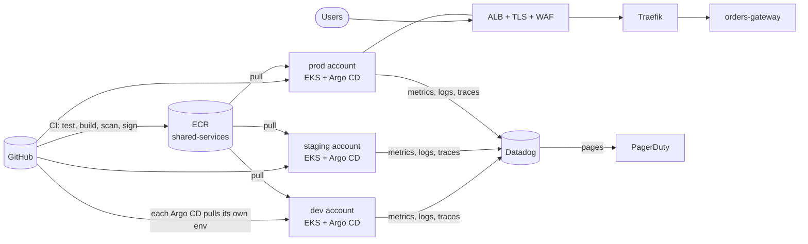

# Running this on AWS

This is a plan. None of it has been built or applied. It shows what this local platform would become on AWS, so you can see which parts carry over and which change. [`terraform-sketch/`](terraform-sketch/README.md) sketches the EKS part in Terraform. [`ci-cd-in-production.md`](ci-cd-in-production.md) covers the pipeline.

## The target

Production drops Docker Compose, kind and the in-stack Git server. Instead:

- **One AWS account per environment** (dev, staging, prod), plus a shared-services account for the image registry and DNS.
- **One EKS cluster per account**, in its own VPC across 3 availability zones.
- **One Argo CD per cluster.** Each Argo CD deploys only to its own cluster, from GitHub, with the same `bootstrap/apps` app-of-apps and sync waves as today. Nothing in dev or staging can deploy to prod.
- **ECR** holds the images and charts. CI pushes to it with short-lived credentials from GitHub OIDC, never stored AWS keys.
- **Traffic** enters through an AWS load balancer (ALB) that terminates TLS and runs WAF, then goes to Traefik, which keeps the chart's Ingresses and the `/admin` 403.
- **Datadog** replaces Prometheus, Loki, Alertmanager and Grafana.
- **Secrets** come from AWS Secrets Manager through External Secrets.
- **Prod releases are canaries**, run by Argo Rollouts.

The environments share only two things: the images in ECR and the Git repo.



## What each local piece becomes

| Here (local) | On AWS |
| --- | --- |
| Docker Compose, `ready` and the toolbox | Terraform, run from CI. Compose and kind stay as the local practice stack and the E2E test |
| kind: 3 nodes, two labelled "zones" | EKS per environment, 3 real zones, Karpenter adding Graviton nodes |
| dev, staging, prod as namespaces in one cluster | A cluster per environment, each in its own account |
| In-stack Git server (soft-serve) | GitHub |
| In-stack registry, `./pipeline ci` publishes | ECR; CI publishes on merge to main |
| `./pipeline cd` and `rollback` | Promotion PRs and revert PRs |
| cosign keyless, Trivy | The same, run in CI. ECR also rescans images for new CVEs (Inspector) |
| Kyverno, 1 replica, fails open | Kyverno, 3 replicas, fails closed for app namespaces, every policy enforced |
| Traefik on host ports, plain HTTP | ALB (TLS with ACM certificates, WAF) in front of 3 Traefik replicas |
| No DNS, a port per environment | Route 53, a hostname per environment, records from ExternalDNS |
| Sealed Secrets, demo key in Git | External Secrets + Secrets Manager, encrypted with KMS |
| Prometheus (24 h), Loki, Grafana, Alertmanager | Datadog: metrics, logs, dashboards, SLOs, monitors |
| Alerts to a local receiver | PagerDuty for pages, Slack or Jira for tickets |
| Runbooks in `runbooks/` | Kept in Git; every Datadog monitor links to one |
| Rolling updates | Canary releases in prod (Argo Rollouts) |
| `admin` / `admin12345` | SSO everywhere (IAM Identity Center and the company's identity provider) |

## Accounts and network

Use AWS Organizations: an account each for dev, staging, prod and shared services, plus security and log-archive accounts. Service control policies block the obvious risks, such as other regions, disabling CloudTrail, or creating IAM users.

Each environment gets its own VPC. Only the load balancer and NAT gateways sit in public subnets; nodes run in private ones. Prod has a NAT gateway per zone, so losing a zone doesn't cut off outbound traffic; dev and staging share one, as the sketch does. The cluster API is private, reached over a VPN with SSO. VPCs aren't peered: each Argo CD talks only to its own cluster.

## EKS and compute

Each cluster has a small fixed node group for the platform controllers. Karpenter adds nodes for the apps: on-demand in prod, Spot in dev and staging, Graviton throughout.

The app keeps its chart settings: 100m CPU request, no CPU limit, 128 Mi memory limit, HPA from 3 pods. Raise `maxReplicas` in prod above 6; that limit was the laptop's.

Upgrade clusters in order, dev then staging then prod, a week apart. For a big version jump, build a new cluster from the same Terraform and Git and move DNS to it. The app is stateless, so that's cheap.

## Access and identity

- **People** sign in with SSO (IAM Identity Center), and so do Argo CD and Datadog. No IAM users, no shared `admin` login. In prod, developers get read-only access; changes go through Git.
- **Controllers** that need AWS each get a least-privilege role through EKS Pod Identity. ExternalDNS, for example, can write only its own environment's DNS zone. The app gets no AWS role. (The sketch uses IRSA, the older way to do the same.)
- **CI** gets a role only on main, and only to push images. Pull requests get none. CI never talks to a cluster: Argo CD pulls from Git, as it does here.

## Images and charts

- **ECR in shared-services** holds the images, and the charts as OCI packages (`oci://<account>.dkr.ecr.<region>.amazonaws.com/charts`). Each environment account can pull from it.
- **Tags are immutable.** `./pipeline` already refuses to re-publish a version; ECR enforces it.
- **Pull-through caches** for Docker Hub, Quay, GHCR and registry.k8s.io send third-party images through ECR too. That removes rate limits on start-up and lets Kyverno allow only one registry.
- **Signing stays cosign keyless.** Kyverno's `verify-image-signatures` policy already checks that an image was signed by a GitHub Actions workflow on main. On AWS only the registry and the workflow identity in it change.
- **Inspector** rescans images in ECR when new CVEs are published, after Trivy has passed them in CI.

## Releases and promotion

Releases move through Git, as they do here. Only the trigger changes.

- A merge to main builds, scans, signs and publishes the image and chart, then commits the new version to `cd/<app>/dev.yaml`. Dev's Argo CD syncs it.
- Staging and prod move by **promotion PR**: a pull request that changes only that environment's file. Merging it is the deploy.
- The image is pinned by digest, so staging and prod run exactly the image dev ran. Nothing is rebuilt per environment.
- Checks on the promotion PR are the same gates `./pipeline cd` runs locally: the previous environment ran this version, its Argo CD app is Synced and Healthy, and no alert fires for the app. In prod they read Datadog instead of Prometheus. Prod also needs a human approval.
- **Rollback** is a revert PR of the promotion commit.

Each cluster's Argo CD sets `env` in `bootstrap/apps/values.yaml`, so it renders only its own environment's Applications. Locally `env` is empty and all three run in one cluster. That guard is already in the repo.

### Automating patch promotions

Once this works, a scheduled job can merge promotion PRs for patches by itself:

- CI marks each promotion PR as a patch or a feature, from the commits in it (`fix:` vs `feat:`, or a `Promotion-Kind:` trailer).
- The job merges a patch once the previous environment has run that exact image for an hour, met its SLO, fired no alerts, and stayed Synced and Healthy.
- Features still wait for a person.
- A `promotion/PAUSED` file in the repo stops it, for freezes and for a spent error budget.

The job reads only Datadog and GitHub, so it holds no cluster credentials.

Argo CD can also report each sync to GitHub as a Deployment, so the repo's Environments panel shows what each environment runs.

### Canaries in prod

Locally every release is a rolling update: a bad version reaches every pod before anyone notices. In prod, Argo Rollouts replaces the Deployment with a canary:

1. Send 5% of traffic to the new version, then 25%, 50% and 100%.
2. At each step, check the two SLOs (errors and latency) for the new version only, using Datadog.
3. If they fail, roll back automatically. If there's too little data, pause and wait for a person rather than pass.

Traefik splits the traffic, so the chart's Ingresses stay. Run canaries in staging too, so the canary setup itself is tested before prod.

An abort stops the bad version, but Git still names it. Follow it with a revert PR.

## Ingress, DNS and TLS

An ALB, created by the AWS Load Balancer Controller, terminates TLS with a free, auto-renewing ACM certificate and runs WAF (AWS managed rules, a rate limit per IP, a body-size limit on `POST /echo`). It forwards plain HTTP to Traefik inside the VPC. Traefik keeps the chart's Ingresses and the `/admin` 403, and runs 3 replicas spread across zones.

Each environment gets a hostname instead of a port, for example `orders.example.com` for prod and `staging.orders.example.com`. ExternalDNS in each cluster writes the records into that environment's own Route 53 zone.

The prod edge should be stricter than the local one. Route only the app's real paths (`/work`, `POST /echo`, `/version`) and return 404 for everything else, including `/metrics` and the health probes. The app keeps a metric series for every path it sees, so a scanner hitting random URLs grows its memory. Locally the ServiceMonitor drops those series at scrape time, which protects Prometheus but not the pod.

## Secrets

The app needs no secrets. The platform needs a few: the Datadog API key, the GitHub App keys Argo CD and CI use, Docker Hub credentials for the pull-through cache.

They live in Secrets Manager under `platform-demo/<env>/<component>/<name>`, encrypted with a KMS key per account. External Secrets copies them into the cluster, using a Pod Identity role that can read only its own environment's path. Sealed Secrets and its demo key go away. The CI check for plain secrets stays.

## Observability with Datadog

The Datadog Operator, installed by Argo CD, runs the agent on every node. It collects:

- **Metrics:** the app's existing Prometheus `/metrics`, scraped as OpenMetrics, so `server.js` doesn't change. Plus cluster and Argo CD metrics.
- **Logs:** every pod's output. The app's JSON logs parse as they are. Prod keeps 15 days indexed; dev and staging are sampled. Everything is archived to S3.
- **Traces:** Datadog can inject its Node tracer into the pod at start-up, with no image change. The app makes no downstream calls, so a trace is short, but it links requests to logs.

The SLOs and alerts carry over:

| Here (`alerts/`) | Datadog |
| --- | --- |
| Availability SLO, 99.5% | A metric SLO per environment, over 30 days |
| Latency SLO, 250 ms | A metric SLO from the 250 ms histogram bucket |
| Fast burn (14.4×, 1 h) pages | SLO burn-rate alert to PagerDuty |
| Slow burn (6×, 6 h) tickets | SLO burn-rate alert to Slack or Jira |
| Platform alerts (Argo CD, Kyverno, certificates) | Datadog monitors |
| Watchdog | No-data monitors on each environment's request count |
| promtool unit tests | A weekly fire drill in staging: inject errors with `/admin/fault` and check the page fires |

Monitors, SLOs and dashboards live in Terraform, so a change to what pages someone gets a reviewed plan. Every monitor links to its runbook.

Datadog is the most expensive choice and means rewriting `alerts/` and `dashboards/`. The cheaper alternative is Amazon Managed Prometheus and Managed Grafana, which reuse almost all of today's rules and dashboards. Whichever you pick, keep the app's instrumentation vendor-neutral.

## Testing

Today's pull request checks and the kind E2E keep running. Production adds:

- Terraform checks on every PR: the `plan`, a linter and a security scan.
- A smoke test after every sync, as an Argo CD hook: `/version` returns the expected version and `/admin` is refused.
- Datadog synthetic checks on prod every minute.
- A nightly k6 load test in staging. A feature reaches prod only after a green run on its image.
- Game days in staging that kill nodes and zones, as `./platform demo chaos` does locally.

## Backups and disaster recovery

Almost nothing is stateful. The app keeps no data, Argo CD's state is Git, and metrics and logs live in Datadog. So recovery is mostly "rebuild and move DNS".

- Prod runs across 3 zones. The chart already spreads pods across zones and limits disruption.
- Terraform state lives in versioned, encrypted S3, replicated to a second region.
- ECR images and Secrets Manager secrets are replicated to the second region.
- To recover a region: apply the Terraform for the second region, let Argo CD install everything, then switch the Route 53 record. Roughly an hour.
- Practise it: rebuild staging from scratch every quarter and record the time, as the README records the local 9 min 43 s.

## Cost

A rough monthly guess at list prices, before any discounts. Check current prices before budgeting.

| Item | Per month |
| --- | --- |
| 3 EKS control planes | ~$220 |
| Nodes across 3 clusters | ~$600–800 |
| NAT gateways (3 in prod, 1 each elsewhere) | ~$210 plus data |
| Load balancers, WAF, VPC endpoints in prod | ~$300 |
| Secrets, KMS, DNS, ECR, security services | ~$100–200 |
| **AWS total** | **~$1.5–1.9k** |
| Datadog | ~$350–600 |

To save: Spot and Graviton nodes, dev scaled to zero at night, fewer and larger nodes (Datadog bills per host), Savings Plans once usage is steady. Put a budget alert on each account.

## Terraform layout

Terraform owns everything in AWS: accounts, networks, clusters, IAM, ECR, DNS, certificates, Datadog monitors. Argo CD owns everything inside the clusters. Nothing is owned by both.

```
infra/
  modules/   org, account-baseline, network, eks-cluster, argocd-bootstrap, ecr, github-ci-roles, dns
  live/      management, security, shared-services, dev, staging, prod, observability
```

Terraform's last step in each cluster installs Argo CD and the root Application, passing in the values Argo CD needs (role ARNs, certificate, zone, `env`). From then on Argo CD manages itself and everything else, as it does locally.

Run `plan` on every PR and `apply` on merge, with a required approval for prod. A nightly `plan` catches drift.

## Migration plan

1. **Foundations.** The AWS Organization, SSO, CloudTrail and GuardDuty, budgets. Branch protection on main.
2. **Images.** ECR, the pull-through caches, CI pushing and signing there.
3. **Dev.** The dev account and cluster with its own Argo CD. Run Datadog alongside Prometheus for a couple of weeks and check the SLO numbers match.
4. **Observability as code.** Datadog SLOs, monitors and dashboards in Terraform; PagerDuty and Slack routing; runbooks updated.
5. **Staging.** Its own account and cluster from the same modules. Canaries on, smoke tests, nightly load tests, the first game day.
6. **Prod.** The prod account, the ALB with WAF, canaries with Datadog analysis, Kyverno failing closed. A game day before real traffic, then move DNS.
7. **Later.** The second-region standby, Savings Plans, the patch-promotion job.

Throughout, the local kind stack keeps working. It stays the place to practise and the E2E test in CI.
